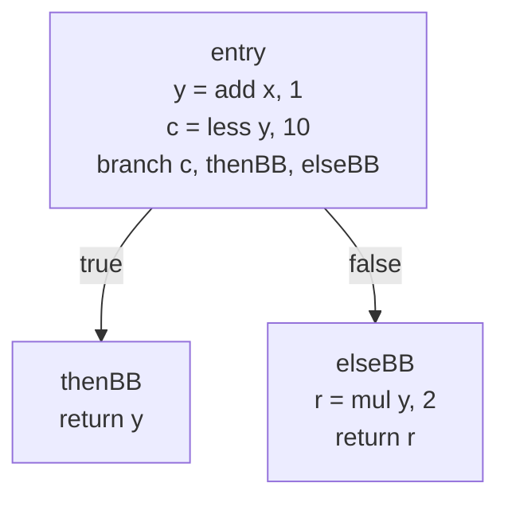
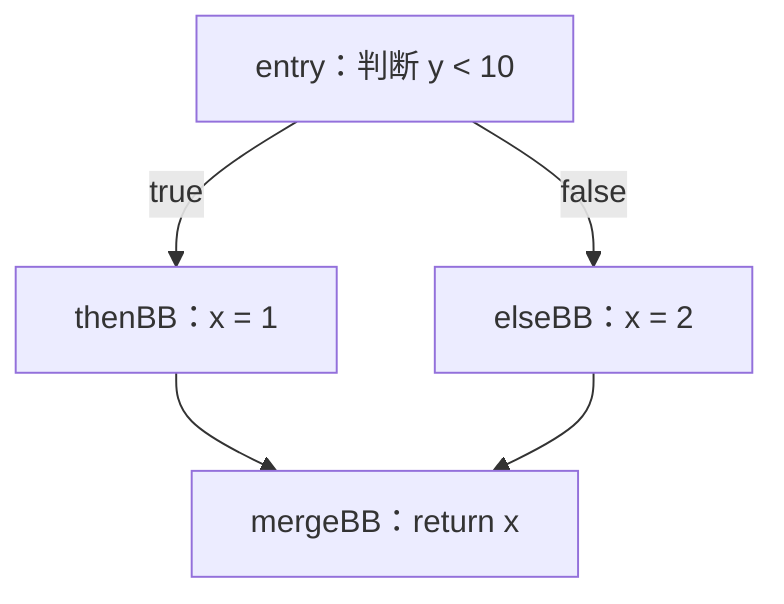
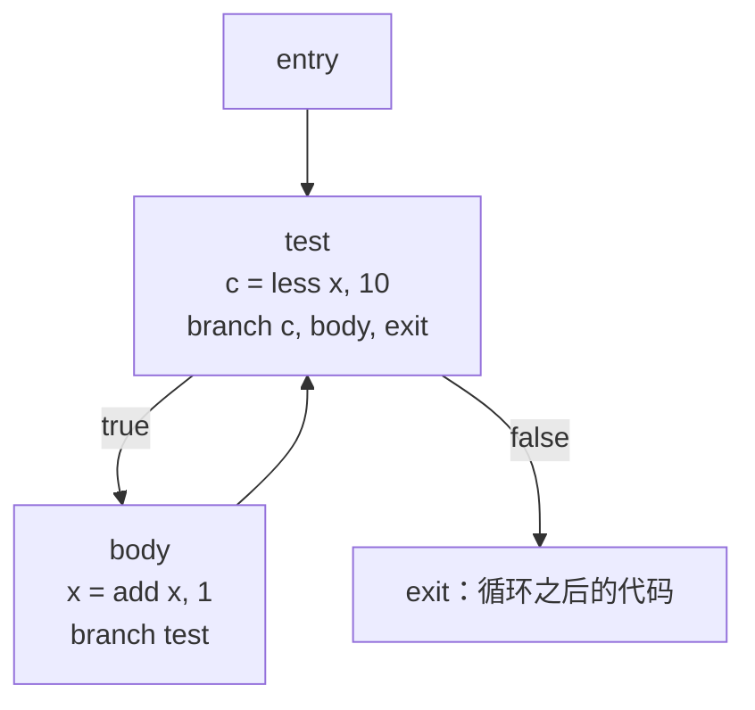

# LEC 11 · Intermediate Representation (I)

> SE3355 编译原理（2026 秋）  
> 依据：[LEC-11-Intermediate-Representation-I.pptx](../lectures/LEC-11-Intermediate-Representation-I.pptx)，共 45 页。本文 p.n 指 PPT 中第 n 张幻灯片，包含封面，以实际顺序为准。  
> 前置：[LEC 8 · AST and Name Resolving](LEC-8-AST-and-Name-Resolving.md)、[LEC 9 · Type System (I)](LEC-9-Type-System-I.md)、[LEC 10 · Type System (II)](LEC-10-Type-System-II.md)。  
> 本笔记按主题整理。标注“补充理解”“补充实现”的内容用于展开课件规则及其边界。下文 IR 和算法均为教学伪代码，不是可以直接交给 LLVM 的文本格式。

## 1. 本讲主线：从程序结构到执行结构（p.2–3、44–45）

名字解析已经回答“这个名字指向哪个声明”，类型检查和推导已经回答“这个表达式具有什么类型”。得到 Typed AST 后，编译器还要回答：

- 各个计算按什么顺序执行，中间结果如何引用？
- 遇到条件和循环时，程序沿哪条路径执行？
- 最终使用什么指令、寄存器、内存位置和调用约定？

本讲引入中间表示（Intermediate Representation，IR），先处理前两个问题：

```text
Typed AST
    │ 表达式 lowering：展开嵌套计算，给结果命名
    ▼
三地址指令与 Value
    │ 控制流 lowering：建立路径入口和跳转
    ▼
Basic Block + Control-Flow Graph（CFG）
    │ 后续课程：完善 IR、优化、后端 lowering
    ▼
目标指令、寄存器与机器码
```

这张图按学习顺序拆分概念。实现时，表达式与控制流 lowering 可以交织进行：遍历到一个表达式，就把指令追加到当前基本块。

| 阶段 | 已经明确的信息 | 仍待决定的信息 |
| --- | --- | --- |
| Typed AST | 语言结构、Symbol、类型 | 显式求值序列与控制转移 |
| 本讲三地址 IR + CFG | 计算步骤、结果引用、分支与循环路径 | 物理寄存器、栈位置、目标指令和 ABI |
| 机器层表示 | 逐步落实到目标机器资源 | 最终布局、编码等剩余后端工作 |

## 2. 贯穿案例 adjust：AST 与机器代码之间的距离（p.4–11）

### 2.1 源码与 Typed AST

```c
int adjust(int x) {
    int y = x + 1;
    if (y < 10)
        return y;
    return y * 2;
}
```

前端已经知道：`x` 引用参数 Symbol，`y` 引用局部变量 Symbol；二者类型为 `Int`，比较结果为 `Bool`。其结构可以简写为：

```text
Function adjust(x : Int) -> Int
└── Body
    ├── VarDecl y : Int
    │   └── Add(x, 1) : Int
    ├── If
    │   ├── Less(y, 10) : Bool
    │   └── Return(y)
    └── Return
        └── Mul(y, 2) : Int
```

树的边表达语法上的组成关系。`If` 的子节点说明条件和分支是什么，但尚未直接给出机器跳转目标。

**补充理解：** 原源码没有 `else`，但只有条件为假时才会到达最后的 `return y * 2`。因此本例可以等价改写为：

```c
if (y < 10)
    return y;
else
    return y * 2;
```

课件后半部分用这个形式画 CFG。这里依赖 then 分支已经返回；不能把普通 `if` 后面的语句一律移入 `else`。

### 2.2 x86-64 已经落实了更多决定

课件给出的简化汇编采用 Intel 语法：

```asm
adjust:
    lea eax, [rdi + 1]
    cmp eax, 10
    jl  .return
    add eax, eax
.return:
    ret
```

在课件采用的调用约定中，参数 `x` 通过 `edi` 传入，返回值放在 `eax`。这里已经确定：

| 源语言构造 | 汇编中的落实 |
| --- | --- |
| `x + 1` | `lea` 完成所需加法 |
| `y < 10` | `cmp` 设置条件，`jl` 根据条件跳转 |
| `y * 2` | `add eax, eax` |
| 分支入口 | 标签 `.return` |
| 返回 | 返回值所在寄存器与 `ret` |

这些是本例的目标选择与调用约定，不能仅凭“x86-64”就推出所有平台都使用相同的参数寄存器。这里也只比较源码具有已定义行为的执行。

### 2.3 三类差距

| 差距 | Typed AST 中的形式 | 较低层表示需要明确什么 |
| --- | --- | --- |
| 表达式结构 | 嵌套的 `Add`、`Mul` 等子树 | 有序计算步骤，中间结果名字 |
| 控制结构 | `If`、`While` 的父子关系 | 标签、跳转、分支目标与控制流边 |
| 语言抽象 | Symbol、Int、函数参数和返回 | 寄存器／栈／地址、位宽、具体指令与调用约定 |

本讲的 lowering 跨越前两类差距；生成三地址 IR 后，第三类仍然存在。

## 3. 为什么引入 IR：Pass 交接与前后端复用（p.12–16）

### 3.1 直接从 AST 生成汇编是可行的

可以递归访问 Typed AST，对每类节点直接输出 x86 指令。对小型编译器，这是一条可行路线。

问题在于，一次遍历可能同时承担表达式求值顺序、分支展开、指令选择、寄存器分配、溢出到栈、对象布局、调用约定和优化。某一个决定改变时，其他部分也容易受影响。

把工作拆成多个 Pass 后，每个 Pass 都需要接收并交付“当前程序”。**IR 就是各阶段可以读取、检查和改写的程序表示。**

```text
Typed AST
    → lowering → IR A（版本 0）
    → 优化     → IR A（版本 1）
    → 转换     → IR B（版本 0）
    → 后续处理 → IR B（版本 1）
```

优化 Pass 可以保持同一种 IR；lowering Pass 则可能改变表示层次。因此，“一个 Pass”与“一种新 IR”没有一一对应关系。

### 3.2 共享 IR 减少前后端组合

如果每种源语言都为每种目标机器单独实现翻译，需要考虑 `N × M` 种组合。共享 IR 后：

```text
C     ─┐                  ┌─→ x86-64
Rust  ─┼─→ 共享 IR / 中端 ─┼─→ AArch64
Swift ─┘                  └─→ RISC-V
```

前端负责把源语言翻译为公共表示，后端负责把公共表示翻译到目标机器，中端优化可以被多个组合复用。

**补充理解：** `N × M → N + M` 描述的是翻译接口的分解，不是程序运行复杂度，也不是精确的工程成本公式。共享 IR 仍须能表达各语言所需的语义，各目标也可能有专门处理。

### 3.3 IR 的规则也是 Pass 之间的约定

仅有一个能装节点的容器还不够。Pass 还需要知道：

- 操作数允许引用哪些对象，结果如何表示？
- 指令的类型要求是什么？
- 基本块如何结束，跳转目标必须满足什么条件？
- 改写后哪些结构关系必须继续成立？

这些不变量让后续 Pass 可以依赖输入，而不必每次重新猜测前一个阶段的含义。

## 4. IR 的形态与本课程的位置（p.17–18）

IR 的形状取决于后续分析和变换需要什么信息。课件列出的分类可整理为：

| 形态 | 主要显式表达的信息 | 常见用途 | 课件中的系统示例 |
| --- | --- | --- | --- |
| Tree／高层 IR | 语言构造及嵌套关系 | 去糖、类型检查等 | Rust HIR／THIR，GCC GENERIC |
| 三地址指令 + CFG | 计算步骤与控制转移 | 数据流分析、优化 | LLVM IR，GCC GIMPLE，Rust MIR |
| Node Graph | 定义—使用、数据依赖等关系 | 图上的优化 | HotSpot C2 Ideal Graph，GraalVM IR |
| Stack／Bytecode | 栈式操作或紧凑执行指令 | 验证、解释、分发 | Java bytecode，WebAssembly，CPython bytecode |

这是按主要特征进行的概括。Bytecode 不必都采用相同的栈模型；同一系统也可以使用多种 IR，或者在同一 IR 上同时维护 CFG 与 def-use 关系。AST 在广义上也属于 IR。

本课程涉及的层次是：

```text
Typed AST
    → 三地址 IR + Basic Block / CFG
    → SSA 形式与 def-use 关系
    → Machine IR：目标指令、虚拟寄存器
    → 寄存器分配、spill、布局与编码
```

本讲集中在第二层。SSA 和机器资源分配先作为后续问题出现。

## 5. 表达式 lowering：生成指令，返回 Value（p.19–21、24–27）

### 5.1 Lowering 的含义

Lowering 把较高层表示转换为较低层表示，并逐步显式化后续阶段需要的信息。本节的目标是把表达式树展开为有明确顺序的指令。

考虑：

```text
(x + 1) * (x - 2)

        Mul
       /   \
     Add   Sub
    /  \   /  \
   x    1 x    2
```

约定本讲按从左到右的顺序求值，lowering 结果是：

```text
t0 = add x, 1
t1 = sub x, 2
t2 = mul t0, t1

result = t2
```

| 步骤 | 处理的子树 | 追加的指令 | 返回给调用者的 Value |
| --- | --- | --- | --- |
| 1 | `Add(x, 1)` | `t0 = add x, 1` | `t0` |
| 2 | `Sub(x, 2)` | `t1 = sub x, 2` | `t1` |
| 3 | `Mul(…, …)` | `t2 = mul t0, t1` | `t2` |

父节点只需拿到子树结果的引用，无须把整棵子树嵌入新指令。原来藏在父子关系里的数据依赖变成了对 `t0`、`t1` 的显式引用。

### 5.2 Value 代表运行时结果

`lowerExpr` 的接口可以写成：

```text
Value lowerExpr(Expr e)
```

它同时完成两件事：

1. 向当前指令序列追加计算步骤。
2. 返回一个代表表达式运行时结果的 Value，供父节点引用。

**补充理解：** 编译器此时并没有真的算出运行时的 `x + 1`。返回的 `t0` 是编译期间持有的结果引用；执行生成的代码时，才会产生相应数值。

| 对象 | 本讲中的含义 |
| --- | --- |
| `Symbol(x)` | 源程序中某个声明的身份 |
| `Const(1)` | 可直接作为操作数的常量 |
| `t0` | 某一步计算结果的引用 |
| `eax` | 目标机器上的物理寄存器 |

创建 `t0` 不意味着立刻给它分配了一个物理寄存器，也不意味着分配了一个内存单元。

### 5.3 递归算法

```text
lowerExpr(Int(n)):
    return Const(n)

lowerExpr(Var(symbol)):
    return valueOf(symbol)

lowerExpr(Binary(op, left, right)):
    a = lowerExpr(left)
    b = lowerExpr(right)
    return emit(op, a, b)
```

其中，`emit(op, a, b)` 创建结果 Value、追加一条指令，再返回结果引用。前两类叶子在课件的简化模型中可以直接作为 operand，不必生成额外算术指令。

这个过程类似按选定顺序进行后序遍历：先处理操作数，再生成使用它们的父操作。第二次递归不会清空第一次生成的指令，所有步骤共同构成结果序列。

**补充理解：** `valueOf(symbol)` 暂时隐藏了变量如何读取的问题。若变量存放在内存中，读取可能需要 `load`；若变量可变，还必须正确表示各程序位置读到的值。不能把这个简化接口理解为“所有变量访问永远不需要指令”。

## 6. 求值顺序与求值策略属于语言语义（p.22–23）

### 6.1 实参位置不决定实参求值顺序

```c
#include <stdio.h>

int f(void) { puts("f"); return 1; }
int g(void) { puts("g"); return 2; }
void use(int a, int b) {}

int main(void) {
    use(f(), g());
}
```

AST 确定 `f()` 的结果传给第一个参数，`g()` 的结果传给第二个参数。C 没有为这个例子规定两个调用谁先执行，所以以下两种 lowering 顺序都可以保持参数对应关系：

```text
顺序一：                    顺序二：
a = call f                  b = call g
b = call g                  a = call f
call use(a, b)              call use(a, b)
```

课件展示 GCC 常见输出 `g`、`f`，Clang 常见输出 `f`、`g`。这是演示中的常见选择，不是某编译器所有版本、目标和上下文的保证。

这个程序的求值顺序**未指定**，并不因此构成**未定义行为**。有关调用顺序的依据可见 [C11 工作草案 N1570 §6.5.2.2 ¶10–12](https://www.open-std.org/jtc1/sc22/wg14/www/docs/n1570.pdf)。

要区分三件事：

| 信息 | 决定什么 |
| --- | --- |
| 运算符优先级、结合性与 AST | 表达式怎样分组 |
| 实参位置 | 哪个结果传给哪个形参 |
| 求值规则 | 何时求值、谁先求值、哪些子表达式必须求值 |

### 6.2 Haskell 的子表达式可能根本不求值

```haskell
first x _ = x

first 42 (error "boom")  -- 42
take 5 [1..]            -- [1, 2, 3, 4, 5]
```

`first` 不需要第二个参数，因此获取结果不要求计算 `error "boom"`。有限前缀的需求也不要求先生成整个无限列表。Haskell 的普通函数应用采用非严格语义，参见 [Haskell 2010 Report §6.2](https://www.haskell.org/onlinereport/haskell2010/haskellch6.html)。

课件用 thunk（延迟计算）解释实现思路：先保存计算，在需要其结果时再求值。非严格语义不能简单实现为“把递归顺序改成从右到左”。

### 6.3 本讲算法的适用范围

之后的表达式伪代码采用**从左到右、需要求值的普通二元操作**。改变遍历顺序前，必须检查语言允许的顺序和可观察副作用。

**补充理解：** 短路运算不能把两侧的计算都放进同一条必经的执行路径，再用一个二元操作组合结果。例如 `false && f()` 不应调用 `f()`。编译器仍可生成右侧的代码，但必须把它放在条件满足时才会执行的路径上，或采用其他能保留短路语义的表示。

## 7. 三地址代码：结果与输入分开（p.28–29）

### 7.1 “三个地址”是什么

典型二元计算的形式为：

```text
result = op arg1, arg2
```

它包含两个输入和一个独立的结果位置。这里的“地址”泛指可引用的操作数或结果，可能是变量、常量或临时名字，不专指虚拟内存地址。

课件提到的四元式（quadruple）表示为：

```text
(op, arg1, arg2, result)

t0 = add x, 1   ⇔   (add, x, 1, t0)
```

四个字段中一个是操作码，其余三个才是所说的“地址”。

### 7.2 为什么适合中端

| 特点 | 对分析与改写的帮助 |
| --- | --- |
| 复杂表达式拆成较小操作 | 可以逐条查看、替换和移动计算 |
| 结果与输入分别命名 | 无须为了表达运算而先覆盖某个输入 |
| 中间结果有引用身份 | 容易追踪一个结果由谁产生、被谁使用 |
| 不预先绑定物理寄存器 | 优化可先处理抽象计算，再由后端安排资源 |

例如：

```text
t0 = add x, 1
t1 = sub x, 2
t2 = mul t0, t1
```

可直接看出 `mul` 依赖前两条指令的结果。至于 `t0` 与其他 Value 最终能否共用寄存器，要到后续分析和分配时决定。

GCC 的 GIMPLE 文档明确介绍了这种拆分复杂表达式、引入临时结果的三地址表示，也说明函数调用等操作存在例外。参见 [GCC Internals：GIMPLE](https://gcc.gnu.org/onlinedocs/gccint/GIMPLE.html)。

### 7.3 三地址形式不等于所有指令恰好三个操作数

```text
t0 = neg x                 // 一元操作
x = 1                      // 赋值示意
return x                   // 返回
branch c, thenBB, elseBB    // 条件控制转移
r = call f(a, b, c, d)      // 可以有多个实参
```

这些也可以出现在三地址风格的 IR 中。“三地址”描述典型计算的组织方式，不要求每条指令都返回结果或拥有同样数量的操作数。

**补充理解：** 三地址形式与 SSA 是不同维度。三地址形式关注操作如何拆分；SSA 额外要求相应名字只在一个位置定义。本讲后面的 `x = 1`、`x = 2` 和 `x = add x, 1` 仍使用可变变量的教学模型。

## 8. Basic Block、terminator 与 CFG（p.30–35）

### 8.1 条件执行不能只靠顺序排列

下面的直线序列没有保留分支语义：

```text
c = less y, 10
return y
r = mul y, 2
return r
```

`c` 没有影响接下来执行哪条指令，程序直接遇到第一个 `return`。因此还需要明确路径入口和控制转移：

```text
entry:
    c = less y, 10
    branch c, thenBB, elseBB

thenBB:
    return y

elseBB:
    r = mul y, 2
    return r
```

### 8.2 基本块的结构

Basic Block（BB，基本块）是一段从入口进入、内部按顺序执行、末尾才进行显式控制转移的指令序列。控制流不能跳到块中间。

本讲使用显式 terminator 的组织方式：

```text
BasicBlock:
    普通指令 0
    普通指令 1
    ...
    terminator
```

Terminator（终结指令）结束当前块，决定后续控制流：

| 终结指令 | 含义 | 本讲函数内 CFG 的后继 |
| --- | --- | --- |
| `branch c, A, B` | 根据 Bool Value 选择路径 | 目标 A、B |
| `branch A` | 无条件跳转 | 目标 A |
| `return v` | 结束当前函数并返回值 | 无 |

“单入口、单出口”中的出口指控制从块末尾离开，**不表示只能有一个后继基本块**。条件分支可以选择两个目标。

完成构造后，每个块应当恰好以一个 terminator 结束，后面不能再追加普通指令。新建但尚未填完的块可以暂时没有 terminator。LLVM 也采用基本块末尾必须有终结指令的规则，参见 [LLVM LangRef：Terminator Instructions](https://llvm.org/docs/LangRef.html#terminator-instructions)。

### 8.3 CFG 的节点与边

控制流图（Control-Flow Graph，CFG）通常按函数组织：

```text
G = (B, E)

B：基本块集合
E：terminator 中的目标所确定的控制流边
```

把 `adjust` 的初始化也放入入口块，得到：



它有 3 个基本块、2 条控制流边。两个返回块都没有函数内后继。

**补充理解：** AST 边表示“某构造包含哪个子结构”，CFG 边表示“执行完这个块后可能转到哪个块”。CFG 中的一条边也不表示每次执行都会走这条边。

## 9. 构造 if：维护 currentBlock（p.36–39）

### 9.1 Builder 的基本操作

生成 CFG 时，原来“向同一个序列 emit”的状态扩展为“向当前基本块 emit”：

| 操作 | 编译期间的作用 |
| --- | --- |
| `newBlock(name)` | 创建新基本块，得到可供分支引用的目标 |
| `switchTo(bb)` | 把插入位置切换为 bb |
| `emit(...)` | 向 currentBlock 追加指令 |
| `isTerminated()` | 检查 currentBlock 是否已有 terminator |

**创建基本块、切换插入位置和生成运行时跳转是三件不同的事。** `switchTo(elseBB)` 只是让编译器在那里继续生成代码；程序运行时是否进入 elseBB，取决于生成的 branch。

### 9.2 两个分支都返回的情形

课件先处理不需要接续共同代码的版本：

```text
lowerIf(stmt):
    c = lowerExpr(stmt.condition)
    thenBB = newBlock("then")
    elseBB = newBlock("else")
    emit(branch c, thenBB, elseBB)

    switchTo(thenBB)
    lowerStmt(stmt.thenBranch)

    switchTo(elseBB)
    lowerStmt(stmt.elseBranch)
```

对 `adjust` 而言，构造过程是：

| 阶段 | currentBlock | 追加的内容 |
| --- | --- | --- |
| 初始化 | entry | `y = add x, 1` |
| 条件 | entry | `c = less y, 10` |
| 分流 | entry | `branch c, thenBB, elseBB`，结束 entry |
| then | thenBB | `return y`，结束 thenBB |
| else | elseBB | `r = mul y, 2`，再 `return r` |

`branch` 使用已经生成的 Bool Value `c` 选择后继，它不负责再次计算 `y < 10`。

编译器会遍历并生成两个分支的代码；运行时每次执行到这个 if，只会进入被条件选中的分支。这与 Haskell 的运行时是否需要某个结果，是不同层面的问题。

### 9.3 Return 也是表达式与控制流的配合

**补充实现：** 返回语句可以分成“先获得返回值，再结束基本块”：

```text
lowerStmt(Return(expr)):
    value = lowerExpr(expr)
    emit(return value)
```

因此 `return y * 2` 会生成乘法和返回两条指令。返回之后，当前块已经终止，不能继续往同一个块追加普通语句。

## 10. Merge block：连接仍可继续的分支（p.40–41）

### 10.1 分支后还有共同代码

```text
if (y < 10)
    x = 1
else
    x = 2

return x
```

两个分支都应继续执行共同的 `return x`，所以引入 merge block（汇合块）。把课件图中的连接线写成显式分支后得到：

```text
entry:
    c = less y, 10
    branch c, thenBB, elseBB

thenBB:
    x = 1
    branch mergeBB

elseBB:
    x = 2
    branch mergeBB

mergeBB:
    return x
```



Merge 是这个块在图中的作用，不是一种特殊的跳转指令。它仍然保存普通指令，并以 terminator 结束。

### 10.2 补全 lowerIf

课件给出的版本预先创建共同后继：

```text
lowerIf(stmt):
    c = lowerExpr(stmt.condition)
    thenBB = newBlock("then")
    elseBB = newBlock("else")
    mergeBB = newBlock("merge")
    emit(branch c, thenBB, elseBB)

    switchTo(thenBB)
    lowerStmt(stmt.thenBranch)
    if not isTerminated():
        emit(branch mergeBB)

    switchTo(elseBB)
    lowerStmt(stmt.elseBranch)
    if not isTerminated():
        emit(branch mergeBB)

    switchTo(mergeBB)
```

最关键的检查是 `if not isTerminated()`：只有还能继续执行的分支，才需要跳向 merge。

```text
错误：                     正确：
thenBB:                    thenBB:
    return y                   return y
    branch mergeBB
```

左侧在 terminator 后又追加了 terminator，违反基本块结构。

### 10.3 按实际控制流处理边界情况

| then 分支 | else 分支 | 与共同后继的连接 |
| --- | --- | --- |
| 可继续 | 可继续 | 两侧都跳向 merge |
| 已返回 | 可继续 | 只有 else 跳向 merge |
| 可继续 | 已返回 | 只有 then 跳向 merge |
| 已返回 | 已返回 | 没有从这两个分支到共同后继的路径 |

**补充实现：** 课件的伪代码总会创建 merge。若两侧都返回，这个块没有来自分支的入边，属于不可达的接续位置。实现可以按需创建 merge，并返回“能否继续”的状态；也可以保留不可达块再清理，但必须保证留下的块结构合法。不能因为创建了一个空 merge，就认为前面的执行路径能够到达它。

另外两个常见边界是：

- **没有 else 的 if：** 条件为假时直接跳向共同后继，then 在未终止时也跳向那里。
- **分支内还有嵌套控制结构：** `lowerStmt` 结束时的 currentBlock 可能已经不是最初的 thenBB／elseBB。应从实际的分支出口追加跳转，并检查那个出口是否终止。

### 10.4 控制流汇合与数据值汇合

上面的 `x = 1`、`x = 2` 表达“不同路径修改同一个可变变量”。CFG 已经说明哪些路径会到达 `return x`，但还没有说明在 SSA 中如何表示这里的 `x`。

**补充理解：** 转换为 SSA 时，分支上的定义需要分开命名，并在共同后继按来源路径选择值，例如：

```text
thenBB:                    elseBB:
    x1 = 1                     x2 = 2
    branch mergeBB             branch mergeBB

mergeBB:
    x3 = phi [x1, thenBB], [x2, elseBB]
    return x3
```

这只用于提示下一阶段的问题，不是本讲要求掌握的 SSA 构造算法。`phi` 根据进入当前块的前驱选择输入，参见 [LLVM LangRef：phi Instruction](https://llvm.org/docs/LangRef.html#phi-instruction)。

因此，**有 merge block 不等于已经完成 SSA；有 merge block 也不表示一定需要 phi。** 若共同代码不需要区分来自各路径的值，就没有对应的值汇合需求。

## 11. While lowering：条件块、循环体、出口与回边（p.42）

### 11.1 循环的 CFG

课件源码：

```c
while (x < 10)
    x = x + 1;
```

它需要三个主要角色：test 每次检查条件，body 执行循环体，exit 接续循环之后的代码。



为了展示完整的终结指令，下面**补充**一个循环后的 `return x`：

```text
entry:
    branch test

test:
    c = less x, 10
    branch c, body, exit

body:
    x = add x, 1
    branch test

exit:
    return x
```

这里仍使用非 SSA 的可变变量模型。body 修改 `x`，下一次 test 读取修改后的值。

### 11.2 回边为什么指向 test

`body → test` 让执行重新到达条件检查，形成循环。本例中：

- `x` 初始为 10 时，第一次检查就进入 exit，循环体执行 0 次。
- `x` 初始为 8 时，依次将其更新为 9、10，再检查失败后退出。
- 如果 body 错误地跳回自身，就不会重新检查条件。
- 如果只在 entry 计算一次条件并反复使用旧结果，也不能表达这个循环。

课件把回边直观描述为“往回指的边”。**补充理解：** 这里关键是控制流返回循环检查位置，而不是图上箭头朝上，或目标标签写在文本前面；图的绘制和块的排列都可以改变。

### 11.3 lowerWhile 伪代码（补充实现）

以下根据课件的 CFG 展开，假定进入时 currentBlock 尚未终止：

```text
lowerWhile(stmt):
    testBB = newBlock("test")
    bodyBB = newBlock("body")
    exitBB = newBlock("exit")
    emit(branch testBB)

    switchTo(testBB)
    c = lowerExpr(stmt.condition)
    emit(branch c, bodyBB, exitBB)

    switchTo(bodyBB)
    lowerStmt(stmt.body)
    if not isTerminated():
        emit(branch testBB)

    switchTo(exitBB)
```

条件表达式的**代码只生成一次**，但放在 testBB 中，运行时每次进入该块都会重新执行。生成次数与执行次数不能混淆。

循环体如果已经 `return`，就不再为该出口追加回边。若进一步支持 `break`／`continue`，可分别使用当前循环的 exitBB／testBB 作为目标；嵌套循环还需要保存各层目标。这属于对本讲算法的扩展。

## 12. Flatten CFG：排列基本块，保留控制关系（p.43）

### 12.1 图没有唯一的文本顺序

对 `adjust` 而言，以下两种块排列都可以保留同一 CFG：

```text
entry → thenBB → elseBB
entry → elseBB → thenBB
```

这里的箭头只表示**书写排列顺序**。真正的控制流仍由指令中的目标决定。例如第二种排列可以写成：

```text
entry:
    y = add x, 1
    c = less y, 10
    branch c, thenBB, elseBB

elseBB:
    r = mul y, 2
    return r

thenBB:
    return y
```

条件为真时，即使 elseBB 紧接在文本后面，控制流仍跳向 thenBB。

### 12.2 基本排列规则

课件给出三条规则：

1. entry 放在第一位。
2. 每个可达基本块只写一次。
3. 暂时保留 label 与 branch。

**补充实现：** 可用带 visited 集合的 DFS 生成一种排列：

```text
order = []
visited = {}

visit(bb):
    if bb in visited:
        return
    visited.add(bb)
    order.append(bb)
    for succ in successors(bb):
        visit(succ)

visit(entry)

for bb in order:
    writeLabel(bb)
    writeInstructions(bb)
```

访问后继之前就标记 visited，才能在循环回边处停止重复访问。这不是拓扑排序：含循环的 CFG 不能按有向无环图的方式进行拓扑排序。

### 12.3 写成序列后仍然是 IR

Flatten 只决定基本块的排列，没有自动完成机器代码生成。抽象 `branch` 还需由后端落实为目标的条件跳转、无条件跳转或顺序落入，抽象 Value 也仍需分配位置。

课件用“把 branch 换成 jmp”概括后续工作。**补充理解：** 条件分支不一定对应单条无条件 `jmp`；具体实现取决于比较结果的表示、条件跳转指令和块布局。

## 13. 本讲结束时，IR 已解决和仍未解决的问题（p.44–45）

| 问题 | 本讲的状态 |
| --- | --- |
| 表达式怎样展开为步骤 | 用三地址指令表达，临时结果通过 Value 引用 |
| if 怎样选择执行路径 | 条件 Value + 分支终结指令 + 目标 BB |
| 分支后怎样接续共同代码 | 未终止的分支连接到共同后继 |
| while 怎样重复执行 | 条件块、循环体、出口和回边 |
| 怎样将图写成文本 | 排列可达 BB，保留标签与分支目标 |
| 跨路径的结果如何定义和传递 | 还需完善 Value、SSA 等设计 |
| 变量与存储位置如何区分 | 还需完善值、地址和内存操作的表示 |
| 各 Pass 怎样可靠改写 | 还需明确类型、结构规则和验证机制 |
| 怎样运行在具体机器上 | 后端继续处理指令选择、寄存器、栈、ABI、布局和编码 |

### 13.1 三种关系各自回答一个问题

| 关系 | 回答的问题 | 例子 |
| --- | --- | --- |
| AST 的结构关系 | 程序构造由什么组成 | `Mul` 有两个子表达式 |
| Value 的定义—使用关系 | 一次计算依赖哪些结果 | `t2` 使用 `t0`、`t1` |
| CFG 的控制流关系 | 执行完某块后可能去哪 | entry 进入 thenBB 或 elseBB |

仅知道数据依赖不足以决定条件路径；仅知道控制路径也不足以知道跨路径应使用哪个值。

### 13.2 最小结构检查（补充实现）

写出教学 IR 后，可以先检查：

- 每个留下的基本块都以一个 terminator 结束，terminator 后没有指令。
- 分支目标确实存在，且属于当前函数。
- 条件分支消费符合 IR 规则的条件值，普通操作的操作数类型匹配。
- 使用的值在相应执行路径上可获得；不能直接引用只在另一条互斥分支中定义的结果。
- 返回类型与函数约定一致，未终止路径得到正确接续。

这些检查服务于不同 Pass 之间的交接。前端类型检查成功，并不意味着后来构造或改写的 IR 自动合法。

**补充理解：** SSA 的“单次赋值”说的是名字在 IR 中只有一个定义位置，不是那条指令在整个程序运行中只执行一次。循环块中的指令可以执行多次。

## 14. 易错点速查

| 易错点 | 正确理解 |
| --- | --- |
| Typed AST 已经明确了所有机器执行细节 | 还要显式化计算步骤、控制转移和机器资源 |
| IR 必须是某种固定的数据结构 | Tree、指令序列、CFG、节点图等都可以服务于不同阶段 |
| 每个 Pass 都必须换一种 IR | 多个 Pass 可以分析、优化同一种 IR |
| `N × M → N + M` 是程序的运行复杂度变化 | 它说明前端与后端翻译接口的分解 |
| `lowerExpr` 返回运行时算出的整数 | 它返回代表运行时结果的 Value 引用 |
| 每个临时 Value 都对应一个独占物理寄存器 | 物理位置由后端决定，也可能共用或溢出到栈 |
| AST 的左右位置天然要求从左到右求值 | 求值规则由语言决定，本讲显式采用从左到右约定 |
| C 的实参求值顺序未指定就是未定义行为 | 本讲 f／g 示例可有不同合法顺序 |
| 普通二元表达式算法可直接用于所有短路操作 | 需要保留右侧的条件执行语义 |
| 三地址中的地址一定是内存地址 | 它可以是变量、常量或临时结果引用 |
| 四元式有四个字段，所以不是三地址 | 其中一个字段是操作码 |
| 三地址 IR 天然就是 SSA | SSA 还限制名字的定义方式，并处理跨路径的值 |
| 基本块单出口意味着只能有一个后继 | 末尾的条件分支可以选择多个目标 |
| `switchTo` 会让生成的程序发生跳转 | 它只改变编译器的代码插入位置 |
| 编译器生成 then、else，就会运行两个分支 | 运行时由条件选择路径 |
| return 后还可以追加跳转到 merge | return 已经终止当前块 |
| 每个 if 都一定需要一个可达 merge | 两个分支都返回时没有继续路径 |
| 创建 merge 就解决了分支结果的选择 | 控制汇合与数据值汇合需要分别表示 |
| while 的条件只需在 entry 计算一次 | 条件代码放在 test，每次到达时重新执行 |
| flatten 应沿回边重复输出循环体 | 每个可达基本块只输出一次，运行时通过跳转重复执行 |
| CFG 的文本顺序就是唯一执行顺序 | 执行路径由 terminator 的目标决定 |
| flatten 后已经是目标机器代码 | 仍需目标指令、资源分配、布局与编码 |

## 15. 复习自测与简答

1. **为什么 `adjust` 的第二个 return 可以写进 else？**  
   因为 then 分支已经返回，只有条件为假时才会到达第二个 return。若 then 可以继续执行，这种改写一般不成立。

2. **IR 解决了 Pass 之间的什么问题？**  
   它提供可以传递、检查和改写的程序表示，并通过不变量约束各阶段的交接。

3. **将 `(a + b) * (c - d)` 按从左到右顺序 lower，得到什么？**

   ```text
   t0 = add a, b
   t1 = sub c, d
   t2 = mul t0, t1
   result = t2
   ```

4. **生成 `t1` 后，之前的 `t0` 会被覆盖吗？**  
   不会。这里是不同的临时结果引用，之后的乘法仍可同时使用它们。

5. **`use(f(), g())` 中若先求 g，是否应把它的结果传给第一个形参？**  
   不应。求值顺序与参数位置不同；g 的结果仍传给第二个形参。

6. **为什么不能对 `first 42 (error "boom")` 无条件先计算所有实参？**  
   这会破坏 Haskell 的非严格语义。结果不需要第二个参数，而提前求值会触发错误。

7. **`(mul, t0, t1, t2)` 为什么称为四元式，也符合三地址形式？**  
   它有四个字段，其中 mul 是操作码，t0、t1、t2 是两个输入和一个结果。

8. **`adjust` 的三块 CFG 有几条边？return 指向 merge 吗？**  
   有两条边：entry 分别到 thenBB 和 elseBB。return 结束函数，没有指向 merge 的函数内控制流边。

9. **lowerIf 为什么要在追加 `branch mergeBB` 前检查 isTerminated？**  
   分支可能已经 return 或以其他控制转移结束，再追加分支会破坏基本块结构。

10. **若 then 返回而 else 可以继续，共同代码从哪些路径可达？**  
    只能从 else 的未终止出口到达，then 不应再连接到共同后继。

11. **嵌套 if 生成结束后，为什么不能总把跳转追加到最初的 thenBB？**  
    嵌套结构可能创建新块并改变 currentBlock。应连接实际的分支出口，最初的 thenBB 可能早已终止。

12. **两个分支分别赋值 x，merge 中直接使用 x，这一定是 SSA 吗？**  
    不是。这是可变变量的表示；SSA 需要区分定义，并按需要处理汇合处的值选择。

13. **`while (x < 10) x = x + 1` 的回边为什么到 test？**  
    每次执行循环体后都要重新判断更新后的 x，条件为假时才退出。

14. **循环条件在编译时只 lower 一次，会不会导致运行时只检查一次？**  
    不会。lowering 生成 test 块中的代码，运行时每次进入该块都会执行条件计算。

15. **用 DFS 排列含循环的 CFG，为什么需要 visited？**  
    防止沿回边无限递归，并保证每个可达基本块只输出一次。

16. **把 thenBB 与 elseBB 的文本顺序交换，会改变程序含义吗？**  
    在这里的显式分支模型中，只要入口位置、标签、分支目标和块内指令保持正确，就不会仅因交换排列而改变路径语义。

17. **本讲是否已经决定了 y 放在哪个寄存器里？**  
    没有。IR 中的 y 或临时 Value 仍是抽象引用，物理位置和具体机器指令留给后端处理。
