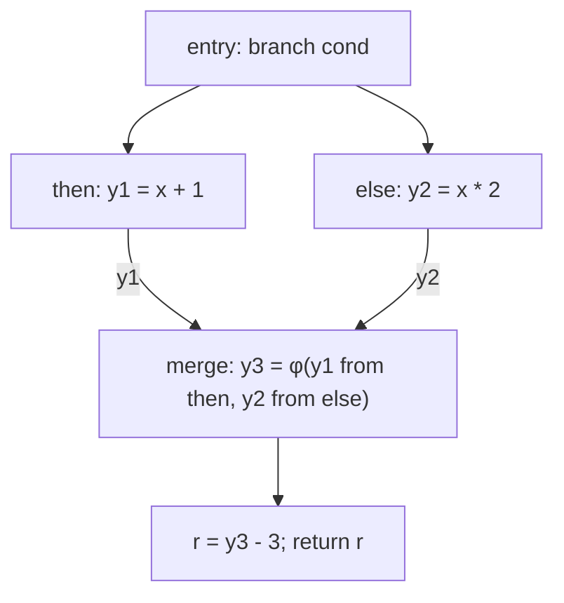

# LEC 12&13 · Intermediate Representation (II)

> SE3355 编译原理（2026 秋）
>
> 依据：[LEC-12&13-Intermediate-Representation-II.pptx](/Users/xlchen/Compilers-fa26/lectures/LEC-12&13-Intermediate-Representation-II.pptx)，共 55 页。本文 p.n 指包含封面的第 n 张幻灯片，以实际顺序为准。
>
> 前置：[LEC 11 · Intermediate Representation (I)](/Users/xlchen/Compilers-fa26/notes/LEC-11-Intermediate-Representation-I.md)。
>
> 本笔记按主题整理，标注“补充理解”“补充示例”的部分用于解释课件中的规则及边界。`text` 代码块中的课程 IR 是教学伪代码；`llvm` 代码块使用 LLVM IR 语法。LLVM 的补充细节附官方文档链接。

## 1. 本讲主线：让 IR 支持分析与优化（p.2–7、54–55）

上一讲已经把 Typed AST 转换成三地址指令、基本块和 CFG，显式表示了计算顺序与控制转移。现在的问题是：**怎样让编译器方便地找到数据来源、判断操作语义，并处理可变状态？**

| 增强 | 要回答的问题 | 本讲引入的机制 |
| --- | --- | --- |
| 数据关系 | 一个操作数来自哪个定义？结果被谁使用？不同路径的值如何汇合？ | def-use、SSA、φ／Block arguments |
| 表示信息 | 这是整数、浮点数还是指针？运算和访问的宽度是什么？ | typed IR、明确的 opcode 与语义 |
| 可变状态 | 怎样描述共享存储的修改？哪些读写相互影响？ | Location、load／store、Alias analysis |
| 真实 IR 对照 | 这些设计怎样组成实际编译器的接口？ | LLVM IR、Module、GEP、语义标志 |

```text
Typed AST
   ↓ lowering
三地址代码 + Basic Block + CFG       ← LEC 11
   ↓ 明确值之间的关系
SSA + φ + def-use
   ↓ 明确表示与操作语义
typed operations
   ↓ 明确可变状态的读写
load / store + 内存依赖
   ↓
分析、优化与后端代码生成
```

这是概念上的递进，不要求实现时一定按四次独立遍历完成。实际编译器可以在 lowering 时直接构造带类型和内存操作的 SSA IR。

## 2. Definition、Use 与双向关联（p.4–5、8–9）

### 2.1 定义与使用都针对具体结果

课件先使用没有分支、类型和内存的例子：

```c
int compute() {
    int a = 4;
    int b = a * 2;
    int c = a - 3;
    return b;
}
```

```text
a = 4
b = mul a, 2
c = sub a, 3
return b
```

| 指令 | Definition（定义） | Use（使用） |
| --- | --- | --- |
| `a = 4` | 产生结果 a | 无命名结果的使用 |
| `b = mul a, 2` | 产生结果 b | 使用 a |
| `c = sub a, 3` | 产生结果 c | 使用 a |
| `return b` | 无新的计算结果 | 使用 b |

一条指令可以同时包含 def 和 use。`return`、分支等没有普通计算结果的指令也可以使用其他结果。

### 2.2 Def-use 与 Use-def

```text
def-use：从一个定义找到所有使用位置

def(a) ──→ use(a in mul)
       └─→ use(a in sub)

use-def：从一个使用位置找到可能提供值的定义

use(a in mul) ──→ def(a)
```

| 关系 | 起点 | 终点 | 典型用途 |
| --- | --- | --- | --- |
| def-use chain | 一次 definition | 使用该结果的所有 uses | 传播常量、替换结果、检查是否无用 |
| use-def chain | 一次 use | 可能到达这里的 definitions | 查询数据来源、分析依赖 |

这里的 *chain* 表示关联关系，并不意味着只能是一条线性链。在普通、非 SSA 的代码中，一次 use 可能沿不同控制流路径接收不同定义的结果。

**补充理解：** use 更精确地说是一个“操作数位置”。例如 `b = add a, a` 只有一条使用 a 的指令，但其中有两个 a 的使用位置。更新 def-use 时需要同时处理这两个位置。

## 3. Def-use 如何帮助优化（p.10–12）

### 3.1 常量传播与常量折叠

```text
a = 4
b = mul a, 2
c = add b, 1
return c
```

沿 def-use 可以逐步得到：

```text
a 已知为 4
  → 将 b 中的 a 替换为 4
  → mul 4, 2 折叠为 8
  → 将 c 中的 b 替换为 8
  → add 8, 1 折叠为 9
  → return 9
```

两个概念应分开：

- **常量传播（constant propagation）**：把已知的值传递到使用位置。
- **常量折叠（constant folding）**：在编译期计算操作数已知的表达式。

def-use 提供“接下来应访问谁”的索引；指令自身的语义决定能否计算和替换。

### 3.2 死代码删除必须考虑指令效果

```text
a = 4
b = mul a, 2
c = sub a, 3     // c 没有任何 use
return b
```

如果 `sub` 是可安全删除的纯计算，第三行可以移除，因为它的结果不影响后续执行。

但是：

```text
store 1, p       // 可能改变后续可观察的内存
r = call f()    // 即使 r 没有 use，f 仍可能执行 I/O 或修改状态
```

不能仅根据“没有 use”删除它们。

**补充理解：** 判断应针对整条指令的可观察行为，而不只是返回值。某些语言中的运算可能抛异常或触发检查；函数调用也可能不返回。是否可删除由当前 IR 的效果与异常语义决定。

### 3.3 代码移动需要保留依赖

```text
v1 = add a, b
v2 = mul v1, c
```

`v2` 使用 `v1`，因此重排不能让 `v2` 在缺少 `v1` 的路径上执行。直线代码中，这体现为定义先于使用；有 CFG 后，还要检查定义是否在相应路径上可用。涉及内存时，还需要后文的内存依赖信息。

## 4. SSA：每次定义使用唯一名字（p.13–15）

### 4.1 三地址代码本身不要求单一赋值

| 普通三地址代码 | SSA 形式 |
| --- | --- |
| `a = 4` | `a1 = 4` |
| `b = mul a, 2` | `b = mul a1, 2` |
| `a = 5` | `a2 = 5` |
| `c = add a, 1` | `c = add a2, 1` |

普通三地址代码中，两个 a 的定义需要靠程序位置和控制流区分。SSA（Static Single Assignment，静态单一赋值）给每个定义一个唯一名字，使操作数直接指出使用哪个结果。

**三地址形式描述指令的形状，SSA 描述定义与使用的约束。** 两者可以同时成立，但三地址代码不必天然是 SSA。

### 4.2 源码变量、SSA name、SSA value

```llvm
%a = add i32 %x, 1
%b = mul i32 %a, 2
```

| 概念 | 含义 |
| --- | --- |
| 源码变量 | 源语言的绑定，可能被多次赋值 |
| SSA name | `%a`、`%b` 等用于引用结果的 IR 标识符 |
| SSA value | 唯一静态定义产生的结果，供其他指令引用 |

函数参数和 φ 的结果也属于 SSA values。SSA 名字不是物理寄存器编号；多个值最终如何分配寄存器，是后端的问题。

### 4.3 “静态一次”与“动态执行多次”（补充理解）

“每个名字只有一次 definition”指 IR 中只有一个定义位置。循环体中的同一条指令可以执行很多次，各次执行产生的运行时结果也可以不同。

因此，不能把 SSA 理解成“每条指令在整个运行期间最多执行一次”，也不能据此断言 SSA 的数据依赖图一定无环。

### 4.4 名字唯一还需要路径可用性（补充理解）

对于普通操作数，定义必须在所有能到达其使用位置的路径上先发生。这个条件通常通过 **dominance（支配）** 表达：若从入口到 B 的每条路径都经过 A，则 A 支配 B；同一块内还要遵守指令先后关系。

这解释了下一节的问题：then 中定义的值不能直接拿到 merge 中无条件使用，因为执行可能从 else 到达 merge。LLVM 的良构性要求包含这一约束，见 [LLVM LangRef：Well-Formedness](https://llvm.org/docs/LangRef.html#well-formedness)。

## 5. φ 与 Block arguments：汇合不同路径的值（p.16–18）

### 5.1 简单重命名无法解决分支汇合

```text
entry:
  branch cond, then, else

then:
  y1 = add x, 1
  jump merge

else:
  y2 = mul x, 2
  jump merge

merge:
  r = sub ???, 3
  return r
```

如果填 y1，else 路径没有执行它的定义；如果填 y2，then 路径存在同样的问题。我们需要在 merge 处定义一个结果，承接实际执行路径提供的值。

### 5.2 φ 根据前驱边选择输入

```text
merge:
  y3 = φ [y1, then], [y2, else]
  r = sub y3, 3
  return r
```



| 实际到达 merge 的前驱 | y3 采用的值 |
| --- | --- |
| then | y1 |
| else | y2 |

φ 本身也是一次新的 definition，后续 use 统一引用 y3。它不把两个值相加，也不要求运行时同时执行两条分支，更不重新计算原来的条件。

**补充理解：** LLVM 中 phi 位于基本块开头，其输入 use 按对应前驱边理解，所以 y1 只需要在 then 到 merge 的边上可用。见 [LLVM LangRef：phi](https://llvm.org/docs/LangRef.html#phi-instruction)。

### 5.3 多个 φ 同时根据同一条边选择

```text
merge:
  x3 = φ [x1, then], [x2, else]
  y3 = φ [y1, then], [y2, else]
  z = add x3, y3
```

从 then 到达时，选择整组 `(x1, y1)`；从 else 到达时，选择整组 `(x2, y2)`。不会出现 x3 来自 then、y3 来自 else 的混合。

**补充理解：** 块开头的 φ 应按并行赋值理解。后端若将它们转换为复制指令，需要保留这种同时选择的语义；有值交换等情形时，不能随意串成会覆盖旧值的顺序赋值。

### 5.4 Block arguments 把传值写到控制流边上

同一个例子也可以写成：

```text
then:
  jump merge(x1, y1)

else:
  jump merge(x2, y2)

merge(x3, y3):
  z = add x3, y3
```

| 表示 | 汇合值放在哪里 | 前驱如何提供值 |
| --- | --- | --- |
| φ | 目标块开头的指令 | φ 列出每个前驱对应的输入 |
| Block arguments | 目标块的参数列表 | 跳转边携带参数 |

在这里，两种写法表达同样的控制流传值语义。课件列举 LLVM IR、GCC GIMPLE 作为 φ 的例子，MLIR、Swift SIL、Cranelift IR 作为 Block arguments 的例子。

Block arguments 看起来像函数参数，但基本块之间的跳转不等于进行一次普通函数调用。

### 5.5 循环也需要汇合值（补充示例）

```c
int i = 0;
while (i < n)
    i = i + 1;
return i;
```

```text
entry:
  jump test

test:
  i = φ [0, entry], [i_next, body]
  c = less i, n
  branch c, body, exit

body:
  i_next = add i, 1
  jump test

exit:
  return i
```

首次进入 test 时，i 取入口提供的 0；沿回边重新进入时，i 取上一轮的 i_next。IR 中 i 与 i_next 各只有一个定义位置，仍满足 SSA。

这也说明 φ 的用途不限于 `if/else`：只要一个控制流汇合点需要接收不同前驱提供的值，就可能需要 φ。本讲没有展开支配边界、φ 插入和变量重命名等完整 SSA 构造算法。

## 6. IR 为什么仍然需要类型信息（p.19–23）

### 6.1 可以不为每个值显式标注类型

课件以 Tiger Tree IR 为例：

```text
Exp: CONST / TEMP / NAME / BINOP / MEM / CALL / ESEQ
Stm: MOVE / EXP / JUMP / CJUMP / LABEL / SEQ
```

```text
MOVE(
  TEMP t,
  BINOP(PLUS,
    MEM(TEMP fp),
    CONST 1))
```

它区分表达式、语句和节点种类，但计算结果没有逐个写上 `i32`、`f32` 等类型。

其含义依赖课件中的运行时约定：整数、指针和临时值都以一个 machine word 表示，`MEM` 默认访问一个 word，`BINOP` 主要描述整数运算。

**不显式标注值类型，不等于完全没有表示与语义信息。** 信息可能藏在节点种类、语言限制和各 Pass 共同遵守的约定里。

### 6.2 隐式约定增加扩展与优化成本

当语言新增浮点数、字节、向量和不同宽度的整数时，需要更多规则来回答：

- `MEM` 这次读几个字节？读取之后如何扩展？
- `MUL` 是整数乘法还是浮点乘法？
- 相同位模式应按有符号还是无符号方式比较？
- 哪些值能用作地址？

如果答案必须从周围代码恢复，每个优化 Pass 都要理解同一套隐藏约定。把必要信息放到 IR 中，可以降低查询与验证的成本。

### 6.3 类型影响合法变换

```text
t = MUL(x, 2)         // 单看此节点，运算含义不充分
```

明确表示后：

```text
t:i32 = mul.i32 x:i32, 2:i32
    → shl.i32 x:i32, 1:i32

t:f32 = fmul.f32 x:f32, 2.0:f32
    → 不能改成整数移位
```

**补充理解：** 第一种改写仍依赖整数运算的溢出、移位和标志语义。以固定宽度、无额外标志的模运算为例，乘 2 与左移 1 有相同结果；有额外语义承诺时，还要验证这些承诺。知道类型是合法改写的依据之一，并不意味着可以忽略其他语义。

## 7. 类型信息放在哪里，保留到哪一层（p.24–27）

### 7.1 表示类型与操作类型

```text
c:i1   = less.i32 x:i32, 10:i32
y1:i32 = add.i32  x:i32, 1:i32
y2:i32 = mul.i32  x:i32, 2:i32
y3:i32 = φ.i32 [y1, then], [y2, else]
```

`less.i32` 比较两个 i32，结果是用于分支的 i1。**操作数类型与结果类型不一定相同。**

| 需要区分的信息 | 对后续 Pass 的影响 |
| --- | --- |
| 整数与浮点数 | 运算规则、舍入、合法代数变换 |
| byte 与 word | 内存访问宽度、截断和扩展 |
| 有符号与无符号比较 | 大小关系的解释 |
| 整数与指针 | 地址相关操作的合法性与语义 |
| 向量与标量 | 元素类型、元素个数、逐元素操作 |

### 7.2 类型与 opcode 可以共同承载语义

| 设计 | 浮点加法 | 整数加法 |
| --- | --- | --- |
| 类型驱动 | `r:f32 = add x:f32, y:f32` | `r:i32 = add x:i32, y:i32` |
| opcode 驱动 | `r:f32 = fadd x:f32, y:f32` | `r:i32 = add x:i32, y:i32` |

类似地，有符号性可以编码进 `s32/u32` 等类型，也可以编码到 `slt/ult` 等比较操作中。

关键是语义明确、可查询、可验证。不同 IR 可以选择不同分工，没有必要把所有差异都塞进一种机制。

### 7.3 源语言类型不会原样进入所有层次的 IR

| 处理方式 | 课件中的典型对象 | 原因 |
| --- | --- | --- |
| 保留 | i32、f64、vector、ptr、函数签名 | 仍影响表示、操作或调用 |
| Lowering | class、array、closure、enum | 转成字段布局、地址、环境结构或 tag |
| 擦除 | type alias、已完成实例化的泛型区别 | 后续 Pass 不再需要相应区别 |

原则是：**一种区别至少保留到最后一个需要它的 Pass，之后再 lowering 或擦除。**

**补充理解：** “泛型可擦除”在这里有完成相应处理的前提。若运行时仍需类型信息、动态分派或反射，应保留相应表示；不能理解为所有语言的泛型或类信息都可以无条件消失。

## 8. 不可变绑定与状态管理（p.28–33）

### 8.1 SSA 让值关系保持稳定

课件用环境映射描述 SSA 名字与运行时值：

```text
V : SSAName → RuntimeValue

V[x0] = 1
V[x1] = V[x0] + 1
```

引入 x1 不会把 x0 的结果改成 2。已有 use 仍然指向原来的定义，因此数据依赖更容易追踪。对循环，应结合前文“静态定义与动态执行”的区别理解此模型。

### 8.2 语言也可以显式区分可变与不可变

课件列举：

- Haskell 的普通纯函数产生新值，不修改原有值，例如 `ys = 3 : xs` 保留原来的 xs。
- Scala 用 `val` 和 `var` 区分不可重新赋值与可重新赋值的绑定。
- Rust 的 `let` 默认不可重新赋值，需要修改时显式声明 `mut`。

**补充理解：** 绑定不可重新赋值，不自动意味着它指向的对象不可变。课件中的 Scala 示例正好体现这一点：

```text
a = 一个可变 Buffer(1, 2)
b = a
a.append(3)

b 也观察到 [1, 2, 3]
```

即使 b 不能改为绑定另一个对象，原对象仍可能经由 a 改变。应区分“绑定不变”“对象不变”和“函数无副作用”。

### 8.3 不可变数据的收益与成本

如果 a0 是不可变列表：

```text
a0 = [1, 2]
b  = a0
a1 = 在 a0 末尾加入 3 后得到的新列表

b 仍然表示 [1, 2]
```

旧值稳定，使局部推理、共享、缓存或保留历史版本更直接。

但把整个程序状态都显式版本化会带来成本：函数需要传入旧状态并返回新状态；修改局部字段时要构造相应新版本；共享同一对象的使用者还要获得最新版本。结构共享可以减少复制，但不会自动消除所有状态传递问题。

课件由此引入 **mutable store**：用稳定的存储位置表示共享身份，让该位置的内容随执行改变。

## 9. Location、Mutable store 与 load／store（p.34–36）

### 9.1 Location 表示可持续识别的存储位置

把存储状态抽象成映射：

$$
M : \mathrm{Location} \to \mathrm{Value}
$$

```text
M₀(ℓ) = 0
M₁ = M₀[ℓ ↦ 1]
M₁(ℓ) = 1
```

变化的是 ℓ 中存储的值，ℓ 本身仍标识同一个位置。

**补充理解：** 用 M₀、M₁ 两个数学映射描述前后状态，不意味着运行时一定复制整块内存。它们是描述一次写入前后状态的语义模型。

### 9.2 指针／引用标识 Location

```cpp
int x = 0;
int* p = &x;
int* q = p;
int& r = x;
```

课件把 x 的可写位置记作 ℓx，p、q 和引用 r 都可以让程序访问这个位置。对象字段 `obj.f`、数组元素 `a[i]` 也可以对应可写位置。

指针值与存储位置是不同概念：不同名字引用的指针值可能标识同一个 Location。指针作为 SSA value 保持不变，也不阻止它指向的位置被写入。

**补充理解：** 源语言具有变量，不意味着后端必须为每个变量分配独立内存。可用 SSA 表达的局部状态可以只表现为值；取地址、共享等语义才会对存储表示提出进一步要求。

### 9.3 load 读出当前内容，store 改变内容

| 抽象状态语义 | 课程 IR |
| --- | --- |
| `M₁ = store(M₀, ℓ, 1)` | `store.i32 1, p` |
| `x = load(M₁, ℓ)` | `x:i32 = load.i32 p` |

其中 p 标识 ℓ。常见 IR 不把 M₀、M₁ 作为普通指令的显式操作数写出来，而由程序顺序、控制流和内存语义共同确定状态变化。

### 9.4 SSA 与可变内存可以同时存在（补充示例）

```text
store.i32 1, p
v1:i32 = load.i32 p
store.i32 2, p
v2:i32 = load.i32 p
```

在普通顺序执行、访问有效且没有其他修改的前提下，v1 为 1，v2 为 2。第二次 store 改变的是存储位置的内容，不会把已经读出的 v1 改成 2。

这里没有违反 SSA：v1、v2 各定义一次；p 仍表示同一个地址；内存状态可以变化。

## 10. Alias analysis 与内存依赖（p.37–41）

### 10.1 别名会限制指令重排

```text
store 1, p
x = load q
```

若 p 和 q 标识同一个 Location，x 必须观察到前面的写入。将它们交换：

```text
x = load q
store 1, p
```

可能使 x 读到旧值。因此，**两个指针的名字不同，不能作为交换读写顺序的理由。**

课件用 NoAlias 排除此类冲突。补充条件是：这里讨论访问有效的普通内存操作，重排也没有违反其他控制流、异常或同步约束。仅凭 NoAlias 不能推出任意两条指令都能交换。

### 10.2 普通 Value def-use 没有覆盖内存内容的流动

```text
v1 = add a, b
v2 = mul v1, c
```

这段代码通过名字 v1 明确连接 producer 和 consumer。

```text
store 1, p
x = load q
```

这里的 store 使用 p，load 使用 q；这些指针本身仍有普通 def-use 关系。但 store 没有定义一个供 load 直接引用的普通 SSA 结果，**被写入的内存内容如何流向读取，尚未体现在这些指针的 def-use 中。**

是否存在 store 到 load 的依赖，需要结合它们访问的位置判断。

### 10.3 Points-to 集合是课件介绍的一种分析思路

记 `Pt(p)` 为指针 p 可能标识的抽象 Location 集合：

```text
p = &x
    Pt(p) = {ℓx}

q = p
    Pt(q) ⊇ Pt(p)

r = cond ? p : &y
    Pt(r) ⊇ Pt(p) ∪ {ℓy}
```

将赋值、分支等关系转化成约束，传播集合直到不再变化，即达到不动点（fixed point）。

**补充理解：** 分析可能合并多条路径、多个分配实例或多次循环执行，所以集合通常是对实际运行情况的过近似。上面的包含关系表示必须纳入这些可能目标，不一定表示最终集合只能包含它们。这也不是所有 Alias analysis 都采用的唯一算法。

### 10.4 NoAlias、MayAlias、MustAlias

| 查询结果 | 含义 | 优化时如何使用 |
| --- | --- | --- |
| NoAlias | 能证明所查询的访问不会重叠 | 可以排除这两个访问之间相应的内存冲突 |
| MayAlias | 不能排除重叠 | 必须保留可能的依赖 |
| MustAlias | 能证明查询的访问始终从同一位置开始 | 可结合访问宽度等条件做更精确推理 |

在课件简化的 Location 集合模型中：

$$
Pt(p)\cap Pt(q)=\varnothing\ \Longrightarrow\ \mathrm{NoAlias}
$$

集合重叠通常只支持 MayAlias。**MayAlias 表示存在不确定性，不表示每次执行都别名。** MustAlias 需要额外证明始终访问相同位置。

**补充理解：** 实际内存查询还涉及访问范围，起始地址不同也可能部分重叠。LLVM 因此还区分 PartialAlias；不能只比较指针名字或起始地址。见 [LLVM Alias Analysis：alias 查询](https://llvm.org/docs/AliasAnalysis.html#the-alias-method)。

### 10.5 为什么必须保守

```text
p = cond ? &x : &y
u = &a[i]
v = &a[j]

p = find(buf)
update(p)
```

精确答案可能依赖 cond、i、j 的运行时值，或跨越函数边界：`find` 返回哪里？`update` 修改哪些位置？

一个正确的保守分析允许“实际不别名，但回答 MayAlias”，代价是错过优化；不能把实际可能冲突的访问错误地回答为 NoAlias，否则可能生成错误程序。

**补充理解：** 别名查询回答位置是否可能重叠，内存依赖分析还要结合读／写种类、先后顺序和控制流。例如两个普通读取即使访问相同位置，也不因“都在读”而形成写入冲突；未知函数调用则需要考虑它可能读写的内存。

### 10.6 IR 中同时存在两类依赖

| 依赖 | 例子 | 获取依据 |
| --- | --- | --- |
| Value dependence | `v1 = add ...` → `mul v1, c` | SSA 名字直接连接定义与使用 |
| Memory dependence | `store 1, p` → `load q` | 内存语义、访问顺序与 Alias 信息 |

前者明确表达“使用哪一个静态结果”，后者保守表达“哪些状态变化可能影响这次访问”。优化器需要同时尊重两类关系。

## 11. 贯穿案例：SSA、类型与内存放在一起（p.42）

### 11.1 源程序

```c
int adjust(int x, int *out) {
    int y;
    if (x < 10)
        y = x + 1;
    else
        y = x * 2;
    *out = y;
    return y;
}
```

与上一讲的案例相比，这次将不同分支产生的 y 汇合，并将结果写入调用者提供的位置。

### 11.2 课程 IR

```text
function adjust(x:i32, out:ptr) -> i32 {
entry:
  c:i1 = less.i32 x, 10
  branch c, then, else

then:
  y1:i32 = add.i32 x, 1
  jump merge

else:
  y2:i32 = mul.i32 x, 2
  jump merge

merge:
  y3:i32 = φ.i32 [y1, then], [y2, else]
  store.i32 y3, out
  return y3
}
```

| 原程序含义 | IR 中的体现 |
| --- | --- |
| 比较并选择执行路径 | i1 结果 c、branch 与 CFG |
| 两个分支分别赋值 y | 两个唯一结果 y1、y2 |
| 后续使用当前路径上的 y | φ 定义 y3 |
| 整数与地址的表示 | i32 与 ptr |
| 修改调用者可见的存储 | `store.i32 y3, out` |
| 返回计算结果 | `return y3` |

### 11.3 跟踪执行与数据关系

假设 out 指向可写的整数位置：

| x | 执行路径 | φ 选中的结果 | 写入与返回 |
| --- | --- | --- | --- |
| 5 | entry → then → merge | y1 = 6 | `*out = 6`，返回 6 |
| 10 | entry → else → merge | y2 = 20 | `*out = 20`，返回 20 |

```text
def(y3) 的 uses：store 的值操作数、return 的返回值操作数
def(out) 的 use：store 的地址操作数
store 的效果：改变 out 所标识位置的内容
```

这里无需把 y3 再读回：store 不改变 y3，return 可以直接使用它。即使调用者忽略返回值，对 out 的写入也可能仍然可观察。

**补充理解：** 这个示例选用 i32 表示源语言 int，只讨论源程序具有已定义行为的执行，例如 out 有效且算术没有违反源语言的溢出规则。它不是完整的平台 ABI 或 C 语言语义教程。

## 12. LLVM 在编译器中的位置（p.43–46）

### 12.1 历史与项目范围

课件给出的历史节点：

| 时间 | 事件 |
| --- | --- |
| 2000 | Lattner／Adve 在 UIUC 开展 LLVM 研究 |
| 2004 | LLVM 的 CGO 论文发表 |
| 2007 | Clang 项目公开 |
| 2014 | LLVM Foundation 成立 |

LLVM 已发展为一组编译器基础设施，LLVM IR 是其中的重要公共表示。不能把“LLVM 项目”“LLVM IR”和“Clang 前端”当作同一对象。

### 12.2 前端、中端与后端

```text
Clang / rustc 的 LLVM 后端 / Swift / Julia 等
                      ↓
              LLVM IR + 分析与优化
                      ↓
          x86、ARM / AArch64、RISC-V 等目标
```

这些是本课件列举的语言实现与目标示例。语言本身与某一种实现应区分；使用 LLVM 也不表示整个编译器只包含 LLVM IR 一种中间表示。

| 组成 | 课件给出的主要职责 |
| --- | --- |
| Clang／Flang | C 语言家族／Fortran 前端 |
| LLVM Core | LLVM IR、分析与优化基础设施 |
| LLVM CodeGen | 目标相关代码生成 |
| LLD | 链接 |
| LLDB | 调试 |
| ORC | JIT 基础设施 |
| MLIR | 多层次 IR 基础设施 |

## 13. 课程 IR 到 LLVM IR 的对应（p.47–50）

### 13.1 完整 adjust 示例

课件把部分基本块压缩在一行中展示。以下将每条 LLVM 指令单独写一行：

```llvm
define i32 @adjust(i32 %x, ptr %out) {
entry:
  %c = icmp slt i32 %x, 10
  br i1 %c, label %then, label %else

then:
  %y1 = add i32 %x, 1
  br label %merge

else:
  %y2 = mul i32 %x, 2
  br label %merge

merge:
  %y3 = phi i32 [ %y1, %then ], [ %y2, %else ]
  store i32 %y3, ptr %out
  ret i32 %y3
}
```

### 13.2 对应关系

| 课程 IR | LLVM IR | 含义 |
| --- | --- | --- |
| `function ... -> i32` | `define i32 @adjust(...)` | 函数定义与返回类型 |
| `x:i32` | `i32 %x` | 带类型的局部值／参数 |
| `less.i32 x, 10` | `icmp slt i32 %x, 10` | 有符号整数比较 |
| `branch c, then, else` | `br i1 %c, label %then, label %else` | 条件跳转 |
| `jump merge` | `br label %merge` | 无条件跳转 |
| `φ.i32 [y1, then], ...` | `phi i32 [ %y1, %then ], ...` | 按前驱汇合值 |
| `store.i32 y3, out` | `store i32 %y3, ptr %out` | 向指定地址写入 i32 |
| `return y3` | `ret i32 %y3` | 返回值 |

### 13.3 读语法时关注的信息

- `@adjust` 是全局标识符；`%x`、`%y3` 是局部标识符。块定义写 `merge:`，作为跳转目标引用时写 `%merge`。
- 比较的操作数是 i32，结果是 i1；`br` 使用这个 i1。
- phi 的每个输入都写成 `[值, 前驱块]`，值的类型与结果类型一致。
- `store` 有效果但不定义普通 SSA 结果，因此没有 `%r = store ...`。

**补充理解：** LLVM 的 `i32` 本身不区分有符号／无符号，`icmp slt` 与 `icmp ult` 指定比较解释。课件使用的现代 `ptr` 语法不携带被指向元素的类型，访问类型由 `load`／`store` 等指令说明。见 [LLVM：Opaque Pointers](https://llvm.org/docs/OpaquePointers.html#the-opaque-pointer-type)。

LLVM 文本中的分号 `;` 开始行尾注释，不能用它在同一行连接两条指令。见 [LLVM LangRef：Identifiers](https://llvm.org/docs/LangRef.html#identifiers)。

## 14. Module：从单个函数扩展到编译单元（p.51）

课程 IR 主要展示一个函数。LLVM Module 可以组织类型定义、全局对象、外部函数声明和函数定义，并携带目标相关信息。

```llvm
@counter = global i32 0

declare i32 @external(i32)

define i32 @get_counter() {
entry:
  %v = load i32, ptr @counter
  ret i32 %v
}
```

| 构造 | 作用 |
| --- | --- |
| `@counter = global i32 0` | 定义一个初始化为 0 的全局存储对象 |
| `declare ...` | 声明函数签名，不提供函数体 |
| `define ...` | 提供函数定义 |
| `target triple` 等信息 | 描述目标平台等编译上下文 |

**补充理解：** Module 可以只是一个编译单元，并不要求包含整个最终程序；外部符号可由后续链接等过程提供。IR 独立于具体机器指令集，也不表示类型布局和调用约定等信息完全与目标无关。

## 15. GEP：按类型与索引计算地址（p.52）

### 15.1 访问结构体字段

```cpp
struct Point {
    int x;
    int y;
};

int read_y(Point *p) {
    return p->y;
}
```

将课件片段补成完整函数：

```llvm
%Point = type { i32, i32 }

define i32 @read_y(ptr %p) {
entry:
  %field = getelementptr %Point, ptr %p, i32 0, i32 1
  %y = load i32, ptr %field
  ret i32 %y
}
```

`getelementptr`，简称 GEP，生成一个指针结果。随后 load 才读取该位置的内容。

### 15.2 两个索引的含义

```text
getelementptr %Point, ptr %p, i32 0, i32 1
              │         │        │       │
           布局类型   基地址   第 0 个   字段 1
                              Point    即 y
```

第一个索引按 `%Point` 的大小从基地址选择对象，0 表示当前对象；第二个索引选择该结构体的字段，字段从 0 编号，因此 1 表示 y。

**补充理解：** `%Point` 为地址计算提供布局信息，具体偏移由布局决定。GEP 只计算地址，不读取字段，也不分配对象；即使指针类型写作 `ptr`，GEP 仍需要显式的布局类型。见 [LLVM：The Often Misunderstood GEP Instruction](https://llvm.org/docs/GetElementPtr.html)。

## 16. `nsw`：将运算的语义承诺写进 IR（p.53）

### 16.1 先做整数提升，再进行加法

```c
int inc(unsigned char x) {
    return x + 1;
}
```

在课件采用的 8 位 unsigned char、32 位 int 的目标模型下：

```text
0 ≤ x ≤ 255
x 经整数提升后，以 int 参与 x + 1
1 ≤ x + 1 ≤ 256
```

因此，可以得到：

```llvm
define i32 @inc(i8 %x) {
entry:
  %x32 = zext i8 %x to i32
  %sum = add nsw i32 %x32, 1
  ret i32 %sum
}
```

| 指令或标志 | 含义 |
| --- | --- |
| `zext i8 ... to i32` | 零扩展，保留输入 0～255 的数值 |
| `add i32` | 在 32 位整数表示上做加法 |
| `nsw` | No Signed Wrap，提供不发生有符号溢出的语义承诺 |

此处 nsw 的依据是扩展后的数值范围，最大结果 256 远小于 32 位有符号整数上界。不能先在 i8 中相加再扩展，因为那样 255 + 1 会在 8 位中回绕，已经丢失源程序的结果。

### 16.2 语义标志影响优化合法性（补充理解）

`nsw` 不插入运行时溢出检查。LLVM 中带 `nsw` 的 add 若发生有符号溢出，结果为 **poison**；无该标志的普通整数 add 则按位宽回绕。不能把 nsw 当作可以任意添加的性能提示。见 [LLVM LangRef：add](https://llvm.org/docs/LangRef.html#add-instruction)。

本例通过范围信息证明不会触发该情况。一般而言，前端或优化器必须有相应语义依据，才能写入这些标志；后续 Pass 则可以利用这些承诺推理。

## 17. 本讲结束时，优化器已经能查询什么（p.54–55）

| 需要的信息 | 由什么提供 | 支持的判断 |
| --- | --- | --- |
| 哪些路径可以到达这里 | Basic Block 与 CFG | 分支折叠、不可达块清理 |
| 一个结果来自哪里、被谁使用 | SSA 与 def-use | 常量传播、复制传播、无用结果检查 |
| 不同路径带来哪个值 | φ／Block arguments | 跨控制流的数据传递 |
| 操作的表示与语义 | 类型、opcode、语义标志 | 常量折叠、代数简化 |
| 哪些状态读写可能相互影响 | load／store、Alias 与内存依赖 | 访存重排、冗余读取消除等 |

课件预告的下一步是保持语义的 IR 改写：局部常量折叠和代数简化、跨控制流传播、死代码删除与 CFG 清理。

**补充理解：** 拥有这些表示不等于优化自动发生。每个 Pass 仍需证明自己的改写合法，并维护 IR 的不变量。检查一次改写时，可以依次确认：

1. 新值是否在所有对应使用路径上可用？
2. φ 输入是否仍与实际前驱边一致？
3. 操作数、结果和访问宽度是否符合类型要求？
4. 效果、内存依赖与控制流是否保持？
5. def-use 等缓存关系是否已经更新或失效重算？

## 18. 易错点速查

| 常见误解 | 应当记住的条件 |
| --- | --- |
| 三地址代码天然就是 SSA | 三地址形式与单一赋值是两种独立约束 |
| 同一个名字只有一条定义指令就一定合法 | 定义还须在相应使用路径上可用 |
| SSA 指令只能执行一次 | “一次”是静态定义次数，循环可以反复执行 |
| SSA value 都是常量 | 它可以依赖运行时输入，只是不会被后续赋值覆盖 |
| φ 会同时执行两个分支并计算结果 | 它根据实际前驱边选择输入 |
| 一个块内多个 φ 可以来自不同前驱 | 同一次进入时，它们都根据同一条入边选择 |
| 只有 if/else 才需要 φ | 循环入口与回边也会汇合值 |
| 没有显式类型就没有任何类型约定 | 信息可能隐含在节点与运行时模型中 |
| `i32` 足以说明所有整数语义 | 比较解释、溢出规则等还可能由 opcode 和标志表达 |
| 不可变绑定意味着对象不可变 | 对象仍可能通过其他引用被修改 |
| SSA 无法表示可变程序 | SSA 值可以与可变内存共同存在 |
| store 改变了指针 SSA value | 它改变指针所标识位置的内容 |
| 指针名字不同就不会别名 | 不同指针可能访问同一位置或重叠范围 |
| MayAlias 表示每次都访问相同位置 | 它表示无法排除重叠 |
| 没有普通 SSA 结果的 store 可以删除 | 对内存的效果可能仍然可观察 |
| GEP 就是读取字段 | GEP 计算地址，load 才读取内容 |
| nsw 会自动检测溢出 | 它是语义承诺，违背承诺会产生 poison |
| LLVM IR 是最终汇编 | 仍需目标 lowering、寄存器分配等后端处理 |

## 19. 复习自测与参考答案（补充练习）

### 19.1 写出 def-use，并判断可删除的指令

```text
a = 4
b = mul a, 2
c = sub a, 3
return b
```

**答案：** def(a) 连接 mul 和 sub 中的使用位置；def(b) 连接 return；def(c) 没有 use。在这些算术操作可安全删除的前提下，c 的定义是死代码。随后还可传播并折叠 b 为 8，得到 `return 8`。

### 19.2 将直线代码重命名为 SSA

```text
x = 1
y = add x, 2
x = mul y, 3
return x
```

**答案：**

```text
x1 = 1
y1 = add x1, 2
x2 = mul y1, 3
return x2
```

关键是每次 use 引用其对应定义，不能只给左侧加编号而不改右侧。

### 19.3 为分支汇合补上 φ

```text
then:
  a1 = 10
  b1 = 1
  jump merge
else:
  a2 = 20
  b2 = 2
  jump merge
merge:
  return a + b
```

**答案：**

```text
merge:
  a3 = φ [a1, then], [a2, else]
  b3 = φ [b1, then], [b2, else]
  r = add a3, b3
  return r
```

两条路径分别返回 11 或 22，不会得到 12 或 21。若用 Block arguments，则前驱分别跳转到 `merge(a1,b1)` 与 `merge(a2,b2)`。

### 19.4 判断 load 能否替换为常量

```text
store.i32 7, p
v:i32 = load.i32 q
```

**答案：** 若能够证明 p、q 对应同一有效位置、访问相同的 i32 内容，且是普通顺序内存访问并无其他修改，则可用 7 替换 v。仅有 MayAlias 不够：q 也可能指向另一个位置。NoAlias 则表明这次 store 不能为 load 提供该常量。

### 19.5 Points-to 集合重叠说明什么

```text
Pt(p) = {ℓx, ℓy}
Pt(q) = {ℓy, ℓz}
```

**答案：** 两者可能都访问 ℓy，因此不能据此回答 NoAlias；这些集合本身通常只能支持 MayAlias。交集非空不能证明每次都访问 ℓy。

### 19.6 GEP 之后拿到的是字段值吗

```llvm
%field = getelementptr %Point, ptr %p, i32 0, i32 1
```

**答案：** 拿到的是字段地址，结果类型为 ptr。要读取 y 的 i32 值，还需 `load i32, ptr %field`。

### 19.7 `inc` 为什么先扩展再相加

**答案：** 源程序的 unsigned char 在加法前提升为 int。以 x = 255 为例，正确结果是 256。先做 i8 加法会回绕到 0，之后再零扩展也无法恢复。先 zext 到 i32 后，范围为 0～255，加 1 的结果为 1～256，可以证明无有符号溢出。

### 19.8 循环 φ 是否违反单一赋值

```text
test:
  i = φ [0, entry], [i_next, body]
```

**答案：** 不违反。i 只有一个静态定义位置；每次进入 test 都按本次前驱边选择输入。首次取 0，后续取前一轮 body 的 i_next。这正是用 SSA 表示循环状态变化的方法。
