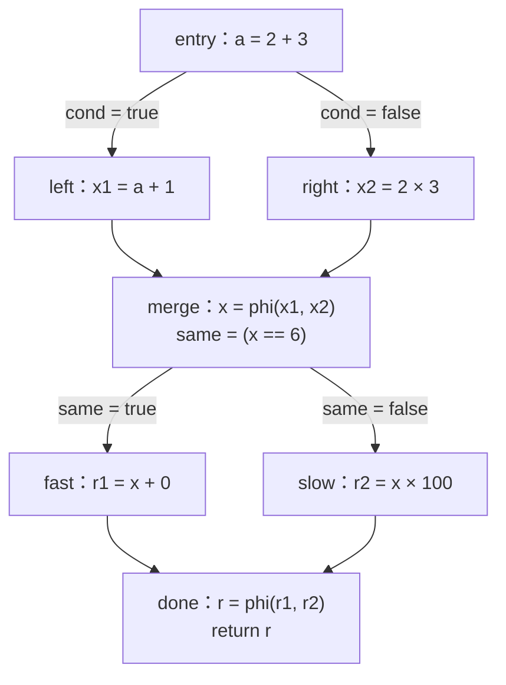

# LEC 14 · Global Optimization (I)

> SE3355 编译原理（2026 秋）
>
> 依据：[LEC-14-Global-Optimization-I.pptx](/Users/xlchen/Compilers-fa26/lectures/LEC-14-Global-Optimization-I.pptx)，共 84 页。本文 p.n 指包含封面的第 n 张幻灯片，以实际顺序为准。p.55–56 是课件内的回顾页，后面仍继续讲解活跃性分析。
>
> 前置：[LEC 12&13 · Intermediate Representation (II)](/Users/xlchen/Compilers-fa26/notes/LEC-12&13-Intermediate-Representation-II.md)。
>
> 本笔记按主题整理。标注“补充理解”“补充推导”“补充实现”或“补充练习”的部分用于展开课件规则及边界。`text` 代码块采用教学 IR 或算法伪代码；其中 `%x = 6` 表示结果已知为常量，不是合法的 LLVM 常量赋值指令。本文的简单算术例子假定操作数是普通的已定义值，具体优化仍须遵守相应 IR 的精确语义。

## 1. 本讲主线：分析事实，再据此改写（p.2–6、84）

上一讲已经用 CFG 表示控制流，用 SSA 与 def-use 表示值关系，用 typed operations 和 load／store 明确运算及内存语义。本讲开始利用这些信息优化程序。

```text
建模事实                 求出事实                    使用事实
抽象域、transfer、join → 沿依赖传播，迭代到固定点 → 替换、删除、简化 IR
```

两个贯穿实例：

| 分析 | 要回答的问题 | 传播方向 | 可以支持的优化 |
| --- | --- | --- | --- |
| 常量传播（constant propagation） | 一个值是否一定等于某个常量？ | 前向 | 常量替换、常量折叠、分支折叠 |
| 活跃性分析（liveness analysis） | 当前值以后是否还可能被使用？ | 反向 | 死代码消除（DCE） |

### 1.1 优化的两个独立判断

编译器优化是一种**受语义约束的程序变换**，目标是降低时间、空间、能耗等代价。

| 判断 | 需要考虑什么 | 例子 |
| --- | --- | --- |
| 合法吗（legal） | 类型、溢出、NaN、异常、内存、副作用 | 浮点数乘零不能直接套用整数恒等式 |
| 值得吗（profitable） | 目标机器、运行时间、代码尺寸、编译时间 | 一个合法变换可能扩大代码，或者没有实际收益 |

课件主要研究如何证明优化所需的事实，具体成本模型留待后续结合后端讨论。

**补充理解：** “保持语义”包括程序允许观察到的行为，不能只比较最后一个返回值。I/O、可观察的内存写入、异常与终止行为等也可能影响能否变换。

### 1.2 本讲的 global 指跨基本块

局部优化通常只检查一条指令或一个基本块；本讲的全局优化要跨越基本块，处理函数 CFG 中的分支、汇合与循环。这里不要求已经进行跨函数分析。

## 2. 局部优化：常量折叠与代数化简（p.7–13）

### 2.1 常量传播与常量折叠的分工

```text
%a = add i32 2, 3
%b = mul i32 %a, 4
ret i32 %b
```

逐步处理：

1. **折叠** `add 2, 3`，得到 `%a = 5`。
2. **传播** `%a = 5`，把第二条指令的 `%a` 替换为 `5`。
3. **折叠** `mul 5, 4`，得到 `%b = 20`。
4. 替换返回值，再删除无用的纯计算，得到 `ret i32 20`。

| 概念 | 做的事 |
| --- | --- |
| 常量折叠（folding） | 在编译期计算操作数已知的表达式 |
| 常量传播（propagation） | 把已知常量事实传到使用该值的位置 |

传播本身是一种分析，也常用来指利用分析结果进行常量替换的整个优化过程。阅读算法时应明确当前是在更新事实表，还是在修改 IR。

### 2.2 恒等式必须符合运算语义

对课件中的普通整数值，可以使用：

```text
add i32 x, 0  ⇒ x
mul i32 x, 1  ⇒ x
sub i32 x, x  ⇒ 0
mul i32 x, 0  ⇒ 0
```

但以下浮点改写不能仅靠数学直觉成立：

```text
fmul double x, 0.0  ⇒  +0.0     // 不能无条件采用
```

若 `x` 是 NaN 或无穷大，结果未必是 `+0.0`；浮点的有符号零等规则也可能影响合法性。同一个表达式形状，换一种类型或语义标志后，改写条件可能变化。

### 2.3 局部改写器的工作顺序

```text
for instruction in basicBlock:
    operands = lookupKnownValues(instruction)
    candidate = matchRewritePattern(instruction, operands)

    if candidate != NONE
       and isLegal(instruction, candidate)
       and isProfitable(instruction, candidate):
        apply(candidate)

    updateKnownValues(instruction)
```

匹配模式只负责发现候选，例如发现 `x * 0`。是否合法由运算语义决定，是否值得由成本模型决定。

### 2.4 为什么需要跨块传播

```text
entry:
    %a = add i32 2, 3
    br %cond, left, right

left:
    %x1 = add i32 %a, 1
    br merge

right:
    %x2 = mul i32 2, 3
    br merge
```

如果局部扫描器每次进入新块都把 `knownValues` 清空，它可以在 entry 得到 `%a = 5`，在 right 得到 `%x2 = 6`，却不能在 left 利用 `%a = 5`。

SSA 保证 `%a` 指向唯一的定义，def-use 帮助找到它的使用者。跨块常量传播进一步计算并维护“这个定义的结果已知为 5”，使 left 能得到 `%x1 = 6`。

## 3. 贯穿案例：从 7 个基本块到 1 个（p.15、22、47）

以下在课件的块内容外补上函数签名，便于整体阅读：

```llvm
define i32 @example(i1 %cond) {
entry:
  %a = add i32 2, 3
  br i1 %cond, label %left, label %right

left:
  %x1 = add i32 %a, 1
  br label %merge

right:
  %x2 = mul i32 2, 3
  br label %merge

merge:
  %x = phi i32 [ %x1, %left ], [ %x2, %right ]
  %same = icmp eq i32 %x, 6
  br i1 %same, label %fast, label %slow

fast:
  %r1 = add i32 %x, 0
  br label %done

slow:
  %r2 = mul i32 %x, 100
  br label %done

done:
  %r = phi i32 [ %r1, %fast ], [ %r2, %slow ]
  ret i32 %r
}
```



推理目标是：无论 `%cond` 选择哪一侧，`%x` 都是 6，因此 `%same` 为 true，slow 不会执行，最后返回 6。后面的算法将这个直觉分解为可机械执行的步骤。

## 4. 常量传播的抽象域与 join（p.17–20）

### 4.1 每个值的事实有三种形态

```text
fact : SSA Value → { ⊥, Const(c), ⊤ }
```

| 事实 | 含义 | 按可能值集合理解 |
| --- | --- | --- |
| `⊥`（bottom） | 尚未得到可达值的信息 | 空集 `∅` |
| `Const(c)`，简写为 `c` | 可以用单一常量 c 描述 | 单元素集合 `{c}` |
| `⊤`（top） | 不能确定为单一常量 | 用整个值域作保守近似 |

外部传入、编译期未知的 `%cond` 应初始化为 `⊤`。尚待处理的内部定义通常初始化为 `⊥`。

**补充理解：** `⊥` 与 `⊤` 都不能直接替换成运行时常量，但原因不同。`⊥` 表示分析尚无值的信息；`⊤` 表示本分析不能确定唯一值。它们不是源程序的“未初始化变量”，也不是 LLVM 的 `undef` 或 `poison`。

迭代中某个事实仍为 `⊥`，不能单凭这一点就删除其所在块。判断不可达还需要控制流可达性信息，而且分析可能尚未完成。

### 4.2 偏序与有限高度

对任意常量 c：

```text
             ⊤
          /  |  \
        ...  6   7  ...
          \  |  /
             ⊥

⊥ ≤ c ≤ ⊤
```

不同常量之间不可比较，例如 `6` 与 `7` 之间没有 `6 ≤ 7`。这里的偏序按可能值集合包含关系定义，与整数大小无关。

**补充理解：** 从 `6` 上升到 `⊤`，表示分析必须容纳更多可能情况，精度反而降低。“向上”不代表“更精确”。常量种类可以很多，但一条严格上升链只有 `⊥ → c → ⊤` 三层。

### 4.3 join 合并不同来源的信息

join 记为 `⊔`，结果是两个事实的**最小上界**：既能覆盖所有来源，又尽可能保留精度。

| 输入 | 结果 | 原因 |
| --- | --- | --- |
| `⊥ ⊔ a` | `a` | 空集不增加可能值 |
| `c ⊔ c` | `c` | 两边给出同一个常量 |
| `c₁ ⊔ c₂`，且 `c₁ ≠ c₂` | `⊤` | 本抽象域不表示多个不同常量的集合 |
| `⊤ ⊔ a` | `⊤` | 合并后仍不能确定唯一常量 |

例如 `{6} ∪ {7} = {6, 7}`，但本域没有 `{6, 7}` 这个元素，只能提升为 `⊤`。所以 `⊤` 不表示实际运行中每个整数都会出现，而是表示当前抽象已无法区分。

join 满足交换律、结合律和幂等律。`6 ⊔ 7` 的结果不是“选一条路径的值”，也不是求平均数。

### 4.4 与类型系统的类比

课件 p.19 用 `Never`、`Any`、`Number` 等展示另一种格结构：在示意的子类型层次中，`Int ⊔ Float = Number`。共同点是求最小公共上界；具体元素含义与偏序必须由各自分析定义，不能照搬名称。

## 5. Transfer function：从操作数事实求结果事实（p.21、23–26）

### 5.1 普通指令的传递规则

```text
transfer(add 2, 3)    = 5
transfer(add ⊤, 1)    = ⊤
transfer(icmp eq 6, 6) = true
transfer(phi(6, 6))  = 6
```

`transfer(inst, facts)` 读取操作数的事实，根据指令语义计算结果的抽象值。

**补充实现：** 对本讲简单、确定且无副作用的二元运算，可以采用以下保守规则：

```text
eval(op, a, b):
    if a == ⊥ or b == ⊥:
        return ⊥
    if a and b are constants:
        return evaluateAccordingToIRSemantics(op, a, b)
    return ⊤
```

这里的 `evaluateAccordingToIRSemantics` 需要检查该计算能否合法折叠。它不能直接采用编译器宿主语言的任意精度整数或浮点规则替代目标 IR 的规则。

以上规则有意保守。例如 `mul ⊤, 0` 会得到 `⊤`；加入合法的整数恒等式后可以进一步得到 `0`。因此“包含 `⊤` 就一定输出 `⊤`”是某些简单传递规则的选择，并非所有运算的必然结论。

### 5.2 φ 的传递规则

对课件中的 φ，合并纳入分析的各条前驱边对应输入：

```text
%x = phi [ %x1, left ], [ %x2, right ]

fact[%x] = fact[%x1] ⊔ fact[%x2]
```

运行时 φ 根据实际进入的前驱选择一个值；静态分析用 join 覆盖可能的来源。两者不是同一个操作。

**补充理解：** 如果尚未证明某条边不可执行，就必须保守考虑它。若另行维护了可靠的可执行边信息，可以只合并那些边；本讲的主要演示先求事实，再改写分支和清理 CFG。

### 5.3 贯穿案例中的事实表

| 处理阶段 | `%cond` | `%a` | `%x1` | `%x2` | `%x` | `%same` |
| --- | --- | --- | --- | --- | --- | --- |
| 初始化 | `⊤` | `⊥` | `⊥` | `⊥` | `⊥` | `⊥` |
| entry | `⊤` | `5` | `⊥` | `⊥` | `⊥` | `⊥` |
| left、right | `⊤` | `5` | `6` | `6` | `⊥` | `⊥` |
| merge 的 φ | `⊤` | `5` | `6` | `6` | `6` | `⊥` |
| merge 的比较 | `⊤` | `5` | `6` | `6` | `6` | `true` |

关键推理是 `6 ⊔ 6 = 6`。即使不知道 `%cond`，也能证明 `%x = 6`，进而证明 `%same = true`。

**补充推导：** 如果此时仍把原 CFG 的两条到达 done 的边都纳入分析，则：

```text
fact[%r1] = 6
fact[%r2] = 600
fact[%r]  = 6 ⊔ 600 = ⊤
```

要进一步证明返回值为 6，需要利用 `%same = true` 排除 slow 路径，更新 done 的 φ。不能在仍然合并两条输入时直接写 `6 ⊔ 600 = 6`。

## 6. 循环为什么要求固定点（p.27–34）

### 6.1 带回边的例子

```text
entry:
    br loop

loop:
    %i = phi [ 0, entry ], [ %next, body ]
    %go = icmp slt i32 %i, 3
    br %go, body, exit

body:
    %next = add i32 %i, 1
    br loop

exit:
    ret i32 %i
```

数据依赖形成环：

```text
%i ──→ %next ──→ %i
 └──→ %go
```

SSA 的唯一静态定义并不意味着该定义在运行时只执行一次。loop 中的 φ 在不同迭代可以产生不同的动态值。

### 6.2 逐轮传播

| 阶段 | `%i` | `%go` | `%next` | 依据 |
| --- | --- | --- | --- | --- |
| 初始化 | `⊥` | `⊥` | `⊥` | 尚未传播 |
| 首次处理 φ | `0` | `⊥` | `⊥` | `0 ⊔ ⊥ = 0` |
| 继续处理比较和 body | `0` | `true` | `1` | `0 < 3`，`0 + 1` |
| 回边使 φ 重算，再传播 | `⊤` | `⊤` | `⊤` | `0 ⊔ 1 = ⊤` |
| 再次传播 | `⊤` | `⊤` | `⊤` | 不再变化，达到固定点 |

第一次得到 `%i = 0`、`%go = true` 只是迭代中的暂时结果。若此时把 `%go` 永久替换为 true，就会破坏原循环的退出条件。

**固定点（fixed point）**表示：再次应用全部传递规则，也不会改变任何事实。

**补充理解：** 这里不是在编译期模拟 `i = 0, 1, 2, 3` 的运行过程。分析为同一个 SSA value 维护一个摘要，发现它不能始终等于同一常量就提升到 `⊤`。这个简单抽象域不能由此证明退出时返回值恰好为 3。

### 6.3 全量迭代算法

以下在课件伪代码中显式补上参数的边界事实，并只对有结果的指令计算常量状态：

```text
facts = allBottomForInternalResults()
initializeExternalInputs(facts)    // 未知函数参数等设为 ⊤

repeat:
    changed = false

    for inst in resultProducingInstructionsInCFGOrder():
        newFact = transfer(inst, facts)
        if newFact != facts[inst.result]:
            facts[inst.result] = newFact
            changed = true

until not changed
```

只有整轮没有变化才能停止。处理过所有指令一次，不等于所有依赖都已传播完毕。

### 6.4 为什么会终止

课件使用的条件是：

- 传递函数单调，输入事实向上变化时，结果不会向下退回。
- 从底元素和规定的边界事实开始迭代。
- 抽象域高度有限，SSA value 的数量也有限。

每个内部值最多经历两次严格变化：

```text
⊥ → 某个常量 → ⊤
```

不会在不同常量之间不断改成 `0 → 1 → 2 → ...`。在固定的 IR 上，所有事实最终稳定。

**补充理解：** 到达固定点只说明选定抽象域中的方程已经稳定，不保证分析能发现程序的一切真实性质。`⊤` 可能来自精度不足，而不一定来自程序确实能取任意值。

## 7. Worklist：只重新计算受影响的节点（p.35–36）

### 7.1 从全量扫描改为依赖驱动

如果 `fact[%i]` 从 `0` 变成 `⊤`，下面两个使用者需要重算：

```text
%go   = icmp slt %i, 3
%next = add %i, 1
```

与 `%i` 无关的 `%p = mul %x, 2` 不需要因此重新处理。

### 7.2 通用算法

```text
facts = initialize()
worklist = allNodes()

while worklist is not empty:
    n = worklist.pop()
    newFact = transfer(n, facts)

    if newFact != facts[n]:
        facts[n] = newFact
        worklist.addAll(affectedBy(n))
```

| 分析组织方式 | 节点事实发生变化后，谁受影响？ |
| --- | --- |
| 本讲按 SSA value 记录常量 | 结果的 users |
| 按基本块组织的前向分析 | CFG 后继 |
| 按指令或基本块组织的反向分析 | CFG 前驱 |

worklist 保存“可能需要重算”的节点，不保证每次取出的节点都会变化。

**补充实现：** 可以用队列加 `inWorklist` 集合去重。初始化时加入所有节点很重要：常量定义或 use 本身就能产生事实，不能只等待其他节点先触发它。

### 7.3 调度顺序与正确性

在相同初始化、单调方程和完整依赖通知下，只要受影响的节点最终都会被处理，worklist 与全量迭代得到相同的最小固定点。顺序影响效率，不应影响最终结论。

“worklist 为空”能作为停止条件的前提，是每次事实变化都正确通知了所有受影响节点。漏加节点会让队列提前变空，留下错误的暂时结果。

**补充理解：** 常量传播在语义上是前向分析，但 SSA 实现可以沿 def-use 调度，不必为每个程序点都存一张完整变量表。分析方向、事实存储位置与调度顺序是不同的设计维度。

## 8. 消费常量事实：替换、折叠与清理（p.37–48）

### 8.1 替换 use

分析稳定后，对确定为常量的值进行替换：

```text
for each (v, c) in facts:
    if c is a constant:
        replaceAllUsesWith(v, c)
```

例如：

```text
%x1 = add i32 %a, 1       ⇒ %x1 = add i32 5, 1
%same = icmp eq i32 %x, 6 ⇒ %same = icmp eq i32 6, 6
br %same, fast, slow     ⇒ br true, fast, slow
```

替换 use 后，原 definition 可能仍在，CFG 的边也尚未改变。维护 def-use 的实现需要同步更新使用关系。

### 8.2 局部折叠与分支折叠

常量操作数为局部规则创造机会：

```text
add 5, 1        ⇒ 6
phi(6, 6)       ⇒ 6
icmp eq 6, 6    ⇒ true
br true, fast, slow ⇒ br fast
```

最后一步删除的是 `merge → slow` 这条边。分支指令的局部改写因此改变整张 CFG。

### 8.3 删除不可达块

```text
reachable = DFS_or_BFS(entry)
delete blocks not in reachable
```

搜索沿改写后的 CFG 边进行。本例 slow 失去从 entry 出发的路径，因此可以删除。

**补充理解：** 删除一条入边不一定使目标块不可达，它可能仍有别的可达前驱。必须进行可达性判断，不能仅凭“某条边被删了”删除整个目标块。

### 8.4 同步更新 φ

删除 slow 及其到 done 的边后：

```text
原先：
%r = phi [ %r1, fast ], [ %r2, slow ]

更新后：
%r = phi [ %r1, fast ]

简化：
用 %r1 替换 %r 的所有 use
```

`%r1` 已知为 6，因此得到 `ret i32 6`。φ 的输入必须与实际前驱对应，不能留下来自已删除块的输入。

这里是在 CFG 已改变后更新结论，与同一张 CFG 上的单调事实迭代不同。变换后可以简化 φ、重新运行分析，或者按实现规则更新受影响事实。

### 8.5 DCE 删除无用的纯计算

替换以后，`%a`、`%x1`、`%x2`、`%x`、`%same`、`%r1` 等定义可能都不再需要。若它们可安全移除，就可以删除。

这时仍可能留下：

```text
entry: br %cond, left, right
left:  br merge
right: br merge
merge: br fast
fast:  br done
done:  ret i32 6
```

DCE 消除无用计算；这些中转块还需 CFG 清理。

### 8.6 CFG 清理的两条规则

| 规则 | 课件中的适用形状 | 动作 |
| --- | --- | --- |
| 绕过跳转块 | B 只有 `br S` | 将进入 B 的边改到 S，并移除 B |
| 合并直线块 | P 只有一个后继 S，S 只有一个前驱 P | 把 S 的指令并入 P，删除中间跳转与 S |

如果条件分支的两个目标变成同一个块，可以折叠为无条件跳转。反复清理，本例得到：

```llvm
define i32 @example(i1 %cond) {
entry:
  ret i32 6
}
```

**补充实现：** 上述是对本例的简化规则。一般实现还要维护入口、φ 输入、值的可用性和控制流语义。尤其不能在两个路径为同一 φ 提供不同值时，直接丢掉用于区分输入的边；自环也不能当成普通中转块随意删除。

### 8.7 级联优化

```text
常量分析 → 替换 use → 局部折叠 → 分支折叠
                                  ↓
再次分析 ← CFG 清理 ← DCE ← φ 简化 ← 删除不可达块
```

一个优化产生的信息和结构变化，会暴露另一个优化的机会。本例从 7 个块变为 1 个块，由多个小步骤共同完成。

需要区分两层迭代：**分析内部**在固定 IR 上求事实的固定点；**优化之间**在 IR 改变后继续发现和利用新机会。

## 9. 活跃性：未来是否可能使用当前值（p.49–56）

### 9.1 为什么事实要反向传播

```text
%x = add i32 %a, %b
...
%z = mul i32 %x, 2
```

要知道 `%x` 的结果是否仍需要，必须考虑后面的 use。需求从使用位置向前传到定义，所以活跃性是一种反向分析。

课件为推导通用算法，暂时允许同一个变量被多次赋值：

```text
x = 3       // 此次定义的值未被使用
x = 4       // 此次定义的值被下面读取
y = x
return y
```

“变量名 x 后面出现过”不足以保留所有 `x = ...`，必须区分不同程序点上的当前值。

### 9.2 活跃性的定义

变量 x 在程序点 p 处 live，当且仅当存在一条从 p 出发的后续路径，使得：

1. 路径上有一次对 x 的 use。
2. 在到达该 use 之前，没有新的 x definition 覆盖当前值。

只要存在一条这样的路径，就必须视为 live；只有所有后续路径都不需要当前值，才能判为 dead。

**补充理解：** 常规 CFG 活跃性分析保守考虑图中的可能路径，其中有些路径可能因条件关联而实际不可执行。因此它可能把实际上无用的值标为 live，少做一些删除；不能漏掉真实可能发生的使用。

### 9.3 DCE 的判据

对赋值 `x = e`，判断的是它产生的新值在**指令之后**是否 dead：

```text
L_out(x, x = e) = dead
且整条指令可安全删除
⇒ 可以删除此次定义
```

```text
x = a + b       // 结果 dead，且是可安全移除的纯计算：可以删除
y = read()      // 即使 y dead，读取操作本身可能有可观察行为：不能据此删除
```

课件用“无副作用”概括第二个条件。**补充理解：** 实际实现应按 IR 判断整条指令是否可安全移除，包括可观察的异常、内存效果等，不能只检查结果有没有 use。

## 10. 活跃性方程：use 产生需求，def 截断旧值（p.57–62）

### 10.1 单变量的事实域

```text
dead < live

dead ⊔ dead = dead
dead ⊔ live = live
live ⊔ live = live
```

初始化为 dead，表示尚未发现未来需求；传播过程中一旦发现需求，就上升为 live。

**补充理解：** 初始化时的 dead 是迭代起点，尚不是可以立即用于删除代码的最终证明。在固定点前，后继的需求可能还没有传回来。

### 10.2 区分指令入口与出口

```text
程序执行方向 ↓       分析传播方向 ↑

L_in(x, s)       // 执行 s 之前，旧 x 是否需要保留
statement s
L_out(x, s)      // 执行 s 之后，此时的 x 是否还会被使用
```

反向 transfer 由 `L_out` 推导 `L_in`：

$$
L_{in}(x,s)=\operatorname{transfer}_s(L_{out}(x,s))
$$

### 10.3 先合并后继，再穿过当前指令

$$
L_{out}(x,s)=\bigsqcup_{t\in succ(s)}L_{in}(x,t)
$$

普通指令通常只有下一条指令这个后继；条件分支的后继是各目标块的第一条指令。多个后继的事实在分支处做 join。

例如某个后继需要 x，另一个不需要：

```text
L_out(x, branch) = live ⊔ dead = live
```

没有后继时，本讲将出口边界设为 dead。`return x` 自身的 use 仍会让它的入口变为 live。

### 10.4 指令内的 transfer

令 `use_x(s)` 表示 s 读取旧 x，`def_x(s)` 表示 s 定义新 x：

$$
L_{in}(x,s)=use_x(s)\lor
\bigl(L_{out}(x,s)\land\neg def_x(s)\bigr)
$$

| 当前指令 | 对 x 的作用 | 入口事实 |
| --- | --- | --- |
| `y = x + 1` | use x，产生需求 | `live` |
| `x = e`，e 不读取 x | def x，截断对旧 x 的需求 | `dead` |
| `z = a + b`，且不涉及 x | 不改变对 x 的需求 | 与 `L_out` 相同 |
| `x = x + 1` | 同时 use 旧 x、def 新 x | `live` |

`x = x + 1` 是最容易混淆的情形：旧 x 在入口必须 live，但新 x 在出口是否 live，要看后面是否使用它。

布尔符号 `∨`、`∧`、`¬` 描述单条语句的逻辑规则；路径汇合用 `⊔`。在 `dead < live` 这个域中，join 恰好与布尔 OR 的结果一致。

### 10.5 扩展到所有变量的集合形式（补充推导）

用 `LiveIn[s]`、`LiveOut[s]` 保存活跃变量集合，可把逐变量布尔方程写为：

$$
LiveOut[s]=\bigcup_{t\in succ(s)}LiveIn[t]
$$

$$
LiveIn[s]=Use[s]\cup\bigl(LiveOut[s]\setminus Def[s]\bigr)
$$

| 单变量形式 | 集合形式 |
| --- | --- |
| x 的事实为 live | `x ∈ LiveIn` 或 `x ∈ LiveOut` |
| dead | 不在相应集合中 |
| `dead < live` | 按集合包含关系排序 |
| 后继事实 join | 后继活跃集合取并集 |
| def 截断旧 x | 从后续需求中减去 Def，再加入当前 Use |

对一个基本块 B，也可以写成：

```text
OUT[B] = ⋃ IN[S]                    S ∈ succ(B)
IN[B]  = USE[B] ∪ (OUT[B] − DEF[B])
```

其中 `USE[B]` 是块内**在本块对该变量的首次定义之前**发生的使用，不能简单取所有指令 Use 的并集。例如 `x = 1; y = x` 不要求从块入口传入旧 x。

## 11. 分支示例：在分支处合并需求（p.63–67）

### 11.1 原程序

```text
B1:
    x = 1
    br c, B2, B3

B2:
    y = x + 1
    br B4

B3:
    x = 2
    y = 0
    br B4

B4:
    return y
```

本例只分析 x，所以 `return y`、`br c` 不会直接产生对 x 的 use。

### 11.2 从出口方向逐条反推

1. B4 的 `return y` 不涉及 x，因此 B4 对 x 的入口事实为 dead。
2. B2 的 `y = x + 1` 使用 x，因此 B2 入口为 live。
3. B3 的所有后续语句都不使用 x，B3 入口为 dead。
4. B1 的分支合并两侧：`live ⊔ dead = live`。
5. 穿过 `x = 1` 时，这次定义截断对旧 x 的需求，所以 B1 入口为 dead。

最终事实：

| 块 | 指令 s | `L_in(x,s)` | `L_out(x,s)` |
| --- | --- | --- | --- |
| B1 | `x = 1` | dead | live |
| B1 | `br c, B2, B3` | live | live |
| B2 | `y = x + 1` | live | dead |
| B2 | `br B4` | dead | dead |
| B3 | `x = 2` | dead | dead |
| B3 | `y = 0` | dead | dead |
| B3 | `br B4` | dead | dead |
| B4 | `return y` | dead | dead |

### 11.3 根据 definition 的出口事实删除

| 定义 | 新值的出口事实 | 结论 |
| --- | --- | --- |
| B1 的 `x = 1` | live | 保留，B2 路径会读取 |
| B3 的 `x = 2` | dead | 可删除，假定赋值无副作用 |

`x = 1` 的 `L_in` 是 dead，表示进入该指令前不需要旧 x，**不能用它来判断这条指令产生的新值是否无用**。

这也解释了为什么活跃性不能只向后扫描某一条路径：B3 不使用 x，但 B2 使用，B1 必须覆盖两种后续情况。

## 12. 循环示例：第一遍的 dead 可能尚未传播完（p.68–77）

### 12.1 程序与初始调度顺序

```text
B1:
 s1  x = 0
 s2  sum = 0
 s3  br B2

B2:
 s4  br c, B3, B4

B3:
 s5  sum = sum + x
 s6  x = x + 1
 s7  br B2

B4:
 s8  return sum
```

本例仍然只分析 x。课件将循环判定简写为 `br c`，未展开条件计算或更新；下面关于连续两次迭代的讨论沿用课件给定的执行情形。

```text
所有 L_in / L_out 初始化为 dead
初始 worklist = [s8, s4, s7, s6, s5, s3, s2, s1]
```

这只是便于观察的一种顺序，回边 `s7 → s4` 使“处理出口再往前扫一遍”仍然不够。

### 12.2 初始节点各处理一次后

| 指令 | `L_in(x,s)` | `L_out(x,s)` | 当时的原因 |
| --- | --- | --- | --- |
| s8 `return sum` | dead | dead | 不使用 x |
| s4 `br c, B3, B4` | dead | dead | 首次处理时 s5、s8 的入口暂时都为 dead |
| s7 `br B2` | dead | dead | s4 入口暂时为 dead |
| s6 `x = x + 1` | live | dead | 使用旧 x，但后继尚未传回对新 x 的需求 |
| s5 `sum = sum + x` | live | live | 自身使用 x，且 s6 入口为 live |
| s3 `br B2` | dead | dead | s4 还没重新处理 |
| s2 `sum = 0` | dead | dead | 对 x 原样传递 |
| s1 `x = 0` | dead | dead | 后续需求尚未传回 |

处理 s5 时，其入口从 dead 变为 live，因此必须把前驱 s4 重新加入 worklist。等初始队列中的节点都处理完，队列仍有：

```text
worklist = [s4]
```

### 12.3 为什么此时不能删除 s6

若误用暂时的 `L_out(x,s6) = dead`，会把 `x = x + 1` 当成死代码。

课件比较循环体连续执行两次的情况：

| 时刻 | 保留 s6 | 删除 s6 |
| --- | --- | --- |
| 初始 | `x = 0, sum = 0` | `x = 0, sum = 0` |
| 第一次循环体后 | `x = 1, sum = 0` | `x = 0, sum = 0` |
| 第二次循环体后 | `x = 2, sum = 1` | `x = 0, sum = 0` |

若随后退出，返回的 sum 不同。这说明在允许多次迭代并退出的执行中，新 x 会影响下一轮的求和，不能删除 s6。

### 12.4 继续传播，需求绕回循环体

重新处理 s4：

```text
L_out(x,s4) = L_in(x,s5) ⊔ L_in(x,s8)
            = live ⊔ dead
            = live
L_in(x,s4)  = live
```

s4 入口变化，通知前驱 s3 和 s7。先看沿回边的一侧：

```text
s4 的入口变为 live
    ↓ 通知前驱 s7
s7 的出口、入口变为 live
    ↓ 通知前驱 s6
s6 的出口变为 live，入口原本已是 live
```

s6 产生的新 x 现在明确为 live。随后沿 s3、s2、s1 向入口继续传播。

### 12.5 最终固定点

| 指令 | 最终 `L_in(x,s)` | 最终 `L_out(x,s)` |
| --- | --- | --- |
| s1 `x = 0` | dead | live |
| s2 `sum = 0` | live | live |
| s3 `br B2` | live | live |
| s4 `br c, B3, B4` | live | live |
| s5 `sum = sum + x` | live | live |
| s6 `x = x + 1` | live | live |
| s7 `br B2` | live | live |
| s8 `return sum` | dead | dead |

不能删除 s1 或 s6 这两个 x 的定义。s8 不使用 x，所以进入出口块时 x 可以是 dead；这与循环体中 x 为 live 并不矛盾。

回边没有特殊的传递规则，它只是让一个后继重新指向已经处理过的节点。worklist 通过依赖通知处理这种循环。

## 13. 活跃性的 worklist 算法（p.62、74–77）

### 13.1 单变量版本

```text
for every instruction s:
    L_in[s] = dead
    L_out[s] = dead

worklist = all instructions

while worklist is not empty:
    s = worklist.pop()
    oldIn = L_in[s]

    newOut = join(L_in[t] for t in successors(s))
    newIn = use_x(s) or (newOut and not def_x(s))

    L_out[s] = newOut
    L_in[s] = newIn

    if newIn != oldIn:
        worklist.addAll(predecessors(s))
```

空后继集合的 join 为 dead。多个变量可以使用相同算法，将布尔值换成活跃变量集合，将 transfer 换成集合公式。

### 13.2 为什么由 IN 的变化通知前驱

前驱的 `L_out` 依赖当前指令的 `L_in`。因此，只有当前 `L_in` 变化，才需要因此通知前驱。

但 `L_out` 无论如何都要更新并保存。循环例子的 s6 第二次处理时：

```text
L_in(x,s6)： live → live     // 不变
L_out(x,s6)：dead → live     // 必须记录
```

如果只在 `newIn != oldIn` 时才保存 OUT，就会保留错误的 dead，进而误删 s6。

### 13.3 单调性不等于沿代码位置永远 live

在固定 IR 上，每个“程序点、变量”的事实随迭代最多从 dead 变为 live 一次，因此算法会终止。

这不妨碍同一条赋值出现：

```text
L_in(x, x = 1)  = dead
L_out(x, x = 1) = live
```

这里比较的是**两个不同程序点**，不是同一个事实在迭代中从 live 降到 dead。def 对旧值的 kill 与分析的单调收敛可以同时成立。

### 13.4 固定点后才能执行本讲的 DCE

```text
求完 liveness
    ↓
对每条可安全移除的 x = e 检查 x ∉ LiveOut[s]
    ↓
删除满足条件的定义
```

**补充理解：** 删除一条指令也可能删除它对其他值的 use，产生新的死代码。例如 `a = 1; b = a + 1; return 0`，先删除 b 的定义后，a 也会变得无用。实现可以重新分析、继续增量清理，或使用后面的 SSA mark-and-sweep 方法。

## 14. 回到 SSA：沿值依赖做 DCE（p.78–82）

### 14.1 唯一定义让依赖直接可见

```text
非 SSA：                 SSA：
x = 3                    x1 = 3
x = 4                    x2 = 4
y = x                    y1 = x2
return y                 return y1
```

构造这段直线代码的 SSA 时，用环境记录源码名字当前对应的值：

| 源语句 | 生成的指令 | 环境变化 |
| --- | --- | --- |
| `x = 3` | `x1 = 3` | `env[x] = x1` |
| `x = 4` | `x2 = 4` | `env[x] = x2` |
| `y = x` | `y1 = x2` | 读取 `env[x]`，设置 `env[y] = y1` |
| `return y` | `return y1` | 读取 `env[y]` |

`y1 = x2` 的操作数直接指向唯一的定义 `x2 = 4`，不需要再从同名的多次赋值中辨认。没有 use 指向 x1。

**补充理解：** 上述环境更新演示的是直线代码。遇到分支和循环时，SSA 构造仍需要 φ 或等价的值汇合机制，不能只维护一个按文本顺序覆盖的全局环境。

### 14.2 Mark：从必须保留的指令向操作数定义追溯

课件把以下指令作为根：

- `return`。
- `branch`。
- `store`。
- 有副作用的 `call`。

先标记根，再沿它们的操作数找到唯一的 definition，递归标记这些定义所依赖的指令。

```text
return y1 → y1 = x2 → x2 = 4

x1 = 3   // 没有被这条依赖链访问
```

**补充实现：** 实际根集合应覆盖所有不能安全删除的指令。把所有分支作为根是一个保守选择，会保留其条件的计算；进一步删除无意义控制流需要另外的分析或 CFG 简化规则。

### 14.3 Sweep：删除未标记且可安全移除的指令

```text
marked = {}
worklist = rootInstructions()

while worklist is not empty:
    inst = worklist.pop()
    if inst in marked:
        continue
    marked.add(inst)

    for operand in inst.operands:
        if operand is defined by an instruction:
            worklist.add(definitionOf(operand))

for inst in allInstructions():
    if inst not in marked and isSafeToRemove(inst):
        erase(inst)
```

该伪代码是对课件 Mark／Sweep 的展开。常量和函数参数不要求存在函数内的定义指令；已标记集合避免在循环依赖中反复访问。

**补充实现：** 未标记指令之间可能仍有相互引用。批量删除时应先解除待删子图内部的引用，再移除指令，并维护 def-use，不能要求每条待删指令在开始清理前就已经没有 use。

对例子而言，x1 未标记且是纯计算，可以删除，得到：

```text
x2 = 4
y1 = x2
return y1
```

常量传播还可以把它进一步化为 `return 4`，但那是另一种改写。

### 14.4 与逐点 liveness 的关系

| 表示或算法 | 怎样找到某个 use 依赖的值 | DCE 的主要工作 |
| --- | --- | --- |
| 非 SSA + liveness | 需要通过程序点、控制流和 def 的 kill 区分当前值 | 检查每次定义之后的活跃性 |
| SSA + mark-and-sweep | use 直接指向唯一的 definition | 从必要指令沿依赖标记，删除未标记纯计算 |

**补充理解：** SSA 简化了这类 DCE，并不意味着编译器从此不需要活跃性。寄存器分配等任务仍可能需要知道值在什么位置活跃。若对 SSA 做逐点活跃性分析，还要正确处理 φ 的输入使用发生在相应前驱边上的语义。

内存操作也不能仅用普通 SSA 结果的“无 use”判断是否无用。课件把 store 保守地作为根；判断一个写入能否删除还需要相关的内存分析。

## 15. 前向与反向分析的统一框架（p.48、83–84）

区别在于**当前位置的事实依赖谁**，不是代码从哪一行开始扫描。

| 维度 | 前向分析 | 反向分析 |
| --- | --- | --- |
| 语义依赖 | 当前位置依赖此前执行带来的信息 | 当前位置依赖未来的需求或性质 |
| CFG 汇合位置 | 从前驱 OUT 计算本块 IN | 从后继 IN 计算本块 OUT |
| 块内传递 | `OUT[B] = transfer_B(IN[B])` | `IN[B] = transfer_B(OUT[B])` |
| 典型通知方向 | 输出变化后通知后继 | 输入变化后通知前驱 |
| 本讲实例 | 常量传播 | 活跃性分析 |
| 课件列举的其他实例 | 可达定义、可用表达式 | 可预期表达式、后支配 |

两类分析的方程骨架：

```text
前向：
IN[B]  = ⊔ { OUT[P] | P ∈ pred(B) }
OUT[B] = transfer_B(IN[B])

反向：
OUT[B] = ⊔ { IN[S] | S ∈ succ(B) }
IN[B]  = transfer_B(OUT[B])
```

都需要明确事实域、偏序、join、传递函数、边界条件与初始化，再使用固定点算法求解。

**补充理解：** 上面的 `⊔` 是相应偏序下的 join，不能把所有分析的汇合都机械写成普通集合并集。有的分析要求性质在所有路径上成立，可能选择集合交集，并配套采用不同的偏序和初始化。

反向分析也不是倒着执行源程序。例如跨过 `x = 4`，分析只判断旧 x 是否仍被需要，并不尝试恢复赋值前 x 的数值。

## 16. 易错点速查

| 易错点 | 正确理解 |
| --- | --- |
| 优化合法就一定值得 | 语义约束与成本模型需要分别判断 |
| 数学恒等式可直接用于所有 IR 运算 | 类型、溢出、浮点与其他语义会影响合法性 |
| 常量折叠和常量传播是同一件事 | 前者计算常量表达式，后者传递已知值 |
| SSA 已经给出 def-use，就无需常量分析 | def-use 表示依赖，常量分析计算依赖所支持的事实 |
| `⊥` 表示编译期未知的参数 | 未知外部输入通常为 `⊤`；`⊥` 表示尚无值的信息 |
| 格里的 `6 ≤ 7` 来自整数大小 | 不同常量不可比较，偏序按抽象含义定义 |
| `6 ⊔ 7` 可以任选一个值 | 应得到 `⊤`，覆盖两种来源 |
| `%i` 首次算为 0，就能永久替换为 0 | 回边可能使事实升到 `⊤`，必须完成分析 |
| 固定点就是程序运行到稳定状态 | 固定的是编译期事实表，不是运行时变量 |
| 常量很多就一定无法保证终止 | 关键是上升链高度有限，不是常量数量少 |
| worklist 为空就无条件保证正确 | 还要求初始化、传递规则及依赖通知完整 |
| 替换 use 会自动删掉原 definition | 删除无用定义通常由后续 DCE 完成 |
| 分支折叠删除一条边就可直接删掉目标块 | 要检查目标块是否仍可从 entry 到达 |
| 删除前驱后可以保留原 φ 不变 | 必须同步维护前驱对应的输入 |
| liveness 要求所有后续路径都使用 x | 任意一条可能路径使用当前值，就必须视为 live |
| `L_in` 为 dead 就能删掉当前赋值 | 对 `x = e` 要检查新 x 的 `L_out` |
| def 会让该变量永远 dead | def 截断旧值需求，新值是否 live 由后续 use 决定 |
| `x = x + 1` 的入口 live，所以出口也必定 live | 入口针对旧值，出口针对新值，需要分别判断 |
| 反向扫描一遍就完成活跃性 | 循环与调度顺序可能要求重新处理已访问节点 |
| `L_in` 不变时可以不保存新的 `L_out` | DCE 要使用最终 OUT，即使 IN 不变也必须更新它 |
| def 的 kill 与单调性矛盾 | kill 比较不同程序点，单调性约束同一点随迭代的变化 |
| 结果 dead 就可以删除调用或存储 | 还要证明整条指令可安全移除 |
| SSA DCE 只需寻找零 use 指令 | 从必要根做标记还能处理互相引用但不被需要的纯计算 |
| 使用 SSA 后 CFG 和 φ 都不重要 | 分支、循环、路径可用性与 φ 的来源仍须维护 |
| 反向分析就是从程序末尾倒着执行 | 它从未来需求推导当前事实，不执行逆运算 |

## 17. 复习自测与参考答案（补充练习）

### 17.1 两个分支都是 6，条件未知，汇合值是多少

```text
left:  x1 = 6
right: x2 = 6
merge: x = phi(x1, x2)
```

**答案：** `fact[x] = 6 ⊔ 6 = 6`。不需要知道具体进入哪一侧。如果右侧是 7，则为 `⊤`。

### 17.2 循环第一次得到常量，为什么不能立即替换

```text
i = phi(0, next)
next = i + 1
```

**答案：** 首次 `next = ⊥`，所以 i 暂时为 0。得到 `next = 1` 后，i 必须重算为 `0 ⊔ 1 = ⊤`。首次结果尚未包含回边带来的信息。

### 17.3 为什么贯穿案例最后返回 6，而不是 `⊤`

**答案：** 先证明 x 为 6，进而证明 same 为 true，折叠分支并删除不可达的 slow，再删除 done 中来自 slow 的 φ 输入。剩余输入 r1 为 6。在未排除 slow 时，`6 ⊔ 600` 仍是 `⊤`。

### 17.4 `x = 4` 入口 dead、出口 live，能删除吗

**答案：** 不能仅根据入口 dead 删除。入口 dead 说明旧 x 不需要保留；出口 live 说明这条赋值产生的新 x 仍会被使用。

### 17.5 `x = x + 1` 的出口 dead，入口是什么

**答案：** 入口为 live，因为右侧读取旧 x。若出口 dead 是最终事实，且整条运算可安全删除，则可以删除该指令；删除后，其读取旧 x 的需求也随之消失，可能触发进一步 DCE。

### 17.6 合并后继的活跃性

```text
LiveIn[left]  = {x, y}
LiveIn[right] = {y, z}
```

**答案：** 分支的 `LiveOut = {x, y, z}`。只要某个后继需要一个变量，分支之前就必须保留相应的当前值。

### 17.7 对 `x = y + 1` 应用集合公式

假定 `LiveOut = {x, z}`。

**答案：** `Use = {y}`、`Def = {x}`，所以：

```text
LiveIn = {y} ∪ ({x, z} − {x})
       = {y, z}
```

后面需要的新 x 由当前指令提供，不要求旧 x 从入口传入。

### 17.8 Worklist 为什么通知前驱而非后继

**答案：** 活跃性中，前驱的 OUT 依赖当前指令的 IN。当前 IN 改变后，需要重算的是前驱。常量传播的 SSA 实现则通常通知结果的 users。

### 17.9 判断 SSA mark-and-sweep 保留哪些指令

```text
a = 1
b = a + 2
c = 9
store b, p
return 0
```

**答案：** store 和 return 是根。store 使用 b 和 p，标记 b 的定义，再沿 b 的操作数标记 a；若 p 有定义指令，也需追溯。c 是未标记的纯计算，可以删除。不能因为 store 没有普通返回结果就删除它。

### 17.10 本讲结束时应能独立完成什么

- 为简单常量传播问题写出 `⊥ / c / ⊤`、join 和 transfer。
- 沿分支和回边手算事实，说明哪些结论只是暂时结果。
- 写出 worklist 的初始化、更新规则、受影响节点和停止条件。
- 按合法顺序执行常量替换、分支折叠、不可达块删除、φ 简化与 DCE。
- 写出活跃性的布尔与集合方程，区分指令入口的旧值和出口的新值。
- 解释为什么非 SSA 的逐点活跃性与 SSA 的值依赖标记都能支持 DCE。

下一讲的问题是：**当值不是常量，而且结果仍然有用时，能否通过识别重复计算继续优化？**
