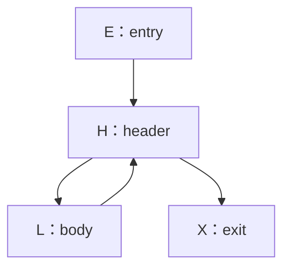

# LEC 15 · 公共子表达式消除、支配与全局值编号

SE3355 编译原理 · 2026 秋　[本讲课件（52 页）](../lectures/LEC-15-Global-Optimization-II.pptx)

两次计算 `x + y`，即使 x、y 都不是常量，也可能省去第二次加法。公共子表达式消除（CSE）需要两个条件。两次计算**得到相同的值**，而且程序走到第二次计算时**一定拿得到第一次的结果**。在同一基本块中可以按指令顺序检查。跨块时，还要看有没有路径绕开了第一次计算。

## 一个基本块内怎样消除重复计算（p.4–15）

从上到下扫描，维护“表达式 → 已算出的结果”表。表的键包括操作码、类型、操作数的当前版本和语义标志。例如普通 `add` 和 `add nsw` 对溢出的约定不同，不能只凭名字都叫加法就合并。只把可安全消除重复执行的运算作为候选。

| 当前指令 | 查询／更新表达式表 | 结果 |
| --- | --- | --- |
| `%a = add %x, %y` | `add(%x,%y)` 未命中，记录 `%a` | 保留 `%a` |
| `%p = mul %a, 2` | `mul(%a,2)` 未命中，记录 `%p` | 保留 `%p` |
| `%b = add %x, %y` | 命中 `add(%x,%y) → %a` | 用 `%a` 替换 `%b` |
| `%q = sub %b, 1` | 前一步替换后，实际看到 `sub(%a,1)` | 按更新后的操作数查表 |

命中后，用旧结果替换新结果的**所有使用位置**，再删除重复的纯指令。给后续指令查表时要用替换后的操作数。在同一语义下，对满足交换律的整数加法可以把操作数按固定顺序排列，使 `x + y` 和 `y + x` 命中同一项。减法不能这样排序，重新结合浮点加法也需另行证明。

**处理重定义。** 非 SSA 代码里，同一个名字可能先后装着不同的值。期中复习题的第三行就改变了 x。

| 指令 | 能否复用 | 理由 |
| --- | --- | --- |
| `a = x + y` | 记录 a | 使用当前的 `x₀,y₀`。 |
| `b = x + y` | 可改成 `b = a` | 两个操作数和代表 a 都没变。 |
| `x = 0` | 旧 x 的版本结束 | 若按名字查表，要让依赖旧 x 的表达式失效。 |
| `c = x + y` | 不能直接用 a | 现在的键是 `add(x₁,y₀)`。 |

若第三行改成 `a = 0`，x、y 都没变，和仍然相同，但 a 已经被覆盖。第二行留下了副本 b，此时可改成 `c = b`。[期中复习课件，第 2、25 页，范围到 Local CSE](../lectures/LEC-17-Midterm-Review.pptx)

**内存也是输入。** 在 `v1 = load p; store 1,q; v2 = load p` 中，p 的 SSA 名字没变，但 q 可能改写 p 指向的字节。只有排除了中间写入的影响、读法也满足条件时，普通 load 才可复用。未知调用、volatile 和原子访问要根据各自的语义处理。[内存与别名](LEC-12&13-Intermediate-Repr-II.md) · [LLVM volatile 访问](https://llvm.org/docs/LangRef.html#volatile-memory-accesses)

## 支配保证旧值在每条到达路径上都算过（p.16–29）

在入口可达的 CFG 中，若从入口到 B 的**每条路径**都经过 A，就说 A 支配 B，写作 `A dom B`。每个块支配自己。若相同加法只在 if 左分支出现，右分支可绕过它，那么汇合点即使还要算同一个和，也不能直接引用左分支的结果。入口处的定义则能在两侧共同使用。同块内还须检查定义在使用之前，φ 操作数在各自的前驱边上检查。[LLVM φ 的使用位置](https://llvm.org/docs/LangRef.html#phi-instruction)

令 `Dom(B)` 表示 B 的全部支配者。入口只受自己支配，其余块的集合可由前驱求得。

```text
Dom(entry) = {entry}
Dom(B) = {B} ∪ ⋂ Dom(P)       P 遍历 B 的可达前驱，B ≠ entry
```

用交集是因为每个前驱都必须经过候选支配者。除入口外先赋全集 V，再反复按方程缩小（或在集合变化时把后继入队）。下图中有一条回边，所以 H 的结果依赖 L，L 的结果也依赖 H。



取 `V = {E,H,L,X}`，每轮用上一轮的结果更新。

| 轮次 k | Dom(H) | Dom(L) | Dom(X) |
| --- | --- | --- | --- |
| 0 | `V` | `V` | `V` |
| 1 | `{E,H}` | `V` | `V` |
| 2 | `{E,H}` | `{E,H,L}` | `{E,H,X}` |
| 3 | `{E,H}` | `{E,H,L}` | `{E,H,X}` |

排除自身后，离 B 最近、受其余严格支配者支配的节点是**立即支配者** `idom(B)`。把每个块接到它的立即支配者下面，就得到支配树。例中 H 的父节点是 E，L 和 X 的父节点都是 H。CFG 的边表示控制可以一步跳到哪里，支配树的父节点表示到达该块前必须经过的最近一层。

## 沿支配树做全局 CSE（p.30–35）

进入块时给表达式表开一层，先按顺序处理块内指令，再访问它在**支配树**中的孩子，离开块就撤销本层新建的表项。这样能查到的旧定义都支配当前位置，兄弟分支看不到彼此的临时值。

```text
entry:
    %a = add %x, %y
    br %cond, left, right

left:
    %b = add %x, %y
    br merge

right:
    %r = sub %x, %y
    br merge

merge:
    %c = add %x, %y
    ret %c
```

| 步骤 | 当前可见作用域 | 动作 |
| --- | --- | --- |
| 进入 entry | entry | 记录 `add(%x,%y) → %a` |
| 进入 left | entry、left | `%b` 命中 `%a`，替换并删除 `%b` |
| 离开 left，进入 right | entry、right | 撤销 left 的表项，新增 `sub(%x,%y) → %r` |
| 离开 right，进入 merge | entry、merge | 撤销 right 的表项，`%c` 仍命中 entry 中的 `%a` |

若误沿 CFG 遍历并始终保留一张表，先访问 left 就可能把其中的值错误地带进 merge。另一类方法在各前驱上分别求可用表达式，再取交集。即便每条路都算过，也得找到一个能在汇合点使用的结果，或者用 φ 汇合各路结果。[Cornell 的冗余消除讲义](https://www.cs.cornell.edu/courses/cs4120/2023sp/notes/redund_elim/)

## GVN 能看出哪些表达式等值（p.36–47）

一般的 CSE 比较操作数名字。全局值编号（GVN）给已证明相等的值同一个编号（VN），用**操作数的编号**组成表达式键。若 `a = x + 0`、`b = x * 1`，则 `a*z`、`b*z` 和 `x*z` 虽然写法不同，仍能得到同一编号。不同编号只表示本分析没有证明相等。

```llvm
define i32 @gvn_example(i32 %x, i32 %z, i1 %cond) {
entry:
  %a = add i32 %x, 0
  %p = mul i32 %a, %z
  br i1 %cond, label %left, label %right

left:
  %b = mul i32 %x, 1
  %q = mul i32 %b, %z
  br label %merge

right:
  %r = mul i32 %x, %z
  br label %merge

merge:
  %out = phi i32 [ %q, %left ], [ %r, %right ]
  ret i32 %out
}
```

在这个无环 CFG 中按拓扑序访问，可保证处理 φ 前已看到各前驱的值。这里令 `VN(x)=1`、`VN(z)=2`、`VN(cond)=3`，沿各条分支为新值编号。

| 块 | 指令 | 值表达式／规则 | 结果编号 |
| --- | --- | --- | --- |
| entry | `%a = add %x, 0` | `add(VN1,0)`，单位元化简 | VN1 |
| entry | `%p = mul %a, %z` | `mul(VN1,VN2)`，新表达式 | VN4 |
| left | `%b = mul %x, 1` | `mul(VN1,1)`，单位元化简 | VN1 |
| left | `%q = mul %b, %z` | `mul(VN1,VN2)`，命中 | VN4 |
| right | `%r = mul %x, %z` | `mul(VN1,VN2)`，命中 | VN4 |
| merge | `%out = phi(%q,%r)` | 两条入边都为 VN4 | VN4 |

实现时，把“值相等”和“旧结果在这里可用”分开记录。

| 查询 | 在本例中怎样使用 |
| --- | --- |
| `valueNumber[value]` | 查已有 SSA 值的编号。`%a` 和 `%b` 化简后都用 `VN1`。 |
| `valueExprTable[key]` | 查表达式对应的编号。三处乘法都查到 `mul(VN1,VN2) → VN4`。 |
| `availableValue[VN]` | 查当前位置可用的 SSA 名字。entry 的 `%p` 支配 merge，可用它替换返回值 `%out`。 |

替换各使用处并清理分支后，函数只需一次乘法。

```llvm
define i32 @gvn_example_optimized(i32 %x, i32 %z, i1 %cond) {
entry:
  %p = mul i32 %x, %z
  ret i32 %p
}
```

若去掉 entry 的乘法，只在 left、right 各算一次，两边的结果仍可得到相同的值编号，但两处定义都只支配各自的分支。这时可以保留 φ 从两边取值。因此给 φ 构造表达式键时，要记住**哪个前驱提供哪个值**。沿 left 进入时，`φ[1,left],[2,right]` 取 1，`φ[2,left],[1,right]` 却取 2。

## 循环中的等价要等到固定点（p.48–50）

```text
entry:
    br header

header:
    %i = phi [ 0,entry ], [ %i.next,body ]
    %j = phi [ 0,entry ], [ %j.next,body ]
    br body

body:
    %i.next = add %i, 1
    %j.next = add %j, 1
    br header
```

第一次进入循环，两个 φ 都取 0。如果某一轮 i 和 j 相等，各自加 1 后仍相等，因此下一轮的 φ 又会取到相同的值。按迭代次数做归纳，就能证明 i 和 j 始终相等，可以给它们同一个值编号。

实现时先把可能相等、类型相容的定义暂分在一起，通过各自的运算和前驱输入逐步拆分。若把 j 的增量改成 2，两个加法先分开，沿 def-use 通知两个 φ 后，i、j 也要分开。在这种算法里，一组定义可以继续拆分，各组不会重新合并。值的总数有限，分组最终会稳定，到那时才能用编号改写程序。

## 非 SSA 形式怎样维护版本（p.51–52）

维护 `Env[变量] = 当前 VN`。处理 `x = x + 1` 时，先用旧 Env 给右侧编号，再更新 `Env[x]`。旧版本构成的表达式键可以留在等价表里，但可用代表必须随赋值更新。多条边汇合时，若各前驱给 x 同一个 VN 就沿用它。若编号不同，就保留路径选择，或保守地记为未知。

**自测。** 在上面的循环 CFG 中加一条 `E → X`，谁是 X 的立即支配者？新路径绕开了 H，故 `Dom(X) = {X} ∪ (Dom(E) ∩ Dom(H)) = {E,X}`，父节点改成 E。此后若某个表达式只在 H 中计算，就不能在 X 直接复用它。下一讲把支配关系用于 [识别循环与循环优化](LEC-16-Global-Optim-III.md)。
