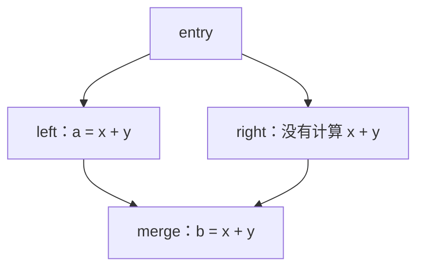
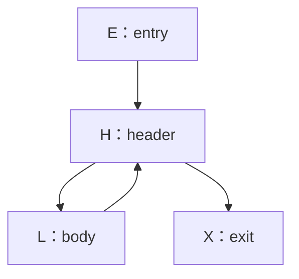

# LEC 15 · Global Optimization (II)

> SE3355 编译原理（2026 秋）
>
> 依据：[LEC-15-Global-Optimization-II.pptx](/Users/xlchen/Compilers-fa26/lectures/LEC-15-Global-Optimization-II.pptx)，共 52 页。本文 p.n 指包含封面的第 n 张幻灯片，以实际顺序为准。课件部分页脚编号与实际顺序不一致，例如实际 p.51 的页脚写作 48；p.20 是课件内的回顾页。
>
> 前置：[LEC 14 · Global Optimization (I)](/Users/xlchen/Compilers-fa26/notes/LEC-14-Global-Optimization-I.md)。
>
> 本笔记按主题整理。标注“补充理解”“补充推导”“补充实现”或“补充练习”的内容用于展开课件规则及边界。`text` 代码块采用教学 IR 或伪代码；简单算术例子假定操作数是普通的已定义整数值。实际优化必须遵守 IR 的类型、语义标记、内存及副作用规则。

## 1. 本讲主线：发现重复计算并复用结果（p.2–3、52）

上一讲通过常量传播发现“值已经确定”，通过活跃性与 DCE 发现“结果不再需要”。本讲处理第三种机会：**值不确定、结果仍有用，但同一个值被重复计算。**

```text
%a = add i32 %x, %y
%p = mul i32 %a, 2
%b = add i32 %x, %y
%q = sub i32 %b, 1
%r = add i32 %p, %q
ret i32 %r
```

`%x`、`%y` 是未知参数，不能把 `%a` 折叠成某个常量；`%a`、`%b` 都有 use，DCE 也不能直接删除它们。不过，两次 `add` 计算相同的结果，可以让 `%q` 改用 `%a`，再删除 `%b` 的定义。

| 方法 | 需要证明的事实 | 由此进行的改写 |
| --- | --- | --- |
| 常量传播 | 某个结果一定等于常量 c | 用 c 替换结果的 uses |
| DCE | 某条计算不再被需要，且可以安全删除 | 删除计算 |
| 公共子表达式消除（CSE） | 当前计算与某个可用的已有结果等价 | 复用已有结果，删除重复计算 |
| 全局值编号（GVN） | 多个 SSA value 属于同一值等价类 | 为 CSE 等优化提供更强的等价信息 |

本讲的推理链可以写成：

```text
表达式 key：识别相同计算
    ↓
支配关系：判断旧定义在新位置是否可用
    ↓
支配树 + 作用域表：跨基本块执行 CSE
    ↓
Value Number：统一记录更广的值等价关系
    ↓
GVN + 可用代表：发现并消除更多冗余
```

这里的 global 仍主要指一个函数内跨基本块的分析与优化。

## 2. 局部 CSE：表达式表与替换（p.4–10）

### 2.1 CSE 的两个问题

课件将 CSE 拆成“识别”与“改写”：

1. **识别可复用的计算：** 两条指令是否等价？旧结果到当前位置是否仍然可用？
2. **完成 IR 改写：** 怎样更新当前结果的所有 uses？是否可以删除当前指令？

在同一个基本块中，按指令顺序向前扫描，先前指令一定先于当前指令执行。因此，对符合条件的纯 SSA 计算，局部 CSE 可以用一张表达式表记录已有结果。

### 2.2 表达式 key 包含什么

```text
key(add i32 %x, %y)
    = (opcode=add, type=i32, operands=(%x,%y), semanticFlags)

exprTable[key] = %a
```

| 字段 | 必须区分的内容 |
| --- | --- |
| opcode | `add`、`sub`、`mul` 等不同运算 |
| 类型 | 例如 `i32` 与 `i64`，整数运算与浮点运算 |
| 操作数 | 当前指令实际读取的 SSA value 或带类型的常量 |
| 语义属性 | 例如溢出标记 `nsw`、浮点相关标记，以及比较的 predicate 等 |

结果名字 `%a` 不进入表达式 key：CSE 正是要识别“结果名字不同，但计算相同”的情况。

**补充实现：** key 中的 `%x` 表示 SSA value 的身份，不是随意比较打印出来的字符串。哈希表也必须处理哈希冲突，最终比较完整 key；哈希值相同不构成等价证明。

### 2.3 逐条扫描示例

| 当前指令 | 查询／更新表达式表 | 结果 |
| --- | --- | --- |
| `%a = add %x, %y` | `add(%x,%y)` 未命中，记录 `%a` | 保留 `%a` |
| `%p = mul %a, 2` | `mul(%a,2)` 未命中，记录 `%p` | 保留 `%p` |
| `%b = add %x, %y` | 命中 `add(%x,%y) → %a` | 用 `%a` 替换 `%b` |
| `%q = sub %b, 1` | 前一步替换后，实际看到 `sub(%a,1)` | 按更新后的操作数查表 |

命中后的顺序是：

```text
replaceAllUses(%b, %a)
delete definitionOf(%b)
```

局部代码变为：

```text
%a = add i32 %x, %y
%p = mul i32 %a, 2
%q = sub i32 %a, 1
```

`replaceAllUses` 修改 use-def 关系，删除 definition 则移除计算指令。两者是不同的动作。若先替换、暂不删除，后续 DCE 可以清理失去 uses 的纯计算。

### 2.4 局部算法

下面在课件伪代码中补上候选指令检查：

```text
localCSE(B):
    exprTable = {}

    for inst in B, in instruction order:
        if not isEligiblePureExpression(inst):
            continue

        key = expressionKey(inst)
        old = exprTable.lookup(key)

        if old exists:
            replaceAllUses(inst.result, old)
            erase(inst)
        else:
            exprTable[key] = inst.result
```

本算法的候选范围是语义已建模、可安全消除重复执行的纯表达式，不能把 `store`、任意 `call`、分支或普通 `load` 一概加入同一套规则。

**补充实现：** 扫描时删除当前指令，需要使用允许删除的迭代方式，例如先保存下一条指令。构造后续指令的 key 时应读取已经改写的操作数。

## 3. SSA、交换律与内存边界（p.11–15）

### 3.1 SSA 为什么简化 CSE

非 SSA 代码中，同一个变量名可以指向不同时间的值：

```text
a = x + y
x = x + 1
b = x + y
```

两次都写作 `x + y`，但第二次读取更新后的 x，所以不能复用 a。若表达式表以变量名为 key，重新赋值必须使依赖旧 x 的表项失效。

用 SSA 显式区分定义后：

```text
%a  = add %x0, %y
%x1 = add %x0, 1
%b  = add %x1, %y
```

两条加法的 key 自然不同：`add(%x0,%y)` 与 `add(%x1,%y)`。SSA 将“这次使用来自哪次定义”写进 IR，减少分析器自行维护版本的工作。

### 3.2 交换律规范化

对语义允许交换操作数的运算：

```text
%a = add i32 %x, %y
%b = add i32 %y, %x
```

可以先按稳定顺序排列操作数，再构造 key：

```text
canonicalOperands(add, x, y) = sortByValueIdentity(x, y)
```

这样 `add(%x,%y)` 与 `add(%y,%x)` 得到相同 key。

| 变换 | 能否直接纳入该规则 |
| --- | --- |
| 普通整数 `x + y` 与 `y + x` | 可以，前提是类型与其他语义条件一致 |
| `x - y` 与 `y - x` | 不可以，减法不满足交换律 |
| `x / y` 与 `y / x` | 不可以 |
| 将 `(x + y) + z` 改成 `x + (y + z)` | 属于结合律变换，需要另外证明 |
| 浮点代数化简 | 需要检查精确浮点语义及允许的语义标记 |

“操作数排序”只解决交换律匹配，不能据此把任意数学恒等式用于 IR。

### 3.3 地址相同不保证 load 的结果相同

```text
%v1 = load i32, ptr %p
store i32 1, ptr %q
%v2 = load i32, ptr %p
```

| 已知信息 | 第二次 load 能否复用 `%v1` |
| --- | --- |
| 两次都是普通 load，且已证明该 store 不会影响 `%p` 读取的内存 | 在本例其他条件满足时可以 |
| `%p`、`%q` 对应的访问可能别名 | 不能仅凭地址 `%p` 未变就复用 |
| 不清楚中间调用是否修改相关内存 | 需要调用效果与内存依赖信息 |

标量 SSA 保证 `%p` 这个地址值没有被重新赋值，但不保证它所指向的内存内容不变。load 的含义依赖地址和相关 memory state。

**补充理解：** 此处“没有别名”需要证明相关访问范围不重叠，不能只比较两个指针的名字。`volatile`、原子访问等还有额外语义，不能套用这个普通 load 例子。LLVM 明确要求优化器保留 volatile 操作的次数及其相对顺序，见 [LLVM LangRef：Volatile Memory Accesses](https://llvm.org/docs/LangRef.html#volatile-memory-accesses)。

### 3.4 一次合法替换需要哪些事实

```text
结果等价
    + 旧结果在新位置可用
    + 删除当前计算不改变必须保留的行为
    ⇒ 可以复用旧结果
```

局部纯算术例子里，前向扫描和 SSA 使这些检查较为直接。扩展到多个基本块后，“旧结果可用”需要控制流上的证明。

## 4. 跨基本块复用与支配关系（p.16–23）

### 4.1 可以复用：旧计算覆盖每条到达路径

```text
entry:
    %a = add %x, %y
    br %cond, left, right

left:
    %b = add %x, %y
    %r1 = mul %b, 2
    ...

right:
    %r2 = sub %x, %y
    ...
```

执行到 left 的 `%b` 时，一定已经经过 entry 中的 `%a`，所以可以用 `%a` 替换 `%b`。

### 4.2 不能直接复用：存在绕过旧定义的路径

以下补上课件图中的跳转，明确 CFG：

```text
entry:
    br %cond, left, right

left:
    %a = add %x, %y
    br merge

right:
    br merge

merge:
    %b = add %x, %y
    ret %b
```



从 `entry → right → merge` 到达 `%b` 时，没有执行 `%a` 的定义。即使编译器先扫描了 left，也不能在 merge 直接使用 `%a`。

### 4.3 支配关系的定义

在函数 CFG 中，若从入口 entry 到 B 的**每条路径都经过 A**，则称 A 支配 B，记为：

```text
A dom B
```

定义 `Dom(B)` 为 B 的所有支配者组成的集合：

```text
Dom(B) = { A | A dom B }
```

本文的 Dom 算法只考虑从 entry 可达的基本块。不可达块可以先清理，或由实现单独处理，避免把“没有到达路径”的情况混入递推。

**补充理解：** 本讲沿 CFG 中的路径进行保守判断，不自动证明复杂分支条件之间的相关性。若 CFG 中保留了一条事实上不可执行的绕行路径，它仍可能阻止当前支配分析支持这次优化。

支配关系具有以下性质：

- **自反：** B 支配 B，所以 `B ∈ Dom(B)`。
- **传递：** 若 A 支配 B，B 支配 C，则 A 支配 C。
- entry 支配所有可达基本块。
- 若 `A dom B` 且 `A ≠ B`，A 是 B 的**严格支配者**。

### 4.4 立即支配者与支配树

对每个可达的非入口块 B，在其严格支配者中，沿支配关系离 B 最近的节点称为立即支配者：

```text
idom(B)
```

“最近”指支配关系中的最近祖先，不是 CFG 最短路径距离，也不要求它是 B 的直接前驱。

在前面的菱形 CFG 中：

| B | Dom(B) | idom(B) |
| --- | --- | --- |
| entry | `{entry}` | 无 |
| left | `{entry, left}` | entry |
| right | `{entry, right}` | entry |
| merge | `{entry, merge}` | entry |

添加每条 `idom(B) → B`，得到支配树：

```text
entry
├── left
├── right
└── merge
```

| 图 | 边表示什么 | merge 的关系 |
| --- | --- | --- |
| CFG | 可能的控制转移 | 有 left、right 两个前驱 |
| 支配树 | 立即支配关系 | 只有 entry 一个父节点 |

在支配树中，A 支配 B 当且仅当 A 是 B 的祖先或 A 就是 B。支配树因此提供了一种紧凑的“所有路径都必须经过哪里”的表示。

### 4.5 从基本块支配到指令可用性（补充理解）

对本讲普通 SSA 指令，替换时还要考虑块内顺序：

- 不同块：旧定义所在块严格支配当前块，旧结果可供当前块使用。
- 同一块：旧定义必须位于当前指令之前。
- φ 的 incoming use：按对应的前驱边判断可用性。

例如 left 中定义的 `%a` 可以作为 `phi [ %a, left ], [ %c, right ]` 的 left 输入，即使 left 不支配 merge。LLVM 将 φ 输入的 use 视为发生在相应入边上，见 [LLVM LangRef：phi Instruction](https://llvm.org/docs/LangRef.html#phi-instruction)。这不允许把 merge 内任意普通指令的操作数直接换成 `%a`。

## 5. 用数据流方程计算 Dom（p.24–28）

### 5.1 为什么不枚举所有路径

有循环时，可以绕回边任意次，路径数量没有有限上限；即使 CFG 无环，连续分支也可能产生指数数量的路径。

数据流方程利用局部依赖表达全局条件：到达非入口块 B 的路径，最后一步一定从某个前驱 P 进入 B。

### 5.2 前驱交集方程

对于 `A ≠ B`，A 支配 B，当且仅当 A 支配 B 的每个可达 CFG 前驱。因此：

```text
Dom(entry) = {entry}

对 B ≠ entry：
Incoming(B) = ⋂ { Dom(P) | P ∈ pred(B) }
Dom(B)      = {B} ∪ Incoming(B)
```

这里使用**交集**：候选支配者必须存在于每个前驱的 Dom 集合中。只在某一条到达路径上出现，不足以支配 B。

**与上一讲对照：** 活跃性只要求某条后续路径可能使用一个值，因此合并后继时取并集；支配关系要求所有到达路径都经过一个节点，因此合并前驱时取交集。集合运算来自分析问题中的“存在”或“所有”。

### 5.3 回边导致方程相互依赖

课件使用以下 CFG：



相应方程为：

```text
Dom(E) = {E}
Dom(H) = {H} ∪ (Dom(E) ∩ Dom(L))
Dom(L) = {L} ∪ Dom(H)
Dom(X) = {X} ∪ Dom(H)
```

`Dom(H)` 依赖 `Dom(L)`，`Dom(L)` 又依赖 `Dom(H)`，需要迭代求解。

### 5.4 初始化与同步迭代

设 `V = {E,H,L,X}`，初始化：

```text
Dom₀(E) = {E}
Dom₀(B) = V       // B ≠ E
```

非入口块从 V 开始，表示暂时保留所有候选支配者，再逐步排除不可能的候选。这些中间集合尚不能用于证明替换合法。

下面采用**同步迭代**：第 k+1 轮所有更新统一读取第 k 轮的集合，entry 始终固定为 `{E}`。

| 轮次 k | Dom(H) | Dom(L) | Dom(X) |
| --- | --- | --- | --- |
| 0 | `V` | `V` | `V` |
| 1 | `{E,H}` | `V` | `V` |
| 2 | `{E,H}` | `{E,H,L}` | `{E,H,X}` |
| 3 | `{E,H}` | `{E,H,L}` | `{E,H,X}` |

第一轮：

```text
Dom₁(H) = {H} ∪ ({E} ∩ V) = {E,H}
Dom₁(L) = {L} ∪ V         = V
Dom₁(X) = {X} ∪ V         = V
```

第二轮才将 `Dom₁(H)` 的变化传到 L、X。第三轮没有任何变化，达到不动点（fixed point，也称固定点）。

**补充理解：** 若实现采用原地更新，后扫描的块可能在同一轮读到新结果，因此收敛轮数可以不同。手算时必须先说明使用哪种更新方式。

### 5.5 Worklist 实现

```text
V = blocksReachableFrom(entry)
Dom[entry] = {entry}
for B in V - {entry}:
    Dom[B] = V

worklist = V - {entry}

while worklist is not empty:
    B = worklist.pop()
    incoming = V
    for P in reachablePredecessors(B):
        incoming = incoming ∩ Dom[P]
    newDom = {B} ∪ incoming

    if newDom != Dom[B]:
        Dom[B] = newDom
        worklist.addAll(successors(B) - {entry})
```

`Dom(B)` 改变后，依赖它的是 B 的 CFG 后继，所以通知后继重新计算。worklist 可去重，但不能漏掉受影响节点。

### 5.6 为什么终止，为什么正确

**终止性：** 从 V 开始，每个集合只能缩小；V 有限，候选支配者只能被删除有限次。每次变化都通知依赖节点，最终所有方程稳定。

**正确性分成两个方向：**

1. **真正的支配者不会被误删。** 若 A 支配 B 且 `A ≠ B`，则每个前驱的到达路径也必须经过 A，前驱交集会保留 A；B 自身由 `{B}` 保留。
2. **非支配者最终会被排除。** 若 A 不支配 B，就存在从 entry 到 B 且绕过 A 的路径。入口边界没有 A，沿这条路径传播，A 最终会从相应前驱及 B 的候选集合中消失。

因此，这个初始化和迭代过程留下的恰好是支配者。仅说“方程稳定了”还不够，初始化与边界条件也是证明的一部分。

**补充理解：** 按普通集合包含关系排序，这里从顶部 V 向下求解最大不动点。上一讲常量传播从 `⊥` 向上增加可能值信息。两者都能使用 worklist，但初始化与变化方向由具体分析决定。

## 6. 从 Dom 集合构造支配树（p.29）

先去掉块自身，得到严格支配者集合：

```text
SDom(B) = Dom(B) - {B}
```

对每个非入口块 B，选择其中的 d，使其余严格支配者都支配 d：

```text
d ∈ SDom(B)
并且对每个 a ∈ SDom(B) - {d}，都有 a ∈ Dom(d)

则 idom(B) = d
```

循环例子的结果：

| B | SDom(B) | idom(B) |
| --- | --- | --- |
| H | `{E}` | E |
| L | `{E,H}` | H，因为 E 支配 H |
| X | `{E,H}` | H，因为 E 支配 H |

```text
E
└── H
    ├── L
    └── X
```

CFG 中的 `L → H` 回边不会变成支配树中的 `L → H`。循环体 L 可以被第一次进入 H 的路径绕过，因此 L 不支配 H。

## 7. 沿支配树执行全局 CSE（p.30–35）

### 7.1 表项的可见范围对应支配树作用域

支配树的祖先支配当前块，所以可以继承祖先记录的表达式；兄弟块通常互不支配，不能把一个兄弟块的结果留给另一个兄弟块复用。

```text
visit(B):
    exprTable.pushScope()
    localScanUsingVisibleTable(B)

    for C in dominatorTreeChildren(B):
        visit(C)

    exprTable.popScope()
```

| 操作 | 含义 |
| --- | --- |
| push | 为当前块建立一层表项作用域 |
| lookup | 查询当前层，未命中则向祖先层查找 |
| insert | 将当前块新产生的结果记录在当前层 |
| pop | 离开子树时撤销这一层表项，恢复外层状态 |

这与名称解析中的作用域栈相似，但这里存的是“可用表达式与结果”。作用域由支配树决定，不是源程序的大括号或 CFG 的任意 DFS 路径。

### 7.2 课件案例的四步遍历

```text
entry:
    %a = add %x, %y
    br %cond, left, right

left:
    %b = add %x, %y
    br merge

right:
    %r = sub %x, %y
    br merge

merge:
    %c = add %x, %y
    ret %c
```

支配树仍为 `entry → {left, right, merge}`。选择先 left、再 right、最后 merge 的遍历顺序：

| 步骤 | 当前可见作用域 | 动作 |
| --- | --- | --- |
| 进入 entry | entry | 记录 `add(%x,%y) → %a` |
| 进入 left | entry、left | `%b` 命中 `%a`，替换并删除 `%b` |
| 离开 left，进入 right | entry、right | left 表项已撤销；新增 `sub(%x,%y) → %r` |
| 离开 right，进入 merge | entry、merge | right 表项已撤销；`%c` 仍命中 entry 中的 `%a` |

如果 merge 中还出现 `sub %x, %y`，它不能直接复用 right 中的 `%r`，因为 left 路径没有执行 `%r`。

### 7.3 算法不变量

扫描某条指令之前，表达式表里可见的每个代表都来自：

- 支配当前块的祖先块；或
- 当前块内已经扫描过的前序指令。

因此，表中代表的定义支配当前指令。只要表达式等价和删除条件也成立，命中就能安全地替换。

**补充实现：** 可用栈式哈希表，或用“单张表 + 撤销日志”实现作用域。pop 必须恢复进入作用域前的映射，不能误删外层同 key 的表项。若一次扫描只删除普通计算、没有改变 CFG，则支配树的结构仍可继续使用。

### 7.4 替换所有 uses，保留必要行为

课件 p.35 中，left 包含一次输出调用：

```text
left:
    %b = add %x, %y
    call @print_int(%b)
    br merge
```

entry 中已有支配 left 的 `%a = add %x, %y`，所以改为：

```text
left:
    call @print_int(%a)
    br merge
```

输出调用仍然保留。CSE 消除的是产生 `%b` 的重复加法，不是 `%b` 的使用者。merge 中 `%c` 的 uses 同样可以转向 `%a`。

课件改写后的代码暂时保留了 `%b`、`%c` 的定义，用于展示“先替换 uses”的状态；这些失去 uses 的纯计算可立即删除，也可交给 DCE。

## 8. GVN：用值编号表示等价类（p.36–40）

### 8.1 表达式写法不同，也可能得到相同值

课件将以下关系放在一起讨论：

```text
%a = add i32 %x, %y
%b = add i32 %y, %x
%c = add i32 %a, 0
%d = phi i32 [ %a, left ], [ %b, right ]
```

这是一组等价规则的示意；φ 的输入应分别在对应入边上可用。可以这样解释：

- `%a`、`%b`：交换律允许证明两者等价。
- `%c`、`%a`：加法单位元规则允许证明两者等价。
- `%d`：若各个 incoming value 已证明等价，选择哪条入边都得到同一等价类的值。

GVN（Global Value Numbering，全局值编号）使用统一编号记录这些结论。

### 8.2 值编号与等价类

```text
valueNumber : SSA value → value number
```

| SSA value | value number |
| --- | --- |
| `%x` | VN1 |
| `%y` | VN2 |
| `%a` | VN3 |
| `%b` | VN3 |
| `%c` | VN3 |
| `%d` | VN3 |

于是可以写：

```text
VN1 对应等价类 {%x}
VN2 对应等价类 {%y}
VN3 对应等价类 {%a,%b,%c,%d}
```

编号只是编译期标识，不是运行时的数值。“VN3”不表示结果等于整数 3，也不对应某个物理寄存器。

**补充理解：** 分析完成后，同一编号表示分析已证明等价；不同编号只表示当前分析没有把它们归为同一等价类。两个不同编号的值仍可能在某次执行中恰好相等，甚至存在当前规则未能发现的恒等关系。

### 8.3 建立等价类的规则

| 规则 | 示例 | 结果 |
| --- | --- | --- |
| 同一常量 | 两个 `i32 1` | 共用同一常量编号 |
| 同一运算作用于等价输入 | `mul(VN1,VN2)` 重复出现 | 使用同一个结果 VN |
| 交换律 | `add(VN1,VN2)` 与 `add(VN2,VN1)` | 规范化后匹配 |
| 合法代数化简 | `add(VN3,0)` | 结果直接使用 VN3 |
| 相同 φ 输入类 | `phi(VN3,VN3)` | 结果使用 VN3 |

`0`、`1` 在表中是常量的简写；实际实现可为带类型的常量统一分配 VN。

每条规则都需要语义依据。例如不同类型的常量不能仅按打印值合并；任意两个 `call` 也不能仅凭函数名和输入编号相同就共用结果。

### 8.4 φ 的表达式必须保留入边对应关系（补充理解）

一般 φ 的 signature 可以写作：

```text
phi(type, mergeBlock; left:VN_a, right:VN_b)
```

它不能只使用一个无序的 VN 集合。例如：

```text
%u = phi [1,left], [2,right]
%v = phi [2,left], [1,right]
```

两个 φ 都包含常量 1 和 2，但同一次进入 merge 时选中的结果不同，不能因此编号为同一类。比较 φ 时要保留前驱与输入的配对关系；全局表还需区分汇合位置。

若所有输入已属于同一类，则可以将 φ 的结果归入该类。是否存在一个可直接替换 φ 的 SSA 定义，还需另行检查可用性。

## 9. 无回边 CFG 的 GVN（p.41–46）

### 9.1 两张表的方向不同

| 表 | 映射 | 回答的问题 |
| --- | --- | --- |
| `valueNumber` | SSA value → VN | 这个值属于哪个类？ |
| `valueExprTable` | 规范化的值表达式 → VN | 对这些等价类做这项运算，结果属于哪个类？ |

与普通 CSE 相比，GVN 的表达式使用操作数的**值编号**，可以跨越不同的 SSA 名字：

```text
CSE key：mul(%a,%z)
GVN key：mul(VN(%a),VN(%z))
```

即使 `%a`、`%b`、`%x` 是不同定义，只要已经证明它们同属 VN1，相关乘法都可以构造出 `mul(VN1,VN2)`。

### 9.2 基本算法

先为不同参数分配独立编号，为同类型的相同常量分配相同编号。未知参数分到不同 VN，不意味着其运行时值必然不同。

```text
for B in topologicalOrder(CFG):
    for inst in B, in instruction order:
        if inst is a supported pure computation:
            argVNs = map(valueNumber, inst.operands)
            expr = normalize(inst.opcode, inst.type,
                             inst.semanticFlags, argVNs)

            if a valid simplification yields an existing VN:
                n = that VN
            else:
                n = valueExprTable.getOrCreate(expr)

            valueNumber[inst.result] = n

        else if inst is a phi:
            numberPhiUsingIncomingEdges(inst)

        else if inst has a result:
            valueNumber[inst.result] = freshVN()
```

这里假设 CFG 无回边、输入 IR 满足 SSA 规则。拓扑序让每个块在前驱之后处理，φ 的所有 incoming value 已有编号；块内则按定义在使用之前的顺序处理。

**补充实现：** 对未建模的结果分配新 VN，是保守地放弃合并机会。`valueExprTable` 可以全局记录等价类，不需要像 CSE 的可用定义表那样在离开兄弟块时删除条目，因为它记录的不是“此位置已有哪个可用定义”。

### 9.3 贯穿案例

以下为课件例子补全函数签名、类型和返回语句：

```llvm
define i32 @gvn_example(i32 %x, i32 %z, i1 %cond) {
entry:
  %a = add i32 %x, 0
  %p = mul i32 %a, %z
  br i1 %cond, label %left, label %right

left:
  %b = mul i32 %x, 1
  %q = mul i32 %b, %z
  br label %merge

right:
  %r = mul i32 %x, %z
  br label %merge

merge:
  %out = phi i32 [ %q, %left ], [ %r, %right ]
  ret i32 %out
}
```

初始化：`VN(%x)=VN1`、`VN(%z)=VN2`、`VN(%cond)=VN3`。为便于阅读，下面直接写常量 0、1，不展开它们各自的 VN。

### 9.4 按拓扑序逐条编号

一种合法顺序为 `entry, left, right, merge`，left 与 right 可以交换处理顺序。

| 块 | 指令 | 值表达式／规则 | 结果编号 |
| --- | --- | --- | --- |
| entry | `%a = add %x, 0` | `add(VN1,0)`，单位元化简 | VN1 |
| entry | `%p = mul %a, %z` | `mul(VN1,VN2)`，新表达式 | VN4 |
| left | `%b = mul %x, 1` | `mul(VN1,1)`，单位元化简 | VN1 |
| left | `%q = mul %b, %z` | `mul(VN1,VN2)`，命中 | VN4 |
| right | `%r = mul %x, %z` | `mul(VN1,VN2)`，命中 | VN4 |
| merge | `%out = phi(%q,%r)` | 两条入边都为 VN4 | VN4 |

最终相关等价类为：

```text
VN1 = {%x,%a,%b}
VN4 = {%p,%q,%r,%out}
```

乘法输入中的 `%a`、`%b`、`%x` 名字不同，但它们的 VN 相同，因此 `%p`、`%q`、`%r` 进入同一类。

课件还将已经化简的 `add(VN1,0) → VN1`、`mul(VN1,1) → VN1` 缓存在 `valueExprTable` 中。是否缓存这些规则命中项是实现选择，不影响等价类结论。

### 9.5 为什么本讲的普通 CSE 会漏掉它们

课件 p.46 假定 CSE 只按 opcode、SSA 操作数等构造 key，并支持交换律；它没有同时执行单位元化简或值编号。

```text
mul(%a,%z)
mul(%b,%z)
mul(%x,%z)
```

三者的操作数名字不同，因此 key 不同。支配树解决了“表项能否继承”，却没有证明 `%a`、`%b`、`%x` 的值等价。

**补充理解：** 这个对照说明当前算法规则的区别，不代表所有名为 CSE 的优化器都缺少代数化简。若先进行合法化简与替换，普通 CSE 也可能看到相同 key。编译器常组合多个 pass 来暴露更多机会。

## 10. GVN 与 CSE 的连接：选择可用代表（p.47）

### 10.1 第三张表 availableValue

GVN 证明等价关系后，CSE 沿支配树维护：

```text
availableValue : VN → 支配当前位置的 SSA value
```

| 表 | 示例 | 能否单独证明可以在当前位置替换 |
| --- | --- | --- |
| `valueNumber` | `%q → VN4` | 不能，只说明 `%q` 的类 |
| `valueExprTable` | `mul(VN1,VN2) → VN4` | 不能，只说明值表达式的类 |
| `availableValue` | `VN4 → %p` | 提供当前位置可用的代表，仍需满足删除语义 |

前两张表回答等价问题，第三张表落实到具体的 SSA 定义。

### 10.2 沿支配树改写贯穿案例

`%p` 定义在 entry，支配 left、right、merge，因此：

| 位置 | 当前结果 | 查找 | 改写 |
| --- | --- | --- | --- |
| entry | `%a`，VN1 | 参数 `%x` 可用 | `%a → %x` |
| entry | `%p`，VN4 | 尚无 VN4 代表 | 记录 `VN4 → %p` |
| left | `%b`，VN1 | 命中 `%x` | `%b → %x` |
| left | `%q`，VN4 | 命中 `%p` | `%q → %p` |
| right | `%r`，VN4 | 命中 `%p` | `%r → %p` |
| merge | `%out`，VN4 | 命中 `%p` | `%out → %p` |

删除重复计算后，分支两侧只剩跳转。进一步进行 CFG 清理，可以得到：

```llvm
define i32 @gvn_example_optimized(i32 %x, i32 %z, i1 %cond) {
entry:
  %p = mul i32 %x, %z
  ret i32 %p
}
```

这里保留原参数 `%cond`，虽然函数体已经不再使用它。最终结果仍取决于 `%x`、`%z`，GVN 并没有把它们变成常量。

### 10.3 改写算法（补充实现）

以下假设 valueNumber 已稳定，候选指令均满足本讲的纯计算语义：

```text
initializeAvailableParametersAndConstants()

visit(B):
    availableValue.pushScope()

    for inst in B, in instruction order:
        if not isEligibleForValueReplacement(inst):
            continue

        n = valueNumber[inst.result]
        old = availableValue.lookup(n)

        if old exists:
            replaceAllUses(inst.result, old)
            erase(inst)
        else:
            availableValue[n] = inst.result

    for C in dominatorTreeChildren(B):
        visit(C)

    availableValue.popScope()
```

同一等价类可以包含多个定义。只有当前作用域内可见的代表才能用于这里的直接替换；不能随意选择“该类最早加入的成员”。

### 10.4 等价但缺少共同可用代表（补充理解）

删去贯穿案例 entry 中的 `%p`，只在两个分支分别计算：

```text
entry:
    br %cond, left, right
left:
    %q = mul %x, %z
    br merge
right:
    %r = mul %x, %z
    br merge
merge:
    %out = phi [ %q,left ], [ %r,right ]
    ret %out
```

GVN 仍可将 `%q`、`%r`、`%out` 归入同一类，但：

- `%q` 不支配 right，也不支配 merge。
- `%r` 不支配 left，也不支配 merge。
- 在 merge 处理 `%out` 时，没有来自祖先的该类代表，所以不能直接将 `%out` 换成 `%q` 或 `%r`。

保留 `%out` 后，它本身可以成为 merge 后续指令及其支配子树中的可用代表。若希望进一步移动计算或构造新的共同定义，需要额外变换，不属于这里的直接替换算法。

**补充理解：** 减少计算次数也不保证运行一定更快。复用较早的结果可能延长其活跃区间、增加寄存器压力；合法性与收益应分别考虑，见 [Cornell CS 4120：Redundancy Elimination](https://www.cs.cornell.edu/courses/cs4120/2023sp/notes/redund_elim/)。

## 11. 有回边时：迭代修正暂定等价类（p.48–50）

### 11.1 循环让值编号相互依赖

课件使用两个同步递增的值：

```text
entry:
    br header

header:
    %i = phi [ 0,entry ], [ %i.next,body ]
    %j = phi [ 0,entry ], [ %j.next,body ]
    br body

body:
    %i.next = add %i, 1
    %j.next = add %j, 1
    br header
```

判断 `%i` 与 `%j` 是否等价，需要知道两个回边输入是否等价；判断 `%i.next` 与 `%j.next` 是否等价，又需要知道 `%i` 与 `%j` 是否等价。

```text
VN(%i) = VN(%j)
         ⇅ 相互依赖
VN(%i.next) = VN(%j.next)
```

含回边的 CFG 无法按无环图的拓扑序一次处理完。必须采用能够处理循环依赖的分析。

### 11.2 课件采用的思路：先暂定，再分裂

初始化时先保留可能的等价关系，例如将结构上相容的定义预分组：

```text
候选组 A = {%i,%j}
候选组 B = {%i.next,%j.next}
```

两个 φ 处于同一 header、前驱对应关系相同，entry 输入都为 0。两个 add 都加 1，另一个输入是否等价留待迭代检查。

此时“同组”只是待验证的候选关系，不能立即据此改写 IR。之后按当前分组构造 value expression，发现不匹配就撤销相应等价假设，并通知依赖它的关系。

**补充理解：** 这是一种乐观地假设可能等价、再逐步细分的分析方式。若一开始为每个循环定义都固定分配互不相同的 VN，且只按当前输入编号做精确查表，就可能一直看不到这种相互支持的循环等价关系。

### 11.3 两组等式均保持不变

令组 A 的暂定编号为 VN_A，组 B 为 VN_B：

| 待检查关系 | 在当前候选分组下比较 | 结论 |
| --- | --- | --- |
| `VN(%i) = VN(%j)` | 两边都是 `phi(header; entry:0, body:VN_B)` | 保留 |
| `VN(%i.next) = VN(%j.next)` | 两边都是 `add(VN_A,1)` | 保留 |

两组关系都没有变化，达到不动点。在这个例子中，最终 `%i`、`%j` 同类，`%i.next`、`%j.next` 同类。

**补充推导：** 可以用运行迭代次数归纳理解这一结论：

1. 第一次进入 header，i 与 j 都从 entry 取得 0。
2. 若某次进入 header 时两者相等，执行相同语义的加 1 后，两个 next 仍相等。
3. 回边将这两个相等结果送入下一次 header。

相等关系由相同的入口值和相同的递推保持。SSA 名字只有一个静态定义，但该定义在循环中可以产生多次动态结果；这里证明的是对应迭代中的值相等。

常量传播可能只能把它们记为 `⊤`，GVN 仍可以证明二者等价。知道关系 `i = j` 不需要知道它们每一次具体等于哪个整数。

### 11.4 将一个递增量改成 2

现在修改 body：

```text
%i.next = add %i, 1
%j.next = add %j, 2
```

从同样的粗候选分组出发，推理过程为：

| 阶段 | 发现的不匹配 | 传播结果 |
| --- | --- | --- |
| 检查两个 add | `add(VN_A,1)` 与 `add(VN_A,2)` 不同 | 将两个 next 分到不同组 |
| 重新检查两个 φ | 回边输入的 VN 已不同 | 将 i、j 分到不同组 |
| 再检查受影响关系 | 当前分组不再变化 | 达到不动点 |

若初始化已根据常量 1 与 2 预分组，第一个拆分可直接在初始化完成；依赖传播的结果相同。

最终四个 SSA value 分属不同类，表示本分析不再认为它们可作为恒等的值互相替换。它不表示这些值在每次执行中都两两不等，例如第一次进入 header 时 i 与 j 仍都为 0。

### 11.5 Worklist 中保存什么

课件将待处理项写成“待验证的 VN 等式”：

```text
worklist = candidateEqualities

while worklist is not empty:
    equality = worklist.pop()       // 暂定 VN(u) = VN(v)

    if expressionsDifferUnderCurrentPartition(u, v):
        removeCandidateEquality(u, v)
        worklist.addAll(equalitiesDependingOnThisChange)
```

这里的 `affectedBy` 是依赖该等价关系的其他等式，不是简单地把当前块的所有 CFG 后继加入队列。

**补充实现：** 上述是讲解依赖传播的伪代码。真正实现等价类时，通常维护一个 partition（对值集合的划分），按当前 signature 将一个组拆成多个子组，并重新检查受影响的组。不能随意从一堆两两等式中删一条，却留下违反等价关系传递性的状态。

一种对应的实现骨架为：

```text
partition = initialCandidatePartition()
worklist = allCandidateGroups(partition)

while worklist is not empty:
    group = worklist.pop()
    subgroups = splitByCurrentSignature(group, partition)

    if group really splits:
        partition.replace(group, subgroups)
        worklist.addAll(subgroups)
        worklist.addAll(groupsWhoseSignaturesDependOnChangedClasses())
```

本骨架对应课件中按运算与 φ 的输入结构比较、只细分候选类的模型；更完整的 GVN 可包含更多等价发现机制。

### 11.6 初始化、终止与可靠性的边界

课件指出可以从较大的组开始，预分组主要用于加速。但“初始同组”不允许绕过语义检查：

- 不同常量、不同未知参数等外部输入必须在检查中保留各自身份。
- signature 必须区分类型、运算语义、φ 的汇合位置与入边等信息。
- 未建模的内存操作、调用或其他有特殊行为的指令应保守处理。
- 有关暂定关系必须全部完成验证和依赖传播，才能消费分析结果。

**终止性：** 在固定 IR 的有限个值上，如果只允许拆分、不重新合并，类的数量只能增加到值的总数。每次真正拆分都使划分更细，因此拆分次数有限。

**补充理解：** 终止性不等于语义正确性。初始化、表达式规则、依赖通知都正确，才可将稳定的分组作为已证明的等价关系。GVN 也不保证发现程序中一切数学上成立的关系。

## 12. 非 SSA 中的 CSE／GVN：在分析状态中维护版本（p.51）

### 12.1 Env 记录变量的当前值编号

非 SSA 也可以做值编号，只是版本信息需要由分析器维护：

```text
Env : variable → current VN
```

课件例子：

```text
x = a + b     // Env[x] = VN1
y = x * c     // signature = mul(VN1,VN(c))
x = d + e     // Env[x] = VN3
z = x * c     // signature = mul(VN3,VN(c))
```

第二次给 x 赋值后，更新 `Env[x]`。后面的查询自然使用新 VN，因此不会把 `x*c` 误认为此前那次乘法。

### 12.2 赋值的读取和写入顺序

**补充实现：** 对 `x = x + 1`，先根据旧 Env 读取右侧，再更新左侧：

```text
rhsVN = numberExpression(x + 1, oldEnv)
Env[x] = rhsVN
```

若在读取右侧之前就更新 `Env[x]`，会把“旧 x 加 1”误建模为依赖新的 x。

### 12.3 旧表达式 key 可以保留，但代表变量可能失效

使用 VN 构造 key 后，旧的 `mul(VN1,VN(c))` 仍描述一个确定的值表达式，未必需要从等价表删除。

但可用于改写的存储位置必须另外维护。例如：

```text
x = a + b
x = d + e
t = a + b
```

虽然最后一行与第一行的值表达式相同，当前 x 已经装着另一个值，不能直接写成 `t = x`。若没有保存旧结果的其他变量或临时量，就缺少可用代表。

这再次区分了“表达式属于哪个 VN”和“现在从哪里取得该 VN 的值”。

### 12.4 CFG 汇合还需要合并 Env

| 各前驱对变量 x 的信息 | 汇合处理 |
| --- | --- |
| 都给出同一 VN | 可以继续使用该 VN |
| 给出不同 VN | 建立保留路径选择的合并值，或保守记为未知 |

不能任选一个前驱的 Env。这个工作对应 SSA 中显式的 φ：

```text
非 SSA：不同路径更新 Env[x]，汇合时合并分析状态
SSA：  路径上的 x1、x2 明确区分，汇合处写 x3 = phi(...)
```

SSA 没有消除版本与汇合的问题，而是把它们显式写进 IR，方便多个分析和变换共用。

## 13. 本讲算法之间的对应关系（p.20、52）

### 13.1 四张表不要混淆

| 结构 | key | value | 主要用途 |
| --- | --- | --- | --- |
| `exprTable` | opcode、类型、语义、SSA 操作数 | 已有 SSA value | 识别并复用相同表达式 |
| `valueNumber` | SSA value | VN | 查询值所属的等价类 |
| `valueExprTable` | opcode、类型、语义、操作数 VN 等 | VN | 根据等价输入建立结果等价类 |
| `availableValue` | VN | 支配当前位置的 SSA value | 为等价类选择当前位置可用的代表 |

对本讲的支配树算法，`exprTable` 和 `availableValue` 使用作用域管理可用性；`valueNumber` 与 `valueExprTable` 记录函数内的等价信息。

### 13.2 三种遍历各解决什么问题

| 遍历／调度方式 | 用在什么阶段 | 保证什么 |
| --- | --- | --- |
| 基本块内按指令顺序扫描 | 局部 CSE、块内编号 | 先处理定义，再处理后续使用 |
| 无环 CFG 的拓扑序 | 无回边 GVN | 前驱和 φ 入边值先完成编号 |
| 支配树 DFS + 作用域 | 全局 CSE、选择可用 VN 代表 | 可见代表的定义支配当前位置 |
| Worklist | Dom 方程、循环 GVN 等 | 变化能继续传播到受影响节点 |

支配树本身是一棵树，即使原 CFG 有循环，也可以对支配树做 DFS；这不代表可以对有循环的 CFG 做拓扑排序。

### 13.3 Worklist 是通用调度框架

| 分析 | 保存的事实 | 主要变化方向 | 谁受变化影响 |
| --- | --- | --- | --- |
| 常量传播 | 值的 `⊥ / c / ⊤` | 从底向上 | 使用该值的指令 |
| 活跃性分析 | 可能需要的值集合 | 从空集逐渐增大 | CFG 前驱 |
| Dom 分析 | 候选支配者集合 | 从 V 逐渐缩小 | CFG 后继 |
| 本讲循环 GVN | 暂定等价类 | 逐渐拆分 | signature 依赖变化类的定义／候选关系 |

worklist 不自动决定分析方向、初始化或抽象域。设计一种分析时，必须明确事实的含义、更新规则、依赖关系和停止条件。

### 13.4 与下一讲的衔接

本讲主要复用另一条静态指令已经产生的值。还有一种重复发生在同一条指令的多次动态执行之间：

```text
loop:
    %base = add %p, %offset
    ...
    br loop
```

即使循环中只有这一条 add，只要输入在循环中保持不变，它仍可能每次迭代都重复计算。下一讲将讨论识别循环不变量，以及将计算移到循环外所需的安全条件。

## 14. 易错点速查

| 易错点 | 正确理解 |
| --- | --- |
| 结果有 use 就完全无法消除计算 | 可以将 uses 改到等价且可用的已有结果，再删除重复定义 |
| key 只需要 opcode 和打印出来的名字 | 还要保留类型、语义属性与操作数的真实身份 |
| key 的哈希值相同就证明等价 | 哈希冲突仍需通过完整 key 比较排除 |
| 同样写成 `x+y` 就是同一表达式 | 非 SSA 中的 x、y 可能已经被重新赋值 |
| 交换律规范化也允许重排减法、除法 | 必须针对具体运算验证规则 |
| SSA 指针没变，load 结果就没变 | 相关内存状态可能已经变化 |
| 编译器先访问过的定义都可复用 | 必须证明运行时所有到达路径都已有该值 |
| A 能到达 B，就说明 A 支配 B | 支配要求从 entry 到 B 的每条路径都经过 A |
| Dom(B) 只包含 B 之前的块 | B 本身也是其支配者 |
| idom(B) 必须是 CFG 中 B 的直接前驱 | idom 由支配关系决定，菱形中 merge 的 idom 是 entry |
| 合并前驱的 Dom 应取并集 | 必须取交集，满足“所有路径”的要求 |
| Dom 初始化为 V，便可立即使用这些支配关系 | 初始集合只是候选，需迭代到稳定 |
| 支配树 DFS 可以让兄弟块继承彼此表项 | 必须在离开作用域时撤销表项 |
| GVN 的编号就是常量值 | VN 是等价类标识，类中值可以不是常量 |
| 不同 VN 证明运行时一定不相等 | 只表示分析没有将它们证明为同一类 |
| 同一 VN 的任意定义都能互相替换 | 还必须检查具体代表在替换位置是否可用 |
| `phi(VN, VN)` 可以直接换成任意 incoming 定义 | φ 的结果属于该类，但分支内定义未必支配汇合点 |
| φ 输入编号的集合相同就足够 | 必须保留每个前驱与输入的对应关系 |
| 无环 GVN 的拓扑序就是 CSE 的支配树遍历 | 两者解决不同问题，顺序要求不同 |
| 循环 GVN 初始同组就是已经等价 | 初始关系待验证，稳定后才能用于改写 |
| 非 SSA 值编号保留旧表达式表，旧变量就总能复用 | 表达式的 VN 可保留，代表变量可能已被覆盖 |

## 15. 复习自测与参考答案（补充练习）

### 15.1 局部 CSE 会保留哪些计算

```text
%a = add i32 %x, %y
%b = add i32 %y, %x
%c = mul i32 %b, 2
%d = mul i32 %a, 2
ret i32 %d
```

**答案：** 支持交换律时，先用 `%a` 替换 `%b`，使 `%c` 变成 `mul %a,2`。之后 `%d` 命中 `%c`，返回值改为 `%c`。最终保留 `%a`、`%c` 和 `ret %c`。

### 15.2 在 Dom 方程中把交集换成并集会怎样

**答案：** 菱形 CFG 中会错误地将 left、right 都加入 `Dom(merge)`。实际上经过右侧的路径绕过 left，经过左侧的路径绕过 right，这会导致非法复用分支内定义。

### 15.3 为循环 CFG 增加一条 `E → X` 后有什么变化

原边为 `E→H`、`H→L`、`L→H`、`H→X`，新增 `E→X`。

**答案：** 现在存在绕过 H 直接到 X 的路径，所以：

```text
Dom(X) = {X} ∪ (Dom(E) ∩ Dom(H)) = {E,X}
idom(X) = E
```

H、L 的 Dom 集合仍分别为 `{E,H}`、`{E,H,L}`。

### 15.4 为什么 Dom 的同步迭代第一轮中 L 仍为 V

**答案：** 第一轮必须读取 `Dom₀(H)=V`，而不能读取本轮刚算出的 `Dom₁(H)={E,H}`。原地更新可以更早使用新值，但那属于另一种调度方式。

### 15.5 支配树遍历中忘记 pop 会造成什么错误

**答案：** 兄弟块或汇合块可能看见只在另一条路径上产生的结果。例如 right 的 `%r` 被留在表中，merge 随后错误地复用它；从 left 到 merge 的执行没有 `%r` 可用。

### 15.6 GVN 为什么能合并三个不同乘法 key

```text
%a = add %x, 0
%b = mul %x, 1
%p = mul %a, %z
%q = mul %b, %z
%r = mul %x, %z
```

**答案：** 合法单位元规则得到 `VN(%a)=VN(%b)=VN(%x)`。三次乘法随后使用相同的操作数 VN，得到相同值表达式，因此归入同一结果类。

### 15.7 两个分支分别算出同一个值，为什么还可能保留 φ

**答案：** 值等价不保证某一个分支定义在 merge 可用。若没有支配 merge 的同类代表，φ 仍负责把两条入边上各自可用的值接起来，不能直接引用任一分支的定义。

### 15.8 两个 φ 输入集合都是 `{1,2}`，是否等价

```text
%u = phi [1,left], [2,right]
%v = phi [2,left], [1,right]
```

**答案：** 不等价。来自 left 时 u 为 1、v 为 2；来自 right 时相反。signature 必须保留入边配对，而不是只保存输入集合。

### 15.9 循环中 i、j 都从 0 开始、每次都加 1，能证明什么

**答案：** 可以证明对应迭代中的 i 与 j 相等，以及两个 next 相等；不需要将 i 或 j 判定为常量。入口值提供归纳基础，相同递推保持相等关系。

### 15.10 j 改为每次加 2，先影响哪组等式

**答案：** 在相同的粗分组下，两个 add 的 signature 首先不匹配，next 的暂定等价关系失效；再沿依赖使两个 φ 的 signature 不匹配，拆分 i、j。若初始化已区分不同常量，这一差异会更早出现。

### 15.11 非 SSA 的旧表达式表项为何可以保留，却不能复用旧变量名

**答案：** 表项按 VN 描述旧值表达式，含义未变；变量的当前存储内容可能已被新赋值覆盖。等价信息与可用代表必须分别维护。

### 15.12 本讲结束时应能独立完成什么

- 为纯 SSA 指令设计 expression key，并手工执行局部 CSE。
- 用到达路径判断支配，区分 CFG 前驱与 idom。
- 写出 Dom 的边界、前驱交集方程、初始化与 worklist 更新规则。
- 对带回边的 CFG 手算 Dom 不动点，并构造支配树。
- 沿支配树维护作用域表达式表，说明哪些定义可以复用。
- 对无环例子建立 VN 等价类，再选择支配当前位置的代表进行改写。
- 解释循环 GVN 中暂定关系、分裂传播与稳定结果的区别。
- 说明非 SSA 中 Env、变量覆盖和控制流汇合带来的额外工作。
