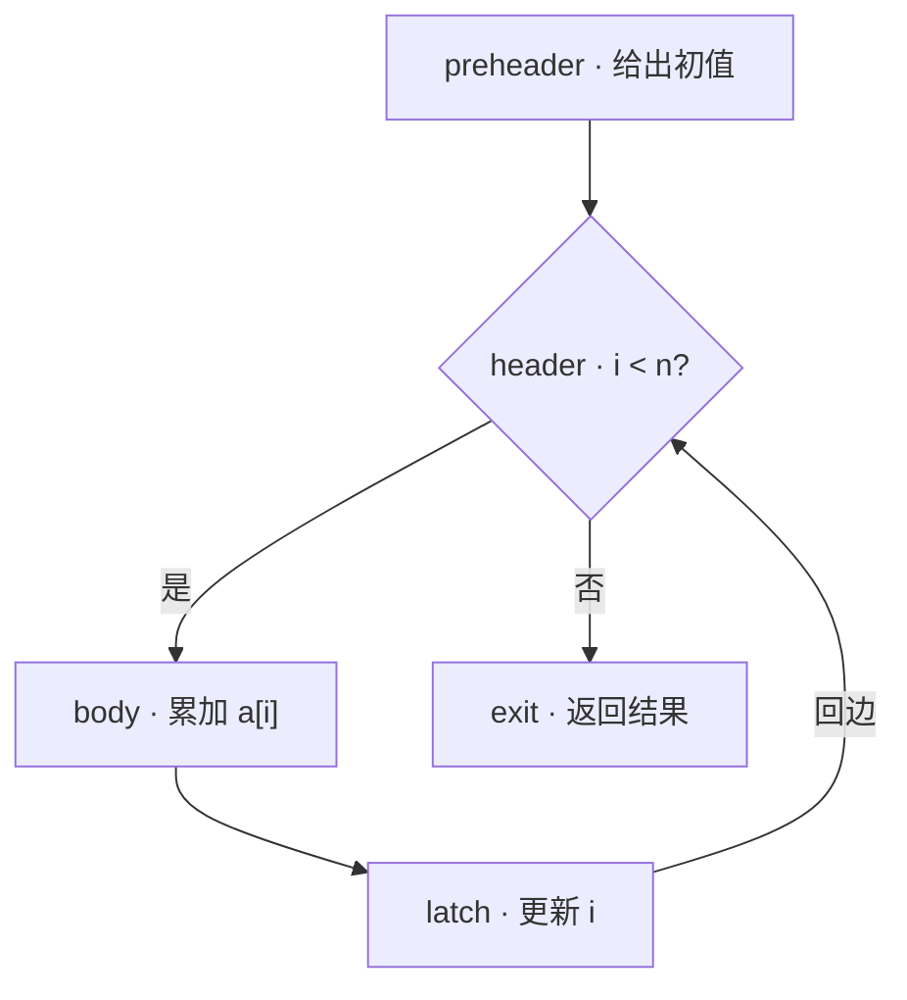

# LEC 16 · 循环优化

SE3355 编译原理 · 2026 秋　[本讲课件（85 页）](../lectures/LEC-16-Global-Optimization-III.pptx)

一条 `base = p + offset` 在 IR 里只写了一次，放在循环体内却可能执行一百万次。如果 p 和 offset 每轮不变，能否只算一次？要回答它，先找出哪些块属于循环，再检查提前计算会不会让原本跳过这条指令的路径也执行它。

本文页码从封面计数。第 10 页起，页脚编号比实际顺序小 2。代码为教学 IR，φ 的每项写作 `[值, 前驱块]`。[支配关系与支配树](LEC-15-Global-Optim-II.md)

## 怎样从 CFG 找出自然循环（p.2–21）



| 名称 | 如何在 CFG 中识别 |
| --- | --- |
| **header**（循环头） | 从外部进入自然循环都要先经过的块。它支配循环内每个块 |
| **latch**（回边起点） | 有一条边返回 header 的循环内基本块。一个 header 可以对应多个 latch |
| **backedge**（回边） | 对边 `n → h`，若 `h` 支配 `n`，它就是本讲定义的回边。支配要求从函数入口到 `n` 的每条路径都经过 `h` |
| **exiting block / exit block** | 退出边的起点在循环内，称为 exiting block。终点在循环外，称为 exit block。上图中分别为 header 和 exit，一个循环也可以有多条退出边 |
| **preheader**（循环预头） | 位于循环外，汇集所有从外部到 header 的控制流，唯一后继是 header |

图中的 `latch → header` 是回边，因为函数入口到 latch 的每条路径都经过 header。有些环无法这样认出唯一的循环头。例如外部可以分别直接进入环上的 c 和 d，那么 c 和 d 彼此都不支配。

给定回边 `n → h`，从 n **逆着前驱边找**，到 h 就停。这会找全所有不经 h 又能到 n 的循环内节点。先把 h 标为已见，避免越过它误收集外部前驱。

```text
naturalLoop(n, h):                  # 已知 n → h 且 h 支配 n
    loop = {h}
    worklist = [n]
    while worklist 非空:
        x = worklist.pop()
        if x in loop:
            continue
        loop.add(x)
        worklist.extend(可达 CFG 中 x 的前驱)
    return loop
```

上图得到 `{header,body,latch}`。若 h 是自环，结果只有 `{h}`。若多条回边指向同一 header，可分别求出循环块集合，再取并集。若一个循环的块集合严格包含另一个，两者在循环树中形成嵌套关系。矩阵按行扫描时，行基址相对内层列循环不变，相对外层行循环则会变。

preheader 把外部的入环路径汇在一处。若 entry 还可能直接去 other，把计算放到 entry 就会影响 other，而放在专用 preheader 只影响选了入环路径的执行。**进入 preheader 仍不保证循环体执行一次**，因为 header 可能马上退出。

插入 preheader 时也要改 φ。若原来 header 的 φ 从外部 A、B 分别接 1 和 2，从 latch 接 `next`，插入 preheader 后可在 preheader 写 `init = φ [1,A],[2,B]`，再在 header 写 `i = φ [init,preheader],[next,latch]`。这样走 A、B 的初值才都能保留。

## 循环不变代码什么时候能外提（p.22–38）

先找值在各轮之间不变的指令。常量和循环外定义的 SSA 值天然不变。如果纯运算只依赖这些值，结果也不变。设 `%x` 和 `%y` 在循环外定义，`%i` 是循环计数器，沿 def-use 链反复标记就能找到以下候选。

| 循环内的指令 | 沿 def-use 链传播的结论 |
| --- | --- |
| `%a = add %x, 4` | 两个输入一开始就不变，可标记 `%a` |
| `%b = mul %a, %y` | 得知 `%a` 不变后，可标记 `%b` |
| `%c = sub %b, 1` | 接着可标记 `%c` |
| `%d = add %c, %i` | `%i` 是每轮递增的计数器，这条规则无法把 `%d` 标为不变 |

找出不变量后，再判断是否能移到 preheader。循环不变代码外提（LICM）需要检查执行路径、操作数、内存和副作用。

| 检查 | 能暴露问题的输入或路径 |
| --- | --- |
| 原指令是否必经，或额外执行一次是否安全？ | `n = 0` 时 body 可以一次都不执行。原来被条件保护的 `10 / x` 若在 `x = 0` 时提前计算，可能引入除零。 |
| 操作数在新位置是否可用？ | `b = a * 2` 若依赖也要外提的 a，先移 a 再移 b。新定义应支配所有使用。φ 的使用按入边检查。 |
| 读到的内存是否稳定？ | 即使 p 不变，`store v,q` 或未知调用也可能改写 `load p` 的内容。还要证明新位置上 p 可安全读取。 |
| 次数和顺序是否可观察？ | `log(x)` 即便每次都接收相同的 x，调用 N 次与调用一次仍有不同的输出。 |

课件在简化 CFG 上用“候选所在块支配所有 exiting block”检查正常退出前是否必经。提前 `return` 也要算作离开循环的路径。若可能先抛异常，或者一直留在某个内层循环，还得检查外提是否会让本来走不到的操作提前执行。

下面的循环在 body 末尾判断是否继续，假定进入时 `n ≥ 1`。原来每轮都要算的 `%base` 已移至 pre。`gep i8` 的偏移单位是字节，`gep i32` 的索引单位是 4 字节元素。

```text
pre:
    %base = gep i8, %p, %offset
    br header
header:
    %i   = phi [0, pre], [%i.next, body]
    %sum = phi [0, pre], [%sum.next, body]
    br body
body:
    %addr     = gep i32, %base, %i
    %v        = load i32, %addr
    %sum.next = add %sum, %v
    %i.next   = add %i, 1
    %done     = icmp eq %i.next, %n
    br %done, exit, header
exit:
    ret %sum.next
```

`%addr` 随 `%i` 变化，所以不能顺带把 load 也搬出去。移动 `%base` 后，N 次地址计算变为一次，代价是这个值要在更长的一段代码中占用寄存器。

## 归纳变量怎样省去重复乘法（p.39–50）

若循环头有 `i = φ [init,pre],[next,latch]`，回边给出 `next = i + s`，且步长 s 不变，那么 i 是**基本归纳变量**。若 `v = a × i + b` 且 a、b 不变，v 是派生归纳变量。即使 s 到运行时才确定，只要本次循环中 s 和 a 固定，相邻两轮 v 的差就是 `a × s`。

```text
v₀   = a × init + b
vₖ₊₁ = a × (iₖ + s) + b
     = (a × iₖ + b) + a × s
     = vₖ + a × s
```

把初值和 `delta = a × s` 放到 preheader，在 header 用 φ 取本轮 v，latch 中加上 delta。这叫**强度削弱**。

```text
pre:
    %v0 = a × init + b
    %delta = a × s
    br header
header:
    %v = phi [%v0, pre], [%v.next, latch]
    ... 使用 %v 代替原来的 a × %i + b ...
latch:
    %v.next = add %v, %delta
    br header
```

例如 `i = 3,5,7,…`，则 `v = 5i + 1` 依次为 16、26、36，每轮加 10。变换必须符合 IR 的溢出和舍入语义。是否能省指令还取决于硬件。x86 的 `[base + index*4]` 可以直接寻址，额外维护一个指针可能更贵。若步幅直到运行时才确定，逐轮加上步幅就可能省掉一次乘法。

## 展开怎样处理循环尾部（p.51–61）

2 倍展开让相邻两轮共用一次比较和回边。以 `sum += a[i]` 为例，每份副本要有自己的 SSA 名字。第二份从第一份算出的 `%sum.1` 继续，最后一个结果 `%sum.2` 才送回循环头。这样即使有累加依赖，也保留原来的运算顺序。

设 `n ≥ 0`、下标从 0 开始、步长为 1。令 `mainCount = n − n % 2`，主循环只处理完整的两项，尾部最多再处理一项。

```text
pre:
    %rem       = urem %n, 2
    %mainCount = sub %n, %rem
    br header
header:
    %i   = phi [0, pre], [%i.next, latch]
    %sum = phi [0, pre], [%sum.2, latch]
    br %i < %mainCount, body, remainder
body:
    %x.0   = load a[%i]
    %sum.1 = add %sum, %x.0
    %i.1   = add %i, 1
    %x.1   = load a[%i.1]
    %sum.2 = add %sum.1, %x.1
    br latch
latch:
    %i.next = add %i, 2
    br header
remainder:
    br %i < %n, tail, exit
tail:
    %x.r   = load a[%i]
    %sum.r = add %sum, %x.r
    br exit
exit:
    %result = phi [%sum, remainder], [%sum.r, tail]
    ret %result
```

| n | 主循环读取的下标 | 余数路径读取的下标 | 出口取值 |
| --- | --- | --- | --- |
| 0 | 无 | 无 | `%sum`，即初值 0 |
| 1 | 无 | 0 | `%sum.r` |
| 3 | 0、1 | 2 | `%sum.r` |
| 4 | 0、1 和 2、3 | 无 | `%sum`，含两组的结果 |

推广到 U 倍，主循环处理 `n − n % U` 项，尾部处理 `n % U` 项。若某份副本执行了 `break`，后面的副本必须跳过，出口也应拿到当时的值。展开减少比较和跳转，但会增加代码大小、指令缓存和寄存器压力。

## 向量化需要哪些迭代可以一起算（p.62–74）

四倍展开可以按顺序做四次标量加法。四路向量化则将相邻四次迭代的同类操作组合起来。对 `c[i] = a[i] + b[i]`，向量中的第 j 项（lane）对应原下标 `i+j`，一条 SIMD 加法完成四对加数的计算。

```text
%va = load <4 x i32>, ptr %pa
%vb = load <4 x i32>, ptr %pb
%vc = add <4 x i32> %va, %vb
store <4 x i32> %vc, ptr %pc
```

为宽度 W 选择向量类型，主循环每组读写 W 项并将索引加 W，剩余项走标量路径。因此最后一次向量读取也必须完全位于合法范围内。`<4 x i32>` 一共是 128 位。目标机器能处理的向量宽度、访存对齐、重排和尾部成本都会影响收益。

`a[i] = a[i-1] + 1` 中，第 i 轮依赖上一轮刚写的值。这种**循环携带依赖**可能藏在两个不同的指针后面。以 `p[i] = q[i] + 1` 为例，能否一起算取决于 p 和 q 的地址关系。

| 已知的地址关系 | 对迭代的影响 |
| --- | --- |
| 两段访问范围不重叠 | 写入 `p[i]` 不会改动后续读取的 `q[j]`。该循环中的元素可按组处理 |
| `p = q + 1`，按元素计 | 第 i 轮写 `p[i]` 等于写 `q[i+1]`，恰好供下一轮读取。直接向量化会改变读到的值 |
| 编译期无法确定 | 可生成运行时范围检查。不重叠时走向量版，可能重叠时走保留原顺序的标量版 |

设 `p = q + 1`、`q[0..4] = [10,0,0,0,0]`。顺序做四轮，`q[1..4]` 逐项变成 `[11,12,13,14]`。若先把四个输入一起读走，就只会算出 `[11,1,1,1]`。反过来，若 `p == q`，每轮只读写自己的下标，本例没有跨迭代依赖。要检查的是**一轮的写入会不会影响另一轮的读取**。

## 把三种优化用在同一个循环（p.75–85）

设输入与输出的访问范围不重叠，每个元素占 4 字节，p、offset、bias 在循环中都不变。

```text
for i = 0 .. n-1:
    base = p + offset
    addr = base + i * 4
    c[i] = load_i32(addr) + bias
```

先外提 `base = p + offset`。再把 `base + 4*i` 改成逐步递增的地址。最后四个元素一起读、加、写，向量循环每次地址加 16 字节，尾部逐个处理。

```text
i = 0
addr = p + offset
mainCount = n - n % 4
while i < mainCount:
    v = load4(addr)
    store4(&c[i], v + splat(bias))
    i = i + 4
    addr = addr + 16
while i < n:
    c[i] = load_i32(addr) + bias
    i = i + 1
    addr = addr + 4
```

`splat(bias)` 把同一个标量复制到四个 lane。取 `n = 6`，主循环处理下标 0–3，尾部从 `i = 4`、`addr = base + 16` 继续处理 4 和 5。两段代码在交界处都满足 `addr = base + 4*i`。

选择其他循环变换时，同样要先核对依赖，再考虑访存和硬件成本。

| 变换 | 改变了什么 |
| --- | --- |
| 循环交换（interchange） | 调换嵌套循环次序，例如让连续存储的维度成为内层 |
| 循环融合（fusion） | 合并相邻循环，让生产与消费靠近，减少中间数据读写 |
| 循环拆分（fission） | 将同一循环中的不同计算分开，分别安排访存或并行执行 |
| 循环分块（tiling） | 把迭代空间切成小块，在块内复用缓存中的数据 |
| 循环倾斜（skewing） | 改变嵌套循环的迭代坐标，使依赖允许的并行执行顺序更易安排 |

GPU 和 AI 编译器还要把迭代映射到线程、向量或张量计算单元。分块让数据留在缓存或共享内存里反复使用，融合可以省去中间张量的读写。最终仍由后端完成指令选择、寄存器分配与指令调度。

## 自测

1. 图中若再加 `body → exit`，自然循环会变大吗？不会。从 latch 反查的集合不变。现在 header 和 body 都是 exiting block，退出边都通向同一个 exit block。
2. `if (flag) use(load p)` 的 p 在循环中不变，又没有其他写入，能直接外提 load 吗？还缺执行安全的证明。flag 一直为假时，原程序根本不会读 p。
3. 二倍展开的求和若把 `%sum.1` 错接到回边，输入 `[2,3,5,7]` 会返回多少？第一组只传回 2，第二组只传回 `2+5=7`，最终返回 7。正确回接 `%sum.2` 才会得到 17。
