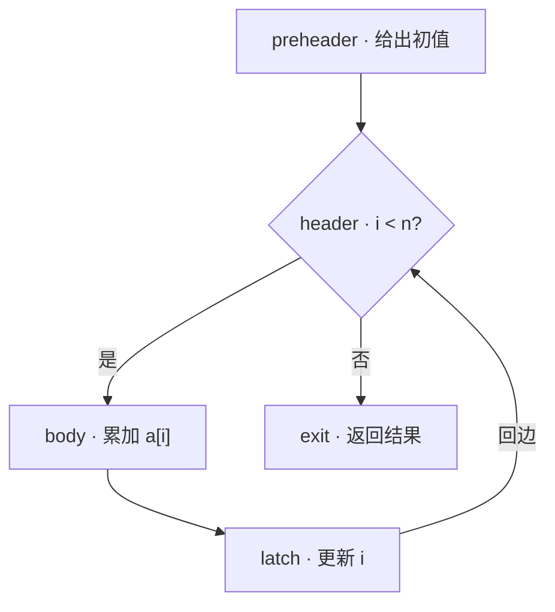

# LEC 16 · Global Optimization (III)

> SE3355 编译原理（2026 秋）· 程序优化（三）
>
> 课件共 85 张。下文的 p.n 从封面起按实际顺序计数。p.8–9 是回顾页，从 p.10 起，页脚编号比实际顺序小 2。[本讲课件](../lectures/LEC-16-Global-Optimization-III.pptx)
>
> 前置知识包括控制流图（CFG）、静态单赋值形式（SSA）、φ 指令和支配关系。[上一讲笔记](LEC-15-Global-Optimization-II.md)
>
> 代码采用教学 IR，省略部分类型和跳转标签。φ 的每个 `[值, 前驱块]` 表示沿该前驱的入边到达时选用的值。

## 1. 循环里的动态重复（p.2–9）

上一讲用全局值编号（GVN）识别等价计算。若旧定义支配第二条 `add %x, %y`，公共子表达式消除（CSE）就可以让它复用第一条相同加法的结果。如果整个函数只有一条这样的加法，放在循环体里，它仍可能执行一百万次。**静态指令数**统计 IR 中有几条指令，**动态执行次数**统计程序运行时实际执行了几次。循环优化主要改变后者。

| 循环中的现象 | 可利用的事实 | 对应变换 |
| --- | --- | --- |
| 每轮都计算 `t = a + b` | `a`、`b` 在循环中保持不变 | 循环不变代码外提（LICM），在进入循环前计算 `t` |
| 每轮都计算 `base + i * 4` | `i` 每次加 1，相邻地址相差 4 字节 | 强度削弱，沿用上一地址并加 4 |
| 每处理一个元素都要比较和跳转 | 连续几轮可以共用一次循环控制 | 循环展开，一轮顺序处理多个元素 |
| 相邻迭代分别执行相同的标量运算 | 若迭代间无妨碍并行的依赖，可同时求值 | 循环向量化，用一条 SIMD 指令处理多个元素 |

## 2. 从 CFG 识别自然循环（p.10–21）

### 2.1 回边、循环头与出口

源码中的 `for` 降低为基本块和跳转。以 `for (i = 0; i < n; i++) sum += a[i]` 为例，循环条件、累加和计数器更新可以分别落在三个块中。



| 名称 | 如何在 CFG 中识别 |
| --- | --- |
| **header**（循环头） | 从外部进入自然循环都要先经过的块。它支配循环内每个块 |
| **latch**（回边起点） | 有一条边返回 header 的循环内基本块。一个 header 可以对应多个 latch |
| **backedge**（回边） | 对边 `n → h`，若 `h` 支配 `n`，它就是本讲定义的回边。支配要求从函数入口到 `n` 的每条路径都经过 `h` |
| **exiting block / exit block** | 退出边的起点在循环内，称为 exiting block。终点在循环外，称为 exit block。上图中分别为 header 和 exit，一个循环也可以有多条退出边 |
| **preheader**（循环预头） | 位于循环外，汇集所有从外部到 header 的控制流，唯一后继是 header |

一条回边 `n → h` 确定一个以 `h` 为唯一入口的**自然循环**。检查箭头方向还不足以识别它。p.14 的 `c → d → c` 构成环，但路径 `a → b → d` 能绕过 `c`，路径 `a → c` 能绕过 `d`。两个节点都不能担任整个环的 header，单入口循环的算法不能直接套用。

### 2.2 从 latch 反向找出循环体

先在从函数入口可达的 CFG 中找到一条回边。除 `h` 本身，属于该回边自然循环的节点都能沿一条不经过 `h` 的路径到达 `n`。因此从 `n` 反向查前驱，到 `h` 为止。

```text
naturalLoop(n, h):                  # 已知 n → h 且 h 支配 n
    loop = {h}
    worklist = [n]
    while worklist 非空:
        x = worklist.pop()
        if x in loop:
            continue
        loop.add(x)
        worklist.extend(可达 CFG 中 x 的前驱)
    return loop
```

上图的回边是 `latch → header`。先收进 latch，再从 `pred(latch)` 收进 body。body 的前驱 header 已在集合中，停止向外扩展。结果为 **`{header, body, latch}`**。这一步既不会越过 header 把 preheader 收进来，也不会沿退出边走到 exit。对于自环 `h → h`，同一算法直接返回 `{h}`。若同一 header 有多条回边，可分别求集合，再取并集。

### 2.3 preheader 与嵌套循环

若原来的 entry 执行 `br go, header, other`，直接把指令移到 entry 会让走向 other 的路径也执行它。拆出 `entry → preheader → header` 这条入环路径后，走向 other 的路径就绕开了新指令。**每次从外部进入 header 时，preheader 执行一次。** 若 header 第一次检查就退出，循环体仍可能执行零次。这一区别决定哪些指令可以提前执行。

对嵌套循环，可分别从回边求出块集合。若 `L_inner ⊂ L_outer`，内层循环属于外层循环，按包含关系可以建循环树。优化通常先看内层。一个值也可能只相对于内层不变，例如矩阵按行扫描时的行基址。

## 3. 循环不变代码外提 LICM（p.22–38）

### 3.1 如何发现不变值

对同一次进入循环的执行，若一项计算每次执行都得到相同的值，就称它相对于该循环**不变**。Loop-Invariant Code Motion（LICM）先发现这些值，再判断其定义能否移到 preheader。

从常量和循环外定义的 SSA 值开始。对结果只由操作数决定的指令，若所有操作数都已知不变，就把结果加入集合。可以反复扫描整个循环，直到集合不再扩大，也可以用 worklist 只重查受影响的指令。

```text
Inv = 常量 ∪ 循环外定义的值
worklist = 循环内所有有结果的指令
while worklist 非空:
    I = worklist.pop()
    if result(I) ∉ Inv and I 的结果只由操作数决定 and operands(I) ⊆ Inv:
        Inv.add(result(I))
        worklist 加入在本循环内使用 result(I) 的指令
```

每个 SSA 值最多加入 Inv 一次。以下面的依赖链为例，假定 `%x`、`%y` 在循环外定义。

| 循环内的指令 | 沿 def-use 链传播的结论 |
| --- | --- |
| `%a = add %x, 4` | 两个输入一开始就不变，可标记 `%a` |
| `%b = mul %a, %y` | 得知 `%a` 不变后，可标记 `%b` |
| `%c = sub %b, 1` | 接着可标记 `%c` |
| `%d = add %c, %i` | `%i` 是每轮递增的计数器，这条规则无法把 `%d` 标为不变 |

SSA 表示每个名字只有一处静态定义。循环头的 `%i = phi [0, pre], [%i.next, latch]` 每次执行会按入边取值，同一个名字在不同迭代可以取到 0、1、2 等不同值。普通 `load` 还读取内存状态，`call` 也可能访问外部状态，两者都需要额外的证明。

### 3.2 外提前的四项检查

| 检查 | 要证明什么 | 课件中的判断 |
| --- | --- | --- |
| **执行路径** | 到达新位置时，原指令必然执行，或者额外执行一次也安全（可推测执行） | 分支保护的 `sdiv 10, %x` 可能从未执行。若 `%x = 0`，无条件提前求值会暴露除零问题。普通无副作用、无异常的整数加法则可推测执行 |
| **SSA 与支配** | 操作数的定义在新位置可用，移动后的定义支配它的各处使用 | 对 `%b = mul %a, 2`，先移动 `%a` 的定义，再移动 `%b`。φ 的输入沿对应前驱边检查 |
| **内存值** | 候选 load 访问同一地址，并且其读取的内容稳定 | 若循环中有 `load %p` 和 `store %x, %q`，`NoAlias` 可排除这次写的影响。`MayAlias` 时仅凭地址不变无法外提。其他可能写入的指令或调用也要检查 |
| **副作用** | 保持可观察操作的次数与顺序 | 即使 `%x` 不变且每轮必经，外提 `log(%x)` 也会把原来的 N 次输出压成一次 |

p.29 在简化 CFG 中用“指令所在块支配所有 **exiting block**”检查正常退出前是否必经该块。在前测循环里，header 本身就可能直接退出，body 因而不满足这个条件。`mayTrap` 和 `mayHaveSideEffects` 等指令属性可用于判断能否推测执行。

**补充理解**　遇到可能提前抛出异常的指令或不退出的内部路径，还要检查这些路径能否绕过候选指令，以及提前执行是否改变可观察顺序。即便别名检查已通过，外提 load 也要保证在新位置读取该地址安全。

### 3.3 手工判断哪些指令能移（p.34–38）

课件的求和循环在 body 末尾判断是否继续。以下沿用该形状，假定进入它时 `n ≥ 1`。地址加法写作 `gep i8` 时按字节偏移，`gep i32` 则按 4 字节元素索引。原来在 body 开头计算的 `%base` 已移至 pre。

```text
pre:
    %base = gep i8, %p, %offset
    br header
header:
    %i   = phi [0, pre], [%i.next, body]
    %sum = phi [0, pre], [%sum.next, body]
    br body
body:
    %addr     = gep i32, %base, %i
    %v        = load i32, %addr
    %sum.next = add %sum, %v
    %i.next   = add %i, 1
    %done     = icmp eq %i.next, %n
    br %done, exit, header
exit:
    ret %sum.next
```

`%p` 和 `%offset` 在 pre 已可用，求地址本身没有访存或可观察副作用，pre 又支配使用 `%base` 的那条 `gep i32`，因此可以移动 `%base`。`%addr` 含有本轮的 `%i`，各轮 load 读取不同地址，无法证明 `%v` 不变。`%sum.next`、`%i.next` 和 `%done` 都依赖本轮状态，仍在循环内计算。

执行 N 轮时，计算 `%base` 的静态指令仍只有一条，动态执行次数从 N 降到 1。代价是 `%base` 的活跃区间变长，可能增加寄存器压力。在允许零次迭代的循环里，一项可安全推测的计算也可能白做一次。

## 4. 归纳变量与强度削弱（p.39–50）

### 4.1 从 φ 读出递推式

```text
header:
    %i = phi [%init, pre], [%next, latch]
    ...
latch:
    %next = add %i, %step
    br header
```

第一次从 pre 进入，φ 取初值。以后从 latch 返回，φ 取上轮的 `%next`。若 `%step = s` 在循环内不变，就识别出一个**基本归纳变量**，满足 `i₀ = init`、`iₖ₊₁ = iₖ + s`。实际有多个 latch 时要核对每条回边带来的更新，课件推导使用单 latch。

若另一项计算能写成 `vₖ = a × iₖ + b`，其中 `a`、`b` 相对于当前循环不变，`v` 就是**派生归纳变量**。从已识别的归纳变量沿 use 继续应用该规则，可以识别多层派生。数组地址 `base + i × elemSize` 是一例。矩阵地址 `base + i × rowStride + j × elemSize` 中，若内层只递增 `j`，则行基址不变，每个元素地址相差 `elemSize`。多维张量的各维步幅也是同样的计算。

### 4.2 仿射式怎样改成增量更新

```text
v₀   = a × init + b
vₖ₊₁ = a × (iₖ + s) + b
     = (a × iₖ + b) + a × s
     = vₖ + a × s
```

每轮增量是 **`a × s`**。强度削弱（strength reduction）把初值和增量移到循环外计算，用一次加法生成下一轮的值。新递推对应三个 SSA 位置。

```text
pre:
    %v0 = a × init + b
    %delta = a × s
    br header
header:
    %v = phi [%v0, pre], [%v.next, latch]
    ... 使用 %v 代替原来的 a × %i + b ...
latch:
    %v.next = add %v, %delta
    br header
```

如 `i` 从 0 开始、步长为 1，`addr = base + 4 × i` 的初值就是 `base`，每轮递增 4 字节。推导要求等式在具体 IR 的运算语义下成立。带 `nsw` 或 `nuw` 的整数运算要检查新的各步运算是否满足相应的无溢出条件，浮点变换还要考虑舍入。

### 4.3 什么时候能省下机器指令

在 x86-64 上，`mov eax, dword ptr [rdi + rsi*4]` 能把比例因子 4 编入访存指令。原本就没有单独的乘法可删，额外维护地址递推可能反而增加指令。若步幅到运行时才知道，原式可能每轮需要 `imul` 计算 `i × stride`。保留上轮地址后，每轮只需加上 `stride`。

递推也引入新的 φ、跨迭代依赖和需要持续占用寄存器的值。编译器即使决定保留原式，已知的步幅、访问次序和距离仍能用于依赖分析、向量化或分块。**分析得到仿射关系之后，是否生成递推代码还取决于目标机器的成本。**

## 5. 循环展开（p.51–61）

### 5.1 两份循环体怎样串接

以 `sum += a[i]` 为例，2 倍展开让相邻两项共用一次主循环的比较和回边。保留原有的累加顺序，一组内的计算就是 `(sum + a[i]) + a[i+1]`。这里有循环携带依赖，仍可以顺序展开。

直接复制 SSA 文本会重复定义 `%x` 和 `%sum.next`，两份副本也会错误地使用同一个旧 `%sum`。改写时，每份副本都要获得新名字，用一条指令定义第二个索引 `%i.1`，把第一份的 `%sum.1` 交给第二份，再把第二份的 `%sum.2` 接回 header 的 φ。这样下一组才会从已累计两个元素的结果继续。

### 5.2 主循环、余数路径与出口 φ

若只把步长改为 2，`n = 3` 时第二组会同时读取 `a[2]` 和越界的 `a[3]`。对从 0 开始、单位步长、共 `n ≥ 0` 次迭代的循环，令 **`mainCount = n - n % 2`**。它是不超过 n 的最大偶数。先在 header 检查整组是否装得下，再开始读数组。

```text
pre:
    %rem       = urem %n, 2
    %mainCount = sub %n, %rem
    br header
header:
    %i   = phi [0, pre], [%i.next, latch]
    %sum = phi [0, pre], [%sum.2, latch]
    br %i < %mainCount, body, remainder
body:
    %x.0   = load a[%i]
    %sum.1 = add %sum, %x.0
    %i.1   = add %i, 1
    %x.1   = load a[%i.1]
    %sum.2 = add %sum.1, %x.1
    br latch
latch:
    %i.next = add %i, 2
    br header
remainder:
    br %i < %n, tail, exit
tail:
    %x.r   = load a[%i]
    %sum.r = add %sum, %x.r
    br exit
exit:
    %result = phi [%sum, remainder], [%sum.r, tail]
    ret %result
```

`urem` 表示无符号取余。主循环退出时 `%i = %mainCount`，`%sum` 已经累加下标小于 `%mainCount` 的所有元素。出口 φ 根据实际来路选择结果。

| n | 主循环读取的下标 | 余数路径读取的下标 | 出口取值 |
| --- | --- | --- | --- |
| 0 | 无 | 无 | `%sum`，即初值 0 |
| 1 | 无 | 0 | `%sum.r` |
| 3 | 0、1 | 2 | `%sum.r` |
| 4 | 0、1 和 2、3 | 无 | `%sum`，含两组的结果 |

### 5.3 推广到 U 倍展开

1. 复制循环体 U 份，为每个定义重命名。第 j 份读取第 j−1 份更新后的循环携带值。
2. 最后一份的结果接到各个 header φ 的回边输入。一组覆盖 U 次原迭代，原计数器步长若为 s，组与组的起点相差 `U × s`。
3. 对上述单位步长循环，主循环处理前 `n - n % U` 项，余数循环按原顺序处理剩下的 `n % U` 项。在每个出口接好对应的最终值。

合法性要求每次原迭代恰好执行一次，并保持副作用、可能异常的操作及其先后顺序。若第一份副本中的 `break` 已触发，就必须跳过其余副本，并传出该出口上的值。终止条件依赖循环体计算时，也不能直接假设整组都要执行。

展开倍数越大，比较和分支可以摊到更多元素上，调度器也能同时看到更多指令。代码体积、指令缓存压力、寄存器需求，以及设置主循环边界和处理尾部的成本都会影响最终选择。

## 6. 循环向量化（p.62–74）

### 6.1 展开四次与四个 lane 的区别

对 `c[i] = a[i] + b[i]`，4 倍展开在一组中仍做 4 次标量加法。4-lane 向量化把这四对加数装成两个向量，进行一次逐 lane 的加法。**lane j 对应原来的第 `i+j` 次迭代**。两种变换可以分别使用，也可以继续展开一个已向量化的循环。

```text
%va = load <4 x i32>, ptr %pa
%vb = load <4 x i32>, ptr %pb
%vc = add <4 x i32> %va, %vb
store <4 x i32> %vc, ptr %pc
```

`<W x T>` 表示由 W 个 T 类型元素组成的向量。上例的两次 load 各读连续四个整数，加法计算 `vc[j] = va[j] + vb[j]`，store 把四个结果写回。SIMD（Single Instruction, Multiple Data，单指令多数据）为这种 IR 提供硬件支持。例如固定宽度为 128、256、512 位时，分别可容纳 4、8、16 个 `i32`。课件列举的固定宽度实例包括 x86 的 SSE、AVX2、AVX-512 和 Arm 的 NEON。Arm SVE/SVE2 与 RISC-V V 的实际向量宽度由具体实现决定。

### 6.2 构造向量主循环

1. 根据元素类型和目标 SIMD 选择 W，检查组内 W 次迭代能否一起执行。
2. 和展开一样，用 `mainCount = n - n % W` 建立步长为 W 的主循环，修复头部 φ、回边和出口，在尾部补上不足 W 项的标量循环。
3. 将各次迭代中相对应的指令分组（instruction pack）。例如，从 `a` 读取的 W 条标量 load 合成一次向量 load，从 `b` 读取的也合成一次。用新的向量操作数构造向量 add，让 store 消费这个向量结果，同时核对类型和 def-use 关系。

这是理解改写的顺序。编译器可以直接构造向量循环，无需先生成 W 份完整的标量 IR。只读写一个元素的标量尾部也保证最后一次向量访存不会越过数组边界。

### 6.3 为什么相邻下标仍可能有依赖

`a[i] = a[i-1] + 1` 的第 i 轮读取上一轮刚写入的值。若把一组旧值一次性载入，再同时计算，一组内后几个 lane 会读到过时的数据。这是**循环携带依赖**（loop-carried dependence）。普通逐 lane 改写需要排除这种会被重排破坏的依赖，或另行证明专门的变换。

课件用 `p[i] = q[i] + 1` 说明依赖也可能隐藏在指针后面。

| 已知的地址关系 | 对迭代的影响 |
| --- | --- |
| 两段访问范围不重叠 | 写入 `p[i]` 不会改动后续读取的 `q[j]`。该循环中的元素可按组处理 |
| `p = q + 1`，按元素计 | 第 i 轮写 `p[i]` 等于写 `q[i+1]`，恰好供下一轮读取。直接向量化会改变读到的值 |
| 编译期无法确定 | 可生成运行时范围检查。不重叠时走向量版，可能重叠时走保留原顺序的标量版 |

**补充推演**　令 `q[0..4] = [10, 0, 0, 0, 0]`、`p = q + 1`。串行执行四轮后，`q[1..4]` 为 `[11, 12, 13, 14]`。若提前把四个输入全部载入，读到的是 `[10, 0, 0, 0]`，结果就成了 `[11, 1, 1, 1]`。

通过合法性检查后，还要估算收益。连续访存和向量算术可能提高吞吐量，短循环却可能把大部分时间花在范围检查、主循环边界和尾部处理上。广播、数据重排、结果提取及目标机器对访存对齐的要求也会影响选择。

## 7. 用三种变换优化同一个循环（p.75–79）

设输入、输出的访问范围互不重叠，`p`、`offset` 和 `bias` 在循环中不变，每个元素是 4 字节整数。下例中 `addr` 的加法以字节为单位，`c[i]` 的下标以元素为单位。原循环每轮做三件事。

```text
for i = 0 .. n-1:
    base = p + offset
    addr = base + i * 4
    c[i] = load_i32(addr) + bias
```

| 变换 | 在这个循环里利用了什么 | IR 如何变化 |
| --- | --- | --- |
| LICM | `p + offset` 安全且循环不变 | 在 preheader 计算 `base` |
| 强度削弱 | 第 i 项和第 i+1 项的地址相差 4 字节 | 以 `base` 初始化 `addr`，标量迭代每次加 4 |
| 4-lane 向量化 | 连续 4 个元素可以一起读、算、写 | 每组将 `i` 加 4、`addr` 加 16 字节，剩余元素继续按标量处理 |

```text
i = 0
addr = p + offset
mainCount = n - n % 4
while i < mainCount:
    v = load4(addr)
    store4(&c[i], v + splat(bias))
    i = i + 4
    addr = addr + 16
while i < n:
    c[i] = load_i32(addr) + bias
    i = i + 1
    addr = addr + 4
```

`splat(bias)` 将同一个标量复制到四个 lane。用 `n = 6` 检查交界处，向量主循环处理下标 0–3，余数循环从 `i = 4`、`addr = base + 16` 开始处理下标 4、5。两段循环始终保持 `addr = base + 4 × i`。

## 8. 更多循环变换与后端（p.80–85）

循环可能有多个外部前驱、多个 latch 或多个出口。**循环结构标准化**可以建立专用 preheader，整理回边和退出边，让后续变换在统一的 CFG 形状上工作。选用哪一种变换、展开多少倍、分块多大、向量多宽，还取决于依赖、访存模式和目标硬件。间接访存、指针追逐、数据相关的分支都会让这些判断更困难。

| 变换 | 改变了什么 |
| --- | --- |
| 循环交换（interchange） | 调换嵌套循环次序，例如让连续存储的维度成为内层 |
| 循环融合（fusion） | 合并相邻循环，让生产与消费靠近，减少中间数据读写 |
| 循环拆分（fission） | 将同一循环中的不同计算分开，分别安排访存或并行执行 |
| 循环分块（tiling） | 把迭代空间切成小块，在块内复用缓存中的数据 |
| 循环倾斜（skewing） | 改变嵌套循环的迭代坐标，使依赖允许的并行执行顺序更易安排 |

GPU 与 AI 编译器把类似的决策用于张量计算。分块决定数据如何利用缓存、共享内存和寄存器，算子融合减少中间张量读写，布局决定相邻线程能否连续访存。编译器还要把迭代维度映射到 SIMD lane、GPU block/thread 或张量计算单元。

中端完成这些改写后，程序仍使用抽象操作和 SSA 值。后端通过**指令选择、寄存器分配和指令调度**，将其落实到具体指令集、有限寄存器和调用约定上。p.48 的缩放寻址就是两者相接的一例，IR 中看得到的乘法可能已经包含在目标机器的一次访存中。

## 9. 复习自测（补充练习）

1. **在第 2 节的图里再加一条 `body → exit`，自然循环和退出边各有什么变化？**

   从 latch 沿前驱仍只收进 body、header，循环集合不变。现在 header 和 body 都是 exiting block，两条退出边通往同一个 exit block。

2. **`p` 循环不变，循环内也没有写内存，能否把 `if (flag) use(load p)` 的 load 直接外提？**

   还需要证明执行安全。例如 `flag` 始终为假时，原程序可以完全不读 `p`。若在 preheader 无法保证该地址可以安全读取，就应保留这次条件访问。

3. **`i` 从 3 开始，每轮加 2。`v = 5 × i + 1` 的新 φ 应取什么初值，每轮怎样更新？**

   初值为 `5 × 3 + 1 = 16`，增量为 `5 × 2 = 10`。φ 从 pre 接 16，从 latch 接 `v + 10`。前几项是 16、26、36。

4. **2 倍展开求和时，若 header 的 φ 错接 `%sum.1`，输入 `[2, 3, 5, 7]` 会返回什么？**

   第一组依次算出 2 和 5，却只传回 2。第二组从 2 开始，依次算出 7 和 14，却只传回 7。此时没有尾项，出口返回 7。正确回接 `%sum.2` 才会得到 17。

5. **对 `p[i] = q[i] + 1`，若已知 `p == q`，会出现 `p = q + 1` 时的依赖吗？**

   此时每轮只读写同一个下标 i，写入不会影响另一轮的读取。在本例的普通数组访问中，逐 lane 更新仍保留原语义。判断依据是各轮访问的具体位置及先后关系。
