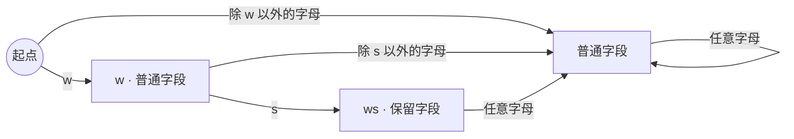

# LEC 17 · 期中复习（Midterm Review）

SE3355 编译原理 · 2026 秋　[本讲课件（84 页）](../lectures/LEC-17-Midterm-Review.pptx)

**考试范围到程序优化 II 的局部公共子表达式消除（Local CSE）为止。** 此前的综述、词法、语法、AST、类型检查、IR 和程序优化 I 都在范围内。课件将程序优化 III、指令选择、寄存器分配和函数式语言列在范围外（p.2）。

Lexer 把字符流切成 token，Parser 按文法恢复语法结构，由此得到 AST。名字和类型确定后，编译器把表达式和控制流翻译为 IR，再依据值与路径做优化。2025 年第 1 题考查 Lexer 如何根据字符和当前模式（mode）切词，第 2 题考查 Parser 如何根据栈顶状态和下一个 token 建树。

## 从字符流到 Local CSE（p.3–26）

### 词法与语法（p.5–19）

**Lexer 每轮从当前位置选择一个匹配。** Token 包含类别（kind）、本次匹配的原文或值（lexeme/value），以及源码位置（span）。例如，`123` 的原文是三个字符，类别可以是整数，数值是 123。当前 mode 决定哪些规则有效，先选能匹配的**最长前缀**，长度相同才选规约里靠前的规则。动作可以返回 token、跳过输入、切换 mode 或报错。

正则表达式用连接、选择和重复描述词的集合。构造自动机时，先用 ε 边组合 NFA，再用子集构造得到 DFA。一个 DFA 状态对应一组 NFA 状态，读一个字符后对可达集合取 ε 闭包。最小化时先按接受结果分组，再按每个字符会转到哪组反复拆分，直到划分稳定。对于 Lexer，接受结果还包括要执行的动作。第 1 题中的 `w` 和 `ws` 都能结束一个词，却会切换到不同的 mode。[正则与词法规约](LEC-2-Lexical-Analysis-Regex.md) · [NFA、DFA 与最小化](LEC-3-Lexical-Analysis-Impl-of-RE.md)

**文法决定同一串 token 怎样分组。** 上下文无关文法（CFG）若允许同一串有两棵分析树，就有歧义。例如 `E → E + E | E @ E | t` 给 `t + t @ t` 留下了两种分组。可用不同层的非终结符表达优先级，用递归的方向表达结合性，也可以给分析器生成器声明这些规则。分析树（parse tree）保留产生式、标点和中间非终结符。AST 则用父子关系保存分组，保留运算、名字和控制结构，供后续阶段使用。

**LL(1) 根据下一个 token 选择产生式。** 给 `A → α` 填表时，先找 α 可用哪些终结符开头，填入 `FIRST(α)` 的相应列。若 `α ⇒* ε`，还要填入可能紧跟 A 的终结符，即 `FOLLOW(A)` 各列。同一格需要两条产生式就有冲突。递归下降前可把左递归的 `E → E + T | T` 改写成 `E → T E′`、`E′ → + T E′ | ε`。遇到公共前缀时，可提取左因子，把选择推迟到能区分两条规则的位置。[LL(1) 预测分析](LEC-5-Top-Down-Parsing.md)

**LR 根据栈顶状态和当前 token 选择动作。** 移进时读一个 token，归约时把栈顶的一段换成产生式左部，再查 GOTO。LR(0) 的普通完成项在所有终结符列归约，SLR 只填左部的 FOLLOW 集，规范 LR(1) 只填该项目自己的展望符。LALR 合并 LR(0) 核心相同的状态并取对应展望符的并集，可能引入新的归约/归约冲突。[LR 分析表的构造](LEC-7-Constructing-LR-Parsing-Gen.md)

### 类型、IR 与优化（p.20–26）

| 阶段 | 手算时记录什么 |
| --- | --- |
| 类型检查 | `Γ ⊢ e : T` 表示在环境 Γ 中表达式 e 具有类型 T。Γ 记录当前可见名字及其类型，进出作用域时要处理遮蔽。检查器递归检查 AST，可先登记声明再检查定义，发现错误后向上传递 Error 以减少级联报错 |
| 类型推导 | 为未知类型引入变量，按 AST 生成约束。合一（unification）把相同类型构造器的参数逐一配对，并在绑定变量时做 occurs check，例如拒绝 `α = List(α)`。在基本的 let 多态规则中，绑定时可泛化类型里未在 Γ 中自由出现的变量，每次使用时用新的类型变量实例化。重载需要筛选候选，再按语言的 `canConvert` 规则插入转换 |
| IR、基本块与 SSA | `a + b * c` 可拆成三地址指令 `t1 = b * c`、`t2 = a + t1`。基本块内指令顺序执行，控制流图（此处 CFG 指 control-flow graph）的边记录可能的后继。SSA 中每个名字只定义一次，如分支 B1 定义 `y1 = -x`、B2 定义 `y2 = x`，汇合处 `y = φ([y1,B1], [y2,B2])` 按实际前驱取值 |
| 数据流分析 | 常量传播向前合并前驱的 OUT，再算 `OUT = transfer(IN)`。活跃性向后求解，`OUT[B] = ⋃ IN[后继]`，`IN[B] = USE[B] ∪ (OUT[B] − DEF[B])`。worklist 只在事实改变后重排受影响的邻块，向前分析重排后继，向后分析重排前驱。各块事实都稳定时达到固定点 |

**Local CSE 需要比较操作数的当前版本。** 在同一基本块中执行下列四行，第二行可以复用 a。第三行重新定义 x，第四行的加法依赖新 x，旧结果便不再适用。表达式表的键由运算符和操作数版本组成。用源变量名维护表时，重定义 x 就要让依赖旧 x 的表项失效。[数据流分析](LEC-14-Global-Optim-I.md) · [Local CSE](LEC-15-Global-Optim-II.md)

```text
a = x + y
b = x + y     →  b = a
x = 0
c = x + y
```

## 2025 年第 1 题 · 词法分析（p.27–63）

消息以 `msg` 和消息名开头，可以有零个或多个普通字段，最后必须有一个 `ws` 字段。**每个字段后面都有逗号，包括右花括号前的最后一个。** 三问共用这份规约，可独立作答。正则表达式占 10 分，Lexer 输出占 10 分，最小化 DFA 占 20 分。

```text
msg Message {
    id: 123,
    name: "compiler",
    ws: "ws://ipads.com/DEADBEEF1234",
}
```

### 1.1 五个正则表达式（p.29–35）

下列模式使用普通正则记法，按整个 lexeme 判断。双引号是要读入的字符，`\.` 匹配域名中的字面点号，普通字符串的字符类中含一个空格。

```text
MSGNAME_REGEX   = [A-Z][A-Za-z0-9]*
STRING_REGEX    = "[A-Za-z0-9 ]*"
NUMBER_REGEX    = 0|-?[1-9][0-9]*
WS_REGEX        = "ws://[0-9]*[A-Za-z][A-Za-z0-9]*(\.[A-Za-z0-9]+)+/([A-F0-9]+|[a-f0-9]+)"
FIELDNAME_REGEX = w|w[A-Za-rt-z][A-Za-z]*|ws[A-Za-z]+|[A-Za-vx-z][A-Za-z]*
```

| 模式 | 为什么这样写 | 可用于验算的边界 |
| --- | --- | --- |
| MSGNAME | 首字符大写，后面允许任意个字母或数字 | `T1` 合法，`message` 和 `_Message` 非法 |
| STRING | 星号允许引号间有零个字符 | `""`、`"a 1"` 合法，`"a!"` 非法 |
| NUMBER | 单列 `0`，其余整数的第一位只能是 1–9 | `-456`、`0` 合法，`012`、`-05`、`-0` 非法 |
| WS | 域名首段至少有一个字母，后面至少有一个由点分隔的非空段。斜杠后至少有一位十六进制字符，整个串必须落在同一个大小写分支 | `"ws://123a.9/012"` 合法。把首段改成 `123`、删掉 `.9` 或把后缀改成 `0f0A` 都会失败 |
| FIELDNAME | 只排除恰好等于小写 `ws` 的纯字母串。四支分别是单独的 `w`、以 `w` 接非 `s` 字母开头、以 `ws` 开头且还有字母、首字母非 `w` | `w`、`wS`、`wsx` 和 `WS` 都是普通字段，`ws` 是保留字段，`field1` 含数字 |

### 1.2 按 mode 手推三组输出（p.36–56）

从 `INIT` 开始。每一步记下当前 mode、匹配的原文、输出及下一个 mode。空格、制表符和换行在各 mode 的 token 之间都能跳过。字符串引号内的合法空格由整个 STRING 一次匹配，仍是值的一部分。

| 当前 mode | 成功匹配 | 下一步 |
| --- | --- | --- |
| `INIT` → `MSG_NAME` → `MSG_BRACE` | 依次读 `msg`、消息名、`{` | 进入 `BODY_LOOP` |
| `BODY_LOOP` | 普通字段名 / 精确的 `ws` | 分别进入 `CUSTOM_COLON` / `WS_COLON` |
| `CUSTOM_COLON` → `CUSTOM_VALUE` → `CUSTOM_END` | 冒号、NUMBER 或 STRING、逗号 | 返回 `BODY_LOOP`，可以继续读字段 |
| `WS_COLON` → `WS_VALUE` → `WS_END` | 冒号、完整 WS 字符串、逗号 | 进入 `END` |
| `END` | `}` | 输出结束消息并返回 |

**Input 1（p.40–52）** 先读普通字段 `question`，再读 `ws`。两个冒号都只切换 mode。下面按每次有输出的动作分行，便于和题面核对。

```text
begin match:
Message Name: Msg
Begin body {
Custom Field: question
Value (Str): "Are labs in compilers full of fun"
End custom field ;
WS Field:
WS : "ws://compiler.ipads.sjtu.edu.cn/DEADBEEF"
End ws field ;
End msg ;
```

**Input 2（p.53）** 的普通字段名 `Error` 合法。错误发生在 `WS_VALUE` 扫描 `"ws://compiler.ipads.sjtu.edu.cn/0f0A/helloworld"` 时。十六进制串混用了 f 和 A，后面又多出一段路径。整条正则连闭引号都要匹配，因此兜底规则 `.` 从起始双引号消费一个字符就触发 ERROR，后面缺少逗号的检查也走不到。报错文字按第 37 页规则使用大写 `WS`，第 53 页演示写成了小写 `ws`。

```text
begin match:
Message Name: Msg1
Begin body {
Custom Field: Error
Value (Str): "Wins come all day under Boss Donald Trump"
End custom field ;
WS Field:
Error: Invalid WS string format
```

**Input 3（p.54–56）** 的 `ws`、冒号和值分在三行。第一个换行发生在 `WS_COLON`，读到冒号后才进入 `WS_VALUE`，第二个换行仍留在 `WS_VALUE`。后缀 `1234abcd` 属于小写十六进制分支。

```text
begin match:
Message Name: QuizRes
Begin body {
Custom Field: answer
Value (Str): "Your Answer is Always Correct"
End custom field ;
Custom Field: score
Value (Num): 100
End custom field ;
WS Field:
WS : "ws://compiler.ipads.sjtu.edu.cn/1234abcd"
End ws field ;
End msg ;
```

### 1.3 怎样画最小化 DFA（p.57–63）

先为各个词画 DFA，再把同一 mode 的有效规则放到同一入口。接受态标明动作，扫描时记住最近一次接受的位置，等匹配无法继续才执行最长匹配对应的动作。画单个正则的 DFA 时，省略的边统一通向死状态。

| 组件 | 画出哪些状态和边 |
| --- | --- |
| MSGNAME | 起点读大写字母进入接受态，任意字母或数字在该态自环 |
| STRING | 起点读开引号进入内容态，字母、数字、空格自环，读闭引号进入接受态。内容态可以直接读闭引号 |
| NUMBER | 起点读 `0` 进入独立接受态。起点或负号后读 `1–9` 进入另一接受态，后者允许 `0–9` 自环。负号后必须先读非零数字 |

**FIELDNAME 与保留字共享前缀。** 下图的节点标出输入在此结束时应选的动作。单画 FIELDNAME 时，`ws` 是非接受态。合入 `BODY_LOOP` 的保留字规则后，`ws` 就有了自己的接受动作。若后面还有字母，如 `wsx`，最长匹配会选完整的普通字段名。



**WS 的状态要记住两个约束。** 固定前缀 `"ws://` 逐字符匹配。余下的转移可以直接由下表画出，第 59 页有对应分图。

| 当前状态 | 合法的下一步 |
| --- | --- |
| 域名首段，尚未见字母 | 数字自环，字母转入“已见字母” |
| 首段已见字母 | 字母或数字自环，点号转入“等待子域首字符” |
| 等待子域首字符 | 读一个字母或数字后进入“子域非空” |
| 子域非空 | 字母或数字自环，点号开始下一个子域，`/` 进入十六进制串起点 |
| 十六进制串起点 | 数字进入“纯数字”，`A–F` 进入“大写”，`a–f` 进入“小写” |
| 纯数字 | 数字自环，仍可读 `A–F` 或 `a–f` 分别转入对应分支，也可读闭引号接受 |
| 大写 / 小写 | 数字或本分支的十六进制字母自环，读闭引号接受 |

“纯数字”必须单列。读完 `12` 后再来 `a` 或 `A` 都合法，读完 `12A` 后再来 `a` 就会失败，这个后缀能区分两态。连接各 mode 时沿用 1.2 的转移，普通字段的逗号回到 `BODY_LOOP`，`ws` 的逗号通往 `END`。第 63 页总图的十六进制边把字母画宽到了 A–Z / a–z，实际字符范围按题意和第 59 页取 A–F / a–f。

## 2025 年第 2 题 · LR(1) 语法分析（p.64–84）

三问依次是项目集状态图（15 分）、ACTION/GOTO 表及冲突判定（15 分）、给定输入的运行轨迹（10 分）。归约编号沿用原题。

```text
0  S → E $
1  E → E + M
2  E → M
3  M → M @ T
4  M → T
5  T → f( M )
6  T → t
```

`f(` 是**一个终结符**，所以规则 5 的右部有三个符号。函数实参所在层是 M。M 先组成 E 的操作数，故 `@` 优先于 `+`，而规则 1 和 3 的左递归使两个运算符各自左结合。原题把开始规则写作 `S → E $`，课件构表时把 `$` 作为输入结束标记，用 `[S → · E, $]` 起步，在 `[S → E ·, $]` 上接受。以下沿用此约定，第 74 页图中的 `E′` 即 S。

### 2.1 项目集、闭包与转移（p.68–75）

在 `[A → α · B β, a]` 中，点表示已经识别到哪里，a 表示**整个 A 完成之后**可能看到什么。求 `closure` 时，为每条 `B → γ` 和每个 `b ∈ FIRST(βa)` 加入 `[B → · γ, b]`。若 β 不能推出 ε，展望符都来自 `FIRST(β)`。若 `β ⇒* ε`，除了 `FIRST(β)` 中的终结符，还要传下 a。特别地，β 为空时只传 a。反复展开直到集合稳定。

```text
I₀ = closure({[S → · E, $]})
    [S → · E,       {$}]
    [E → · E + M,   {$, +}]       [E → · M, {$, +}]
    [M → · M @ T,   {$, +, @}]    [M → · T, {$, +, @}]
    [T → · f( M ),  {$, +, @}]    [T → · t, {$, +, @}]
```

这里的 `+` 来自 `E → · E + M`，内层 E 后面紧跟 `+`，所以 `FIRST(+ M $) = {+}`。`E → · M` 再把 E 的展望符传给 M。同理，`M → · M @ T` 给 M 补上 `@`。同一状态中产生式和点位置相同的项目可以把展望符合写成集合。

求 `goto(I, X)` 时，把 I 中**所有**点后为 X 的项目都移过 X，保留各自的展望符，再取闭包。用 worklist 枚举每个新状态的出边，只有含展望符在内的完整项目集相同才复用编号。例如，`goto(I₀,t) = I₅` 只有完成项 `[T → t ·, {$,+,@}]`。而从 I₀ 读 `f(` 到 I₄ 后，待识别的 M 后面紧跟 `)`，M 的左递归还引入 `@`。此处读 `t` 到达 I₁₁，其完成项是 `[T → t ·, {),@}]`。这就解释了为什么表中 I₅ 与 I₁₁ 分开。

### 2.2 从状态图填写 ACTION / GOTO（p.74–78）

终结符边 `i —a→ j` 写入 `ACTION[i,a] = sj`，非终结符边 `i —A→ j` 写入 `GOTO[i,A] = j`。普通完成项 `[A → β ·, a]` 只在 a 列填对应的 `rk`。增广开始项完成时在 `$` 列填 `acc`。下表前六个符号列是 ACTION，后三列是 GOTO。空格表示无表项，省略了全空的 S 列。沿着表中的移进和 GOTO 项就能逐条还原第 74 页中 19 个状态之间的边。

| 状态 | `+` | `@` | `f(` | `)` | `t` | `$` | E | M | T |
| --- | --- | --- | --- | --- | --- | --- | --- | --- | --- |
| 0  |    |     | s4  |     | s5  |     | 1 | 2  | 3  |
| 1  | s6 |     |     |     |     | acc |   |    |    |
| 2  | r2 | s7  |     |     |     | r2  |   |    |    |
| 3  | r4 | r4  |     |     |     | r4  |   |    |    |
| 4  |    |     | s10 |     | s11 |     |   | 8  | 9  |
| 5  | r6 | r6  |     |     |     | r6  |   |    |    |
| 6  |    |     | s4  |     | s5  |     |   | 12 | 3  |
| 7  |    |     | s4  |     | s5  |     |   |    | 13 |
| 8  |    | s15 |     | s14 |     |     |   |    |    |
| 9  |    | r4  |     | r4  |     |     |   |    |    |
| 10 |    |     | s10 |     | s11 |     |   | 16 | 9  |
| 11 |    | r6  |     | r6  |     |     |   |    |    |
| 12 | r1 | s7  |     |     |     | r1  |   |    |    |
| 13 | r3 | r3  |     |     |     | r3  |   |    |    |
| 14 | r5 | r5  |     |     |     | r5  |   |    |    |
| 15 |    |     | s10 |     | s11 |     |   |    | 17 |
| 16 |    | s15 |     | s18 |     |     |   |    |    |
| 17 |    | r3  |     | r3  |     |     |   |    |    |
| 18 |    | r5  |     | r5  |     |     |   |    |    |

同一格若既要移进又要归约，就是 shift/reduce 冲突，若要按两条不同产生式归约，就是 reduce/reduce 冲突。以状态 12 为例，`E → E + M ·` 只在 `+`、`$` 上归约，`M → M · @ T` 在 `@` 上移进，两者占不同列。全表每个有效格都只有一个动作，所以本题是 **LR(1) 文法，No conflict**。

### 2.3 手推 `f(t@t) @ t + t`（p.79–84）

移进 `sj` 时压入当前终结符和状态 j，同时读入下一个 token。按 `A → β` 归约时，弹出 `|β|` 对符号与状态，再用**弹栈后**的栈顶查 `GOTO[top,A]`，压入 A 和所得状态。归约和 GOTO 都保留当前输入位置。

下表按当前 token 合并课件的 34 步，只列状态栈。每个 `rk→j` 表示按第 k 条产生式归约并查 GOTO 到状态 j。例如初次遇到 `@` 时，`0 4 11` 先经 r6 变为 `0 4 9`，再经 r4 变为 `0 4 8`，这时才移进同一个 `@`。

| 当前 token | 按顺序执行的动作 | 本行结束后的状态栈 |
| --- | --- | --- |
| `f(` | `s4` | `0 4` |
| `t` | `s11` | `0 4 11` |
| `@` | `r6→9`，`r4→8`，`s15` | `0 4 8 15` |
| `t` | `s11` | `0 4 8 15 11` |
| `)` | `r6→17`，`r3→8`，`s14` | `0 4 8 14` |
| `@` | `r5→3`，`r4→2`，`s7` | `0 2 7` |
| `t` | `s5` | `0 2 7 5` |
| `+` | `r6→13`，`r3→2`，`r2→1`，`s6` | `0 1 6` |
| `t` | `s5` | `0 1 6 5` |
| `$` | `r6→3`，`r4→12`，`r1→1`，`acc` | `0 1` |

读到 `)` 时先用 r3 收好实参 `t @ t`，移进右括号后才能用 r5 得到整个函数调用。看到 `+` 时又先用 r3 收好外层 `@`，最后才用 r1 组成加法。最终 AST 为 **`+(@(f(@(t,t)),t),t)`**，即 `(f(t @ t) @ t) + t`。

## 自测

1. 把普通字段名 `wsx` 改成 `ws`，后面仍写 `: 100,`，会在哪里报错？读完冒号进入 `WS_VALUE`。此时只接受带双引号的 WS 值，第一个 `1` 就触发错误动作。
2. `f(t+t)` 能通过这张 LR(1) 表吗？读完 `f(` 和 `t` 到状态 11，`+` 列为空。规则 5 的实参是 M，能在这一层连接实参内部运算的是 `@`。
3. 同一基本块内依次执行 `a = x + y`、`a = 0`、`b = x + y`，且没有别的变量保存旧结果，还能把第三句改成 `b = a` 吗？此时 a 保存的是 0。Local CSE 除了核对输入版本，还需要一个仍保存旧结果的名字。
