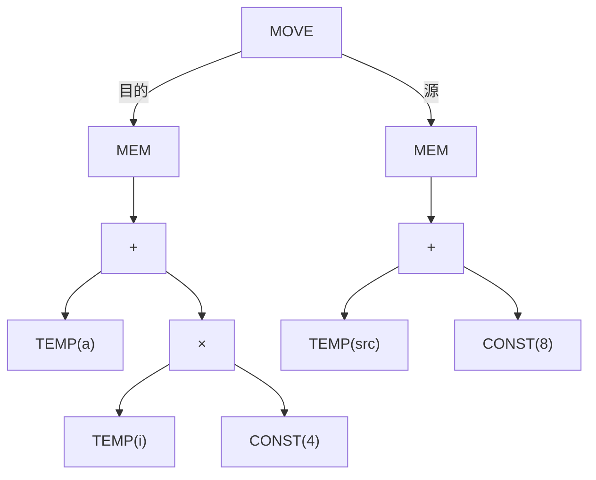

# LEC 19 · 指令选择（一）

SE3355 编译原理 · 2026 秋　[本讲课件（58 页）](../lectures/LEC-19-Instruction-Selection-I.pptx)

## 一次数组读取需要几条指令（p.2–6）

上一讲在目标无关的 IR 上做循环优化。进入后端，**指令选择**（instruction selection）要根据目标指令集和 IR 中的类型、控制流、值依赖，选出语义等价、代价较低的机器指令序列。此时仍可用虚拟寄存器表示临时值，之后再做寄存器分配。[上一讲的循环优化](LEC-16-Global-Optim-III.md)

例如，读取一个 4 字节元素 `base[i]`，IR 先算 `i × 4`，再加上 `base`，最后读内存。设 `%rdi` 存基址、`%rsi` 存下标，x86-64 可以逐步实现这三个操作。

```asm
imulq $4, %rsi, %rax
addq  %rdi, %rax
movl  (%rax), %eax
```

同一次读取也可以只用 `movl (%rdi,%rsi,4), %eax`。这个内存操作数直接表示地址 `base + i × 4`，因此一条机器指令就实现了三个 IR 操作。

## 用目标指令覆盖 IR 树（p.7–17）

本讲一次处理一个基本块，用 Tiger 的非 SSA 树形 IR 表示计算，目标机器换成 Jouette。贯穿全讲的赋值是 `a[i] := src[2]`。`a`、`src` 是数组基址，`i` 是下标，每个元素占 4 字节，所以源元素的字节偏移是 `2 × 4 = 8`。

课件先用 SSA 名字写出这条赋值。最后的 `store` 使用 `%x` 和 `%dstAddr`，是有写内存副作用的根指令。

```text
%offset  = mul %i, 4
%dstAddr = add %a, %offset
%x       = load [%src + 8]
store %x, [%dstAddr]
```

把这两个操作数分别替换成定义它们的表达式，就得到树形 IR `MOVE(MEM(a + i × 4), MEM(src + 8))`。左侧 `MEM` 指明写到哪里，右侧 `MEM` 读出要写的值。



每条目标指令可以实现一种或几种**树模式（pattern）**。把一个模式匹配到树上的具体位置，就得到一个 **tile**。下表中 `•` 表示模式边界上的输入子树，它须提供一个寄存器值。`k` 表示由指令直接编码的 `CONST(k)`。

| Jouette 指令 | 可匹配的 IR 形状 | 指令效果 | cost |
| --- | --- | --- | --- |
| `ADD` | `• + •` | 两个寄存器相加 | 1 |
| `ADDI` | `• + k`、`k + •` 或单独的 `CONST(k)` | 寄存器加立即数。单独生成常量时用 `r0 + k` | 1 |
| `MUL` | `• × •` | 两个寄存器相乘 | 1 |
| `LOAD` | `MEM(• + k)` 或 `MEM(•)` | 读出该地址的值，写入寄存器 | 1 |
| `STORE` | `MOVE(MEM(• + k), •)` 或 `MOVE(MEM(•), •)` | 把寄存器中的值写到目的地址 | 1 |
| `MOVEM` | `MOVE(MEM(•), MEM(•))` | `M[目的地址寄存器] ← M[源地址寄存器]` | 2 |

`r0` 恒为 0。`LOAD` 和 `STORE` 也接受 `k + •` 或单独的常量地址。单独给出基址时位移取 0，单独给出常量地址时基址取 `r0`。表中只有最后三种指令访问内存。Jouette 每周期至多发射一条指令，本讲用各条指令的 **cost 之和**比较完整序列。

一组 tile 构成**合法覆盖（tiling）**，要满足三个条件。

- **完整**。所有待选择的 IR 节点都有归属。`TEMP` 直接提供已有寄存器值，代价为 0。
- **无重叠**。每个待选择节点只归一个 tile。例如，若 `MOVEM` 已覆盖源 `MEM`，再给这个 `MEM` 选一条 `LOAD` 就重复了。
- **边界一致**。每个 `•` 所需的操作数，都由输入寄存器或边界子树的结果提供。`MUL` 要求两个寄存器，所以 `i × 4` 中的 `4` 要先用 `ADDI` 生成。带位移的 `LOAD` 已把 `src + 8` 中的 `8` 编进指令，可以省去生成常量的那一步。

## 同一棵树的两种覆盖（p.18–22）

两个方案都先用三条指令算出目的地址。这里的 `r1` 到 `r4` 是虚拟寄存器。

```text
ADDI  r1 = r0 + 4
MUL   r2 = i × r1
ADD   r3 = a + r2
```

| 后续步骤 | 方案 A · 根部选 `STORE` | 方案 B · 根部选 `MOVEM` |
| --- | --- | --- |
| 第 4 条 | `LOAD r4 = M[src + 8]` | `ADDI r4 = src + 8` |
| 第 5 条 | `STORE M[r3] = r4` | `MOVEM M[r3] = M[r4]` |
| 完整序列的代价 | `3 + 1 + 1 = 5` | `3 + 1 + 2 = 6` |

区别在第 4 条结束时就能看出。A 的 `r4` 里已经是 `src[2]` 的**值**，因为 `LOAD` 一次完成了带偏移的读取。B 的 `r4` 里是 `src[2]` 的**地址**，实际读取和写入都由代价为 2 的 `MOVEM` 完成。

## Maximal Munch 怎样选择与发射（p.23–38）

**Maximal Munch 自顶向下选择。** 在当前根节点尝试所有可匹配的模式，优先选覆盖 IR 节点数最多的一个，然后递归处理它留下的边界子树。实现时可以把较大、较具体的规则排在前面，取第一条匹配规则。

```text
munch(n):
    if n is TEMP(r):
        return r
    t = largestMatchingPattern(n)
    operands = [munch(s) for s in boundaryInputs(t, n)]
    return emit(t, operands)
```

1. 在 `MOVE` 根部，普通 `STORE` 能覆盖 `MOVE` 和目的 `MEM` 两个节点。`MOVEM` 还能覆盖源 `MEM`，共三个节点，因此先选 `MOVEM`。它留下两棵地址子树。
2. 在 `a + i × 4` 处，加号的两个直接孩子是 `a` 和乘法，均无法直接充当立即数。选择 `ADD`，再为乘法选择 `MUL`，为常量 `4` 选择 `ADDI`。
3. 在 `src + 8` 处，`ADDI` 可以同时覆盖加法和常量。源地址就绪后，才输出根部的 `MOVEM`。

**发射指令按后序进行。** 虽然最先选中了 `MOVEM`，它使用的两个寄存器要由递归调用先算出来。因此实际输出的是方案 B，`MOVEM` 排在最后。这个例子也给出了贪心法的反例，根部多覆盖一个 `MEM`，整棵树的代价却从 5 增到 6。

## 动态规划怎样找到最低代价（p.39–51）

固定根部 tile 后，边界上的各棵子树互不共享节点，各自提供约定的操作数。若其中一棵可以换成更便宜的等价实现，其余子树和根指令都可以照用。这就是**最优子结构**。不同根部候选用到同一棵子树时，可以复用它的最低代价。

令 `C(n)` 表示实现以 `n` 为根的子树所需的最低代价。表达式要给出寄存器值，根语句 `MOVE` 要完成写入。`B(t,n)` 是模式 `t` 匹配 `n` 后留下的边界输入。按后序从叶到根填表，同时用 `best[n]` 记下取到最小值的模式。

$$
C(n) = \min_{t\,\text{匹配}\,n}\left(\operatorname{cost}(t) + \sum_{s\in B(t,n)} C(s)\right)
$$

| 子树 `n` | 候选代价怎样算 | `C(n)` | `best[n]` |
| --- | --- | --- | --- |
| `a`、`i`、`src` | 已在寄存器中 | 0 | `TEMP` |
| 单独求寄存器值的 `CONST(k)` | `r0 + k` 需要一条指令 | 1 | `ADDI` |
| `i × 4` | `1 + C(i) + C(4) = 1 + 0 + 1` | 2 | `MUL` |
| `a + i × 4` | `1 + C(a) + C(i × 4) = 1 + 0 + 2` | 3 | `ADD` |
| `src + 8` | `ADD` 要先生成 `8`，共 `1 + 0 + 1 = 2`。`ADDI` 直接编码 `8`，共 `1 + 0 = 1` | 1 | `ADDI` |
| `MEM(src + 8)` | 普通 `LOAD` 先求地址，共 `1 + C(src + 8) = 2`。带位移的 `LOAD` 只需基址，共 `1 + C(src) = 1` | 1 | `LOAD`（带位移） |
| 整棵 `MOVE` | `STORE` 需目的地址和源值，`1 + 3 + 1 = 5`。`MOVEM` 需目的地址和源地址，`2 + 3 + 1 = 6` | **5** | **`STORE`** |

递推式只对 **tile 边界**求和。例如，选带位移的 `LOAD` 后，`MEM`、加号和常量 `8` 都已经归这个 tile。即使表中保存了 `C(src + 8) = 1`，这笔地址计算也无需计入该 `LOAD`。

## 恢复指令与最优性的适用范围（p.52–58）

填表后从根沿 `best[n]` 恢复，只递归访问选中模式的边界输入。遇到 `TEMP` 就返回已有寄存器。等输入就绪，再输出当前指令。算术运算和 `LOAD` 要返回保存结果的新虚拟寄存器，`STORE` 和 `MOVEM` 完成写入即可。在本例中，目的地址子树返回 `r3`，源值子树用一条带位移的 `LOAD` 返回 `r4`，最后输出 `STORE M[r3] = r4`，得到方案 A。

若树有 `N` 个节点，每个节点至多尝试 `P` 个模式，且单个模式大小有界，填表时间为 `O(NP)`。对 Jouette 的固定规则集，时间为 `O(N)`，保存代价和模式的表占 `O(N)` 空间。

Maximal Munch 看根部覆盖多少节点，动态规划把边界子树的代价也算进去。若把贪心规则改为优先选自身 cost 最小的 tile，仍然会出错。课件第 56 页的例子中，一个代价为 1 的 tile 留下两棵代价各为 3 的子树，合计 7。另一个 tile 连这两棵子树一起覆盖，总共只需 4。

动态规划的最优性以给定的模式、可相加的代价和树形输入为前提。在同一基本块内，一个 SSA 值可能供多条指令使用，形成带共享节点的 DAG。直接展开成树就可能把一次共享计算算两遍。下一讲从 SSA 的逐条翻译和合法化（legalization）出发，讨论跨指令匹配、求值顺序、基本块边界，以及 LLVM 如何组织这些规则。

**自测。** 若把右侧换为 `src[0]`，并把源地址化简成 `src`，哪种覆盖更便宜？目的地址仍需 3。`LOAD + STORE` 的总代价为 `3 + 1 + 1 = 5`。`MOVEM` 可以直接用已有的 `src`，总代价也是 `3 + 2 = 5`。此时两种方案并列最优，后者只需 4 条指令。
