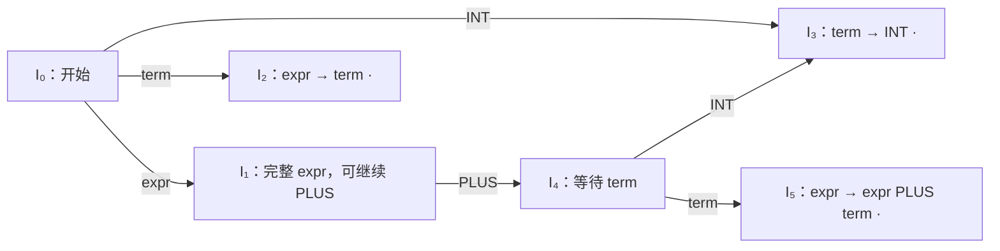

# LEC 6 · Introduction to LR Parsing

> SE3355 编译原理（2026 秋）  
> 依据：[LEC-6-Intro-to-LR-Parsing.pptx](../lectures/LEC-6-Intro-to-LR-Parsing.pptx)，共 50 页。以下页码指课件页码。  
> 本笔记按主题整理；标注“补充理解”“补充推导”或“补充实现”的内容用于解释算法及其边界，不是课件原文。  
> 前置：[LEC 5 · Top-Down Parsing](LEC-5-Top-Down-Parsing.md)。

## 1. 本讲主线：从归约到 LR 状态（p.2–6、50）

上一讲的 LL(1) Parser 从开始符号出发，在展开非终结符之前，根据当前 Token、FIRST 和 FOLLOW 选择产生式。本讲换一个构造方向：**先读入输入并识别产生式右侧，再把它归约为左侧非终结符。**

```text
Token Stream
    ↓ shift 读入，reduce 归约
从叶子向根构造 Parse Tree
    ↓ 用带点的产生式记录识别进度
LR item 与 item 集合
    ↓ closure / goto
LR(0) 自动机
    ↓ 编码成 ACTION / GOTO
状态栈 + 查表循环
```

| 对比项 | 自顶向下：上一讲的 LL(1) | 自底向上：本讲的 LR(0) |
| --- | --- | --- |
| 构树方向 | 从根到叶 | 从叶到根 |
| 使用产生式 | 展开 `A → β` | 将已识别的 `β` 归约为 `A` |
| 对应的推导 | 最左推导 | 最右推导的逆过程 |
| 决策时机 | 展开之前预测产生式 | 识别右侧结构后决定归约 |
| 栈的直观含义 | 尚待匹配的符号 | 已识别的符号及其状态历史 |
| 左递归 | 朴素递归下降会无限递归，通常先改写 | 可以直接处理适合 LR 分析的左递归文法 |

本讲的关键问题是：**当前究竟应该继续读入 Token，还是把栈顶的一段结构归约？若归约，使用哪条产生式？**

**补充理解：LR 名称中的字母与数字。**

- `L`：从左到右扫描输入（Left-to-right）。
- `R`：构造最右推导的逆过程（Rightmost derivation in reverse）。
- `0`：LR(0) item 不附带 lookahead 信息，普通完成项的归约决策不按后继 Token 区分。

LR 中的 `R` 不表示从右向左读取输入。LR(0) 也仍会查询当前 Token，用于决定是否 shift、是否在输入结束时 accept；第 10 节会解释它与“0 个 lookahead”的关系。

## 2. 贯穿案例与记号（p.8）

### 2.1 保留左递归的表达式文法

```text
r0: start → expr
r1: expr  → expr PLUS term
r2: expr  → term
r3: term  → INT
```

输入为：

```text
INT PLUS INT $
```

目标是判断输入能否由开始符号生成，并在分析过程中构造它的语法树。

**补充理解：** 本例的 `start → expr` 起到增广产生式的作用。可把 `expr` 看作原文法的开始符号，再加入一个新的开始符号 `start`。后续分析表中，`r1`、`r2`、`r3` 是普通归约规则；`start → expr ·` 配合输入结束标记触发 `accept`，不作为普通规则在所有 Token 列填入归约。

### 2.2 本笔记的统一约定

| 记号 | 含义 |
| --- | --- |
| `INT`、`PLUS` | 终结符，即 Token 类别 |
| `start`、`expr`、`term` | 非终结符 |
| `ε` | 空串，不对应输入 Token |
| `$` | 输入结束标记，不是源程序中的实际字符 |
| `→` | 文法产生式 |
| `⇒` / `⇒*` | 一步推导 / 零步或多步推导 |
| `⇒rm` | 一步最右推导 |
| `A → α · β` | LR item，点标出产生式右侧的识别位置 |
| `I₀`、`I₁` 等 | item 集合，也是自动机状态 |
| `current` | 当前尚未消费的 Token，或输入结束标记 `$` |

所有栈都写成**左边是栈底，右边是栈顶**。课件前半部分展示符号栈，后半部分展示状态栈；二者的元素和弹出规则需要区分。

## 3. Shift / Reduce：两种核心动作（p.10–21）

### 3.1 Shift：读入一个 Token

Shift（移进）把当前 Token 压入符号栈，并把输入位置向右移动一格。

```text
操作前：栈 = expr PLUS       剩余输入 = INT $
操作后：栈 = expr PLUS INT   剩余输入 = $
```

它扩大已经读入的前缀，还没有为新 Token 确定完整的上层结构。

### 3.2 Reduce：反向使用一条产生式

若选择产生式 `A → β` 归约，则将栈顶对应的 `β` 弹出，再压入 `A`。

```text
reduce term → INT

操作前：栈 = expr PLUS INT   剩余输入 = $
操作后：栈 = expr PLUS term  剩余输入 = $
```

再执行：

```text
reduce expr → expr PLUS term

操作前：栈 = expr PLUS term  剩余输入 = $
操作后：栈 = expr            剩余输入 = $
```

**Reduce 不消费输入。** 同一个 `current` 可以触发连续多次归约，直到需要 shift、accept 或报告错误。

### 3.3 完整运行：INT PLUS INT

下表中的栈和剩余输入均表示**执行该行动作之前**的配置。`∅` 表示空符号栈。

| 步骤 | 符号栈 | 剩余输入 | 动作 |
| --- | --- | --- | --- |
| 0 | `∅` | `INT PLUS INT $` | shift `INT` |
| 1 | `INT` | `PLUS INT $` | reduce `r3: term → INT` |
| 2 | `term` | `PLUS INT $` | reduce `r2: expr → term` |
| 3 | `expr` | `PLUS INT $` | shift `PLUS` |
| 4 | `expr PLUS` | `INT $` | shift `INT` |
| 5 | `expr PLUS INT` | `$` | reduce `r3: term → INT` |
| 6 | `expr PLUS term` | `$` | reduce `r1: expr → expr PLUS term` |
| 7 | `expr` | `$` | accept |

两个 `INT` 都先归约为 `term`，但后续动作不同：

- 第一个 `term` 通过 `expr → term` 归约成 `expr`。
- 第二个 `term` 与左侧的 `expr PLUS` 一起，通过 `expr → expr PLUS term` 归约。

这说明仅知道“栈顶是 `term`”还不够，Parser 也必须保留它之前的上下文。

## 4. 为什么是最右推导的逆过程（p.9、20）

### 4.1 对应的最右推导

**补充推导：** 将每次只应用一条产生式的步骤完整写出：

```text
start
⇒rm expr
⇒rm expr PLUS term
⇒rm expr PLUS INT
⇒rm term PLUS INT
⇒rm INT PLUS INT
```

每一步都展开当前句型中最右侧的非终结符。例如 `expr PLUS term` 中先展开右侧的 `term`，再处理左侧的 `expr`。

课件 p.9 用示意链说明正向展开与反向归约的关系，其中省略了部分中间步骤；这里以 p.20 的最右推导顺序为准补全。

### 4.2 将归约步骤与推导倒序对应

把“符号栈 + 未读输入”连接起来，暂时省略 `$`：

```text
INT PLUS INT
    -- reduce term → INT -->
term PLUS INT
    -- reduce expr → term -->
expr PLUS INT
    -- reduce term → INT -->
expr PLUS term
    -- reduce expr → expr PLUS term -->
expr
```

这正是上面最右推导中，从最终输入退回 `expr` 的过程。最后在输入结束时通过增广开始项接受。

Shift 只移动“已读 / 未读”的分界线。例如：

```text
expr PLUS | INT
expr PLUS INT |
```

两行连接起来都是 `expr PLUS INT`，所以 shift 本身不对应一次文法推导。只有 reduce 改变整体符号串，撤销最右推导的一步。

**补充理解：** “最右推导的逆过程”不意味着先归约输入最右边的 Token。本例首先归约的是最左侧的 `INT`，因为它恰好是正向最右推导中最后展开得到的部分。

## 5. Handle：匹配右侧还不够（p.22–23）

### 5.1 句柄是本次应该归约的那一处

句柄（handle）是当前最右句型中，能够通过归约撤销最右推导最后一步的那一处产生式右侧。

**补充理解：形式化定义。** 若有：

$$
S \Rightarrow_{rm}^{*} \alpha A w
  \Rightarrow_{rm} \alpha \beta w
$$

其中 `A → β` 是产生式，`w` 只含终结符，那么 `αβw` 中紧接在 `α` 之后的这一处 `β`，连同对应产生式和位置，就是一个句柄。将其归约为 `A`，回到前一个最右句型 `αAw`。

在正确的 shift/reduce 分析中，等句柄全部移入栈后，它位于栈顶，Parser 才能归约它。

### 5.2 不能“看到任何右侧就归约”

本例在下面的配置中：

```text
栈 = expr PLUS term
输入 = $
```

栈顶有两段都能与某条产生式右侧匹配：

| 栈顶后缀 | 匹配的产生式 | 此处能否作为正确归约 |
| --- | --- | --- |
| `term` | `expr → term` | 不能；会得到 `expr PLUS expr`，偏离本例的合法归约序列 |
| `expr PLUS term` | `expr → expr PLUS term` | 能；整体归约为 `expr` |

**句柄包含“当前上下文中应该选哪条规则、哪一个位置”的要求。** 仅检查栈顶是否等于某条产生式右侧，无法解决归约选择问题。

LR 状态的作用，就是把决定下一步所需的识别进度编码起来，而不必每次重新搜索整个栈。

## 6. LR Item：用点记录识别进度（p.25–27）

### 6.1 点左边与点右边

对产生式：

```text
expr → expr PLUS term
```

可以得到四个 LR(0) item：

| Item | 含义 |
| --- | --- |
| `expr → · expr PLUS term` | 尚未识别右侧符号 |
| `expr → expr · PLUS term` | 已识别 `expr`，下一步期待 `PLUS` |
| `expr → expr PLUS · term` | 已识别 `expr PLUS`，下一步期待 `term` |
| `expr → expr PLUS term ·` | 右侧已经完整识别，形成一个归约候选 |

点的位置以**文法符号**为单位，表示这条产生式的进展；它不是源代码字符位置，也不要求点左侧等于整个分析栈。

Item 是产生式的识别状态，不是新增的文法规则。对右侧长度为 `n` 的产生式，共有 `n + 1` 个点位置。

**补充理解：空产生式。** `A → ε` 的右侧长度是 0，只有一个 item：`A → ·`。它已经是完成项，不需要先读取一个叫作 `ε` 的 Token。

### 6.2 为什么一个状态包含多个 item

初始状态为：

```text
I₀:
    start → · expr
    expr  → · expr PLUS term
    expr  → · term
    term  → · INT
```

同一前缀可能同时符合多条产生式的识别进度，所以状态必须保存一组 item。

例如识别了一个 `expr` 后：

```text
I₁:
    start → expr ·
    expr  → expr · PLUS term
```

这时既可能已经读完完整输入，也可能还会读到 `PLUS` 并构造更大的表达式。状态保留两种可能，再由分析表与当前 Token 决定动作。

注意，“期待 `expr` 或 `term`”表示期待识别出相应结构。Lexer 实际交给 Parser 的仍是终结符 Token。

## 7. Closure 与 goto（p.28–29）

### 7.1 closure：展开点后期待的非终结符

若 item 中点后是非终结符 `B`：

```text
A → α · B β
```

则识别 `B` 需要从它的某条产生式开始，所以把所有 `B → · γ` 加入集合。对新加入的 item 重复相同操作，直到集合不再增长。

```text
closure(I):
    J = copy(I)
    repeat:
        对 J 中每个 A → α · B β：
            如果 B 是非终结符：
                对每条产生式 B → γ：
                    将 B → · γ 加入 J
    until 本轮没有新增 item
    return J
```

这里用集合存储 item，同一个 item 不会被重复加入。

初始 closure 的计算为：

```text
{ start → · expr }

点后是 expr，加入：
    expr → · expr PLUS term
    expr → · term

expr → · expr PLUS term 再次期待 expr：
    对应 item 已经存在，不重复加入

expr → · term 期待 term，加入：
    term → · INT

INT 是终结符，无须继续展开
```

**补充理解：** 左递归不会让 closure 无限递归。固定文法的 LR(0) item 总数有限，而集合只会加入尚未出现的 item。Closure 只补充识别可能性，不读取 Token，也不移动已有 item 的点。

### 7.2 goto：跨过一个文法符号，再做 closure

定义：

$$
\operatorname{goto}(I, X)
=\operatorname{closure}\bigl(
\{A\to\alpha X\mathbin{\cdot}\beta
\mid A\to\alpha\mathbin{\cdot}X\beta\in I\}
\bigr)
$$

计算时：

1. 找出 `I` 中所有点后恰好是 `X` 的 item。
2. 将这些 item 的点向右跨过 `X`。
3. 对得到的集合做 closure。

例如：

```text
goto(I₀, INT):
    term → · INT
         ↓ 跨过 INT
    term → INT ·

结果为 I₃
```

而：

```text
goto(I₁, PLUS):
    expr → expr · PLUS term
         ↓ 跨过 PLUS
    expr → expr PLUS · term
         ↓ closure
    term → · INT

结果为 I₄，包含最后两个 item
```

**补充理解：** `X` 可以是终结符，也可以是非终结符。终结符转换在运行时对应 shift；非终结符转换在归约产生该非终结符后使用。若没有点后为 `X` 的 item，则 `goto(I, X) = ∅`，无需建立转换边。

## 8. 完整构造 LR(0) 自动机（p.30–37）

### 8.1 六个状态

状态编号与课件一致：

```text
I₀:
    start → · expr
    expr  → · expr PLUS term
    expr  → · term
    term  → · INT

I₁:
    start → expr ·
    expr  → expr · PLUS term

I₂:
    expr → term ·

I₃:
    term → INT ·

I₄:
    expr → expr PLUS · term
    term → · INT

I₅:
    expr → expr PLUS term ·
```

### 8.2 所有非空转换

| 起点 | 识别的文法符号 | 终点 |
| --- | --- | --- |
| `I₀` | `expr` | `I₁` |
| `I₀` | `term` | `I₂` |
| `I₀` | `INT` | `I₃` |
| `I₁` | `PLUS` | `I₄` |
| `I₄` | `INT` | `I₃` |
| `I₄` | `term` | `I₅` |



`goto(I₄, INT)` 与 `goto(I₀, INT)` 得到相同的 item 集合，因此都进入 `I₃`，不建立新状态。

### 8.3 通用构造过程

**补充实现：** 使用工作队列，机械地枚举所有可达的 item 集合：

```text
I₀ = closure({ start → · expr })
states = { I₀ }
worklist = [I₀]

while worklist 非空:
    I = 取出一个待处理状态
    for X in I 中出现在点后的所有文法符号:
        J = goto(I, X)
        if J 非空:
            if states 中还没有与 J 相同的 item 集合:
                为 J 分配状态编号
                将 J 加入 states 和 worklist
            记录转换 I --X--> J
```

判断两个状态是否相同，要比较完整 item 集合；item 的列出顺序不影响集合相等。状态编号本身也没有语法含义。

### 8.4 自动机状态与分析栈的关系

状态概括当前已识别前缀的相关进度，但归约时还需要找回被归约部分之前的状态。单独保存一个当前状态编号无法完成这件事。

**补充理解：** 这类 LR(0) 自动机也称为识别可行前缀（viable prefix）的自动机。可行前缀是最右句型中，不越过句柄右端的前缀；它刻画正确 shift/reduce 过程中可能保留在符号栈上的内容。

有限状态能概括识别进度，并不意味着整个 Parser 不再需要栈。完整的 LR Parser 还利用状态栈保存可以任意增长的历史。

## 9. 为什么归约需要状态栈（p.39–44）

### 9.1 只有 Token 转换表还不够

假设只记录终结符边：

```text
I₀ --INT--> I₃
I₁ --PLUS--> I₄
I₄ --INT--> I₃
```

进入 `I₃` 后，当前 Token 为 `PLUS`，虽然没有 `PLUS` 边，但此时应先归约 `term → INT`。

所以“没有当前 Token 的转换边”不等于“发生语法错误”。Parser 可能需要先归约，再在恢复后的上下文继续。

### 9.2 状态栈保存走过的路径

状态栈初始为：

```text
[0]
```

每识别一个文法符号，就在栈中保存经过该符号后到达的状态。对于符号栈：

```text
expr PLUS term
```

对应状态栈为：

```text
0 1 4 5
```

可把它理解为：

```text
0 --expr--> 1 --PLUS--> 4 --term--> 5
```

**补充理解：** 若另外维护符号栈，则状态栈长度始终比符号栈长度多 1；多出的那个状态是初始状态 `0`。状态栈相邻元素之间的路径标签，对应一个已识别的文法符号。

### 9.3 相同的归约，在不同上下文进入不同状态

两个场景都在 `I₃` 执行 `r3: term → INT`，但归约后去向不同。

场景一：处理第一个 `INT`。

```text
归约前状态栈：0 3
弹出 1 个状态：0
恢复状态：0
查询 GOTO[0, term] = 2
归约后状态栈：0 2
```

场景二：处理 `expr PLUS` 后面的 `INT`。

```text
归约前状态栈：0 1 4 3
弹出 1 个状态：0 1 4
恢复状态：4
查询 GOTO[4, term] = 5
归约后状态栈：0 1 4 5
```

因此，不存在一条固定的“从 `I₃` 归约到某状态”的转换边。归约结果取决于**弹栈后恢复出的状态**和**产生式左侧非终结符**。

### 9.4 右侧长度大于 1 的归约

执行 `r1: expr → expr PLUS term` 时：

```text
归约前状态栈：0 1 4 5
右侧长度：|expr PLUS term| = 3
弹出 3 个状态：0
查询 GOTO[0, expr] = 1
归约后状态栈：0 1
```

弹出数量按右侧的**文法符号数**计算。`expr`、`PLUS`、`term` 各算一个，与它们覆盖多少原始 Token、字符或树节点无关。

## 10. ACTION / GOTO：从自动机生成分析表（p.45–46）

### 10.1 两种查表的区别

| 表 | 何时查询 | 索引 | 结果 |
| --- | --- | --- | --- |
| `ACTION` | 每轮分析开始时 | 当前栈顶状态、当前 Token 或 `$` | shift、reduce、accept 或 error |
| `GOTO` | 归约之后 | 弹栈后恢复出的状态、产生式左侧非终结符 | 应压入的新状态 |

两张表可以物理存放在一起，但使用方式不同。

**补充理解：** 构造自动机时的 `goto(I, X)` 对所有文法符号都有定义；运行时的 `GOTO[i, A]` 表只保存其中非终结符上的转换。终结符转换被编码成 ACTION 表中的 shift 动作。

### 10.2 LR(0) 填表规则

将课件示例归纳为以下规则，其中 `T` 为终结符集合：

1. **Shift：** 若 `goto(Iᵢ, a) = Iⱼ`，且 `a ∈ T`，则填入 `ACTION[i, a] = shift j`。
2. **Reduce：** 若 `Iᵢ` 包含普通完成项 `A → β ·`，则对每个 `a ∈ T ∪ {$}` 填入 `ACTION[i, a] = reduce A → β`。
3. **Accept：** 若 `Iᵢ` 包含增广完成项 `start → expr ·`，则只填入 `ACTION[i, $] = accept`。
4. **GOTO：** 若 `goto(Iᵢ, A) = Iⱼ`，且 `A` 是非终结符，则填入 `GOTO[i, A] = j`。
5. 没有任何动作的 ACTION 单元格为 error。若同一单元格要求填入不同动作，则出现冲突。

这里的“普通完成项”排除了增广开始产生式。`accept` 与普通 `reduce` 必须分开处理。

### 10.3 本例的完整分析表

`sⱼ` 表示 shift 并压入状态 `j`，`rₖ` 表示按编号 `k` 的产生式归约；`—` 表示没有表项。

| 状态 | ACTION: `INT` | ACTION: `PLUS` | ACTION: `$` | GOTO: `expr` | GOTO: `term` |
| --- | --- | --- | --- | --- | --- |
| `I₀` | `s3` | — | — | `1` | `2` |
| `I₁` | — | `s4` | accept | — | — |
| `I₂` | `r2` | `r2` | `r2` | — | — |
| `I₃` | `r3` | `r3` | `r3` | — | — |
| `I₄` | `s3` | — | — | — | `5` |
| `I₅` | `r1` | `r1` | `r1` | — | — |

其中：

```text
r1: expr → expr PLUS term
r2: expr → term
r3: term → INT
```

### 10.4 LR(0) 为什么仍查询当前 Token

`I₂`、`I₃`、`I₅` 的普通归约在所有终结符和 `$` 列都相同。例如：

```text
ACTION[3, INT]  = r3
ACTION[3, PLUS] = r3
ACTION[3, $]    = r3
```

这是 LR(0) 归约不使用 lookahead 区分上下文的体现。它仍需知道当前 Token，才能确定适用哪条终结符 shift 边，或者在 `$` 时接受。

特别地，`I₁` 同时包含：

```text
start → expr ·
expr  → expr · PLUS term
```

它在 `$` 上 accept，在 `PLUS` 上 shift，两个动作位于不同单元格，所以没有冲突。

**补充理解：** 在所有列填归约，不代表每个后继 Token 都能形成合法输入。例如输入 `INT INT $`：

```text
shift 第一个 INT：状态栈 0 3，current = INT
reduce r3：       状态栈 0 2，current = INT
reduce r2：       状态栈 0 1，current = INT
ACTION[1, INT] 为空，报告语法错误
```

Parser 可以先归约已经识别的前缀，再发现后续无法接上；执行了一次合法表动作不等于整个输入已经被接受。

## 11. 表驱动 LR Parser（p.47）

### 11.1 核心循环

```text
state_stack = [0]
current = 输入的第一个 Token，或 $

while true:
    i = state_stack.top()
    action = ACTION[i, current.kind]

    if action is shift j:
        advance()
        state_stack.push(j)

    else if action is reduce A → β:
        state_stack.pop(|β|)
        i = state_stack.top()
        j = GOTO[i, A]
        state_stack.push(j)

    else if action is accept:
        return success

    else:
        report syntax error
```

只有 shift 推进输入。Reduce 必须先弹出状态，再使用恢复后的栈顶查询 GOTO。

**补充实现：** 上述循环假设分析表已正确构造，`current.kind` 对结束标记返回 `$`，缺失的 ACTION 表项按 error 处理。`pop(0)` 应当不做任何事，以支持空产生式。正确表与合法运行配置下，归约后的 GOTO 应存在；缺失通常提示表构造或 Parser 实现有问题。

### 11.2 状态栈的完整轨迹

**补充推导：** 在课件符号栈轨迹上加上状态栈，可验证每一次 ACTION 和 GOTO 查询。各行仍表示动作前的配置。

| 步骤 | 状态栈 | 对应符号栈 | 剩余输入 | 查询与动作 |
| --- | --- | --- | --- | --- |
| 0 | `0` | `∅` | `INT PLUS INT $` | `ACTION[0, INT] = s3` |
| 1 | `0 3` | `INT` | `PLUS INT $` | `r3`；pop 1，`GOTO[0, term] = 2` |
| 2 | `0 2` | `term` | `PLUS INT $` | `r2`；pop 1，`GOTO[0, expr] = 1` |
| 3 | `0 1` | `expr` | `PLUS INT $` | `ACTION[1, PLUS] = s4` |
| 4 | `0 1 4` | `expr PLUS` | `INT $` | `ACTION[4, INT] = s3` |
| 5 | `0 1 4 3` | `expr PLUS INT` | `$` | `r3`；pop 1，`GOTO[4, term] = 5` |
| 6 | `0 1 4 5` | `expr PLUS term` | `$` | `r1`；pop 3，`GOTO[0, expr] = 1` |
| 7 | `0 1` | `expr` | `$` | `ACTION[1, $] = accept` |

### 11.3 三种栈表示不要混淆

**补充实现：** 实际代码中常见三种表示：

| 表示方式 | 示例 | 归约 `A → β` 时的弹出数量 |
| --- | --- | --- |
| 只保存状态的栈 | `0 1 4 5` | `\|β\|` 个状态 |
| 状态与符号交错的栈 | `0 expr 1 PLUS 4 term 5` | `2\|β\|` 个栈元素 |
| 分离的状态栈与符号／语义值栈 | 状态 `0 1 4 5`，符号 `expr PLUS term` | 各弹出 `\|β\|` 个元素 |

课件采用第一种状态栈表示，因此 `pop(|β|)` 是正确的。若看到其他教材写成 `pop(2|β|)`，先检查它是否使用了交错表示。

## 12. 在归约时构造 Parse Tree（p.18、21，补充实现）

只保存状态的循环能完成语法识别。若要输出 Parse Tree，还需维护与符号对应的节点栈，或等价的语义值栈。

```text
shift Token t:
    压入 t 对应的终结符叶子
    执行状态栈的 shift 操作

reduce A → X₁ X₂ … Xₙ:
    从节点栈取出最后 n 个节点，保持原本从左到右的顺序
    建立父节点 A，其子节点为 X₁ 到 Xₙ 的这些节点
    把 A 节点压回节点栈
    执行状态栈的 reduce / GOTO 操作
```

以 `1 + 2` 为例，最终的完整文法树为：

```text
start
└── expr
    ├── expr
    │   └── term
    │       └── INT(1)
    ├── PLUS
    └── term
        └── INT(2)
```

实际 Parser 可以直接返回 `expr` 节点；若需要展示增广开始符号，再包上一层 `start`。

如果目标是 AST，则可以在归约时选择性构造节点：

```text
term → INT             返回整数节点
expr → term            直接传递 term 的节点
expr → expr PLUS term  返回 Add(左 expr 节点, 右 term 节点)
```

得到：

```text
Add
├── Int(1)
└── Int(2)
```

Token 的实际值和源码位置需要另外保留，不能只记录 Token 类别。连续弹栈时还要留意子节点顺序，避免把左右操作数颠倒。

## 13. 为什么 LR 可以直接处理左递归（p.4、48）

对下面的规则：

```text
expr → expr PLUS term | term
```

朴素递归下降若选择第一条，就会在读入任何 Token 前再次调用 `parseExpr()`：

```text
parseExpr()
    → parseExpr()
        → parseExpr()
            → …
```

LR 的执行顺序则是：

```text
INT                  --r3--> term
term                 --r2--> expr
expr PLUS term       --r1--> expr
expr PLUS term       --r1--> expr
…
```

它先识别基础项，再把已经形成的 `expr` 与后续 `PLUS term` 组合起来，不会因为遇到左递归产生式就立即再次展开自身。

**补充推导：** 对 `INT(1) PLUS INT(2) PLUS INT(3)`，在第一个 `expr PLUS term` 完成后先归约，然后继续移进第二个 `PLUS`，得到的结构是：

```text
(1 + 2) + 3
```

这里的左结合由文法 `expr → expr PLUS term | term` 的结构决定。最右推导是展开顺序，不能与运算符的右结合混为一谈。

能处理左递归不等于任意文法都是 LR(0)。文法是否适合某种 LR 方法，还取决于构造出的分析表有没有冲突。

## 14. LR(0) 的边界：冲突（p.49–50）

### 14.1 Shift/reduce conflict

把 `term` 扩展为：

```text
term → INT
     | INT LPAREN RPAREN
```

读到 `INT` 后，同一个状态中会出现：

```text
term → INT ·
term → INT · LPAREN RPAREN
```

当前 Token 为 `LPAREN` 时：

- 第一条是普通完成项，按 LR(0) 规则要求在 `LPAREN` 列填入 reduce。
- 第二条要求继续 shift `LPAREN`。

因此同一个 `ACTION[i, LPAREN]` 单元格出现两个候选动作，形成 **shift/reduce conflict（移进／归约冲突）**。

冲突发生在构表阶段：它说明现有 LR(0) 规则无法为该单元格确定唯一动作。不能直接覆盖其中一个动作，再把结果当作无冲突的 LR(0) 表。

### 14.2 为什么需要更多 lookahead 信息

对扩展后的完整示例文法，读完 `INT` 后直观上希望：

| 当前 Token | 所需动作 |
| --- | --- |
| `LPAREN` | shift，继续识别 `INT LPAREN RPAREN` |
| `PLUS` 或 `$` | 按 `term → INT` 归约 |

LR(0) 的普通归约不区分这些后继，所以产生冲突。接下来的方法需要让归约条件更精确；课件把 LR(1)、LALR 以及工具中的冲突处理、增量解析留给下一讲。

**补充理解：** 分析表冲突不自动证明文法有歧义。它也可能只是说明当前分析方法携带的信息不足；本页扩展例子正体现了这种情况。也不能把“总是 shift”当作适用于所有文法的通用解决办法。

### 14.3 Reduce/reduce conflict（补充理解）

另一类冲突是同一单元格要求使用两条不同产生式归约。例如普通完成项：

```text
A → γ ·
B → δ ·
```

若它们出现在同一 LR(0) 状态中，则两条规则都会向所有终结符和 `$` 列填写归约，形成 **reduce/reduce conflict（归约／归约冲突）**。

| 冲突类型 | 同一 ACTION 单元格内的竞争 |
| --- | --- |
| Shift/reduce | 继续读入一个 Token，或先归约 |
| Reduce/reduce | 使用不同产生式归约 |

冲突的判据是**同一单元格出现不同动作**。同一状态中有多个 item 很正常，不能仅凭 item 数量判断冲突。

## 15. 易错点与复习自测

### 15.1 易错点速查

| 易错点 | 正确理解 |
| --- | --- |
| LR 的 R 表示从右向左读输入 | 输入从左向右读，归约对应最右推导的逆过程 |
| LR(0) 完全不查看当前 Token | 普通归约不按 lookahead 区分，但 shift 与 accept 仍依赖当前 Token |
| 栈顶匹配某个产生式右侧就一定能归约 | 必须选择当前句柄，选择还依赖上下文 |
| Reduce 会消耗一个输入 Token | 只有 shift 推进输入，reduce 不推进 |
| 一个 LR 状态就是一条产生式 | 一个状态是一组 item，保留同时可能的识别进度 |
| Closure 会读取符号或移动点 | Closure 加入点后非终结符的起始 item；goto 才移动点 |
| 左递归会让 closure 无限展开 | 集合去重，有限个 item 使计算最终停止 |
| 没有当前 Token 的转换边就报错 | 可能需要先归约，再继续分析 |
| `term → INT` 总是归约到同一个状态 | 要弹栈恢复上下文，再查 `GOTO[恢复状态, term]` |
| 归约后查 `GOTO[归约前栈顶, A]` | 应使用弹栈之后的栈顶 |
| 弹栈数量等于右侧覆盖的输入 Token 数 | 按产生式右侧的文法符号数计算 |
| 普通完成项与增广完成项处理相同 | 普通完成项填 reduce；增广完成项只在 `$` 上 accept |
| 到达 `I₁` 就可以立刻接受 | 还必须遇到 `$`，遇到 `PLUS` 时继续 shift |
| 有限自动机意味着无需分析栈 | 自动机概括进度，状态栈保存归约所需历史 |
| Shift/reduce conflict 一定说明文法有歧义 | 也可能是 LR(0) 信息不足，需要更强的分析方法 |
| 能直接处理左递归意味着所有文法都能 LR(0) 分析 | 仍需构表并检查冲突 |

### 15.2 自测与简答

1. **为什么 shift 不对应一次文法推导？**  
   它只移动符号栈与未读输入的分界线，连接后的整体符号串不变。

2. **为什么最右推导的逆过程可以先归约最左侧的 INT？**  
   最右推导最后才展开左侧剩余的非终结符，逆过程先撤销这一步。

3. **`expr → expr PLUS · term` 表示什么？**  
   对这条产生式，已经识别 `expr PLUS`，还需要识别一个 `term`。

4. **对 `{expr → expr PLUS · term}` 做 closure，要补入什么？**  
   补入 `term → · INT`，得到 `I₄`。

5. **为什么 `goto(I₀, INT)` 与 `goto(I₄, INT)` 都是 I₃？**  
   两者移动点并做 closure 后，都得到相同集合 `{term → INT ·}`。

6. **状态栈为 `0 1 4 3`，执行 `term → INT` 后是什么？**  
   弹出一个状态恢复到 `4`，查 `GOTO[4, term] = 5`，得到 `0 1 4 5`。

7. **状态栈为 `0 1 4 5`，执行 `expr → expr PLUS term` 后是什么？**  
   弹出三个状态恢复到 `0`，查 `GOTO[0, expr] = 1`，得到 `0 1`。

8. **I₁ 中有一个完成项和一个待移进项，为什么没有冲突？**  
   完成项是增广开始项，只在 `$` 上 accept；待移进项只在 `PLUS` 上 shift，两个动作不占同一单元格。

9. **为什么 `ACTION[3, INT] = r3` 不会让 `INT INT` 被接受？**  
   归约后仍保留第二个 `INT` 为 current，最终在 `ACTION[1, INT]` 处报错。

10. **若存在空产生式 `A → ε`，归约时如何处理状态栈？**  
    弹出 0 个状态，直接用原栈顶查询 `GOTO[原栈顶, A]`，再压入目标状态。

11. **如何从状态栈分析扩展为构造 Parse Tree？**  
    加入节点栈：shift 压入 Token 叶子，reduce 把右侧节点组合成左侧父节点。

12. **本讲结束后，应该能手工完成哪些工作？**  
    写出 item，计算 closure 与 goto，枚举状态及转换，填写 ACTION/GOTO，逐步跟踪状态栈，并定位表中的冲突单元格。

## 16. 复习时的一条完整路线（p.50）

```text
给定 CFG
  → 加入增广开始产生式
  → 给产生式右侧加点，形成 LR(0) item
  → 用 closure 与 goto 枚举状态和转换
  → 生成 ACTION / GOTO，检查冲突
  → 从状态栈 [0] 开始执行表驱动循环
  → shift 读入，reduce 弹栈并恢复上下文
  → 在增广完成状态遇到 $ 时 accept
```

本讲已经给出了一个完整 LR(0) Parser 的构造与执行过程。下一讲的重点是：当 LR(0) 的归约条件过于宽泛时，如何利用 lookahead 缩小归约范围，并处理由此涉及的状态与冲突问题。
