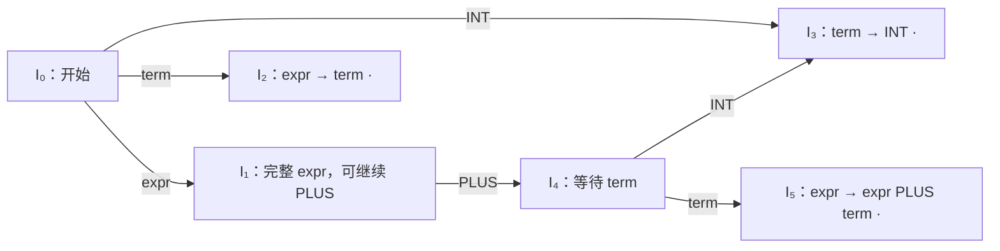

# LEC 6 · 自底向上分析与 LR(0)

SE3355 编译原理 · 2026 秋　[本讲课件（50 页）](../lectures/LEC-6-Parsing-III.pptx)

读到 `1 + 2` 时，可以先把两个整数分别认作 `term`，再把整段认作一个 `expr`。LR 分析器从左到右读输入，在栈上把产生式右侧换回左侧。按相反顺序读这些归约，得到一条最右推导。LR 中的 L、R 分别来自 *left-to-right* 和 *rightmost derivation*。

## 移进、归约与句柄（p.2–23）

```text
r0: start → expr
r1: expr  → expr PLUS term
r2: expr  → term
r3: term  → INT
```

`start` 是新增起点，`r0` 用来判定接受。`$` 表示输入结束。**移进**（shift）读一个 Token 并压栈。**归约**（reduce）把栈顶匹配的右侧 β 换成左侧 A，当前输入位置不动。下面从开始符号推导到 `INT PLUS INT`。每一步都展开最右边的非终结符。

```text
start
⇒rm expr
⇒rm expr PLUS term
⇒rm expr PLUS INT
⇒rm term PLUS INT
⇒rm INT PLUS INT
```

倒着读，先把最左边的 `INT` 换回 `term`，再换成 `expr`。读入 `PLUS INT` 后把第二个 `INT` 换成 `term`。这时栈是 `expr PLUS term`，虽然栈顶 `term` 也符合 `r2`，若只归约它就会得到无法收尾的 `expr PLUS expr`。此处应按 `r1` 把三个符号整体归约。**句柄**（handle）就是此刻能还原最右推导上一步的那段右侧及其位置。

## 用带点项目构造状态（p.24–37）

`expr → expr PLUS · term` 读作“已经认出 `expr PLUS`，还差一个 `term`”。一个状态是一组这样的项目（item），保留当前前缀仍可能对应的所有进度。

1. **闭包 `closure(I)`。** 若有 `A → α · B β`，把 B 的每条规则 `B → · γ` 加入集合。反复做，直到没有新项目。点后是终结符或点已在末尾，就不用展开。
2. **转移 `goto(I,X)`。** 选出点后紧跟 X 的项目，把点跨过 X，对结果取闭包。同一符号上的所有项目一起移动。
3. 从 `closure({start → · expr})` 出发，用队列展开每个非空转移。按完整项目集判重，相同的集合只建一个状态。文法符号有限，每条产生式的点也只有有限种位置。

```text
I₀:
    start → · expr
    expr  → · expr PLUS term
    expr  → · term
    term  → · INT

I₁:
    start → expr ·
    expr  → expr · PLUS term

I₂:
    expr → term ·

I₃:
    term → INT ·

I₄:
    expr → expr PLUS · term
    term → · INT

I₅:
    expr → expr PLUS term ·
```



例如 `goto(I₁, PLUS)` 先得到 `expr → expr PLUS · term`，闭包补上 `term → · INT`。所以 `I₄` 读 `INT` 时可以复用 `I₃`。

## 从项目集填写 ACTION 和 GOTO（p.38–46）

| 发现了什么 | 填什么 |
| --- | --- |
| 从 i 经终结符 t 到 j | `ACTION[i,t] = shift j` |
| 从 i 经非终结符 A 到 j | `GOTO[i,A] = j` |
| i 有普通完成项 `A → β ·` | LR(0) 在所有终结符列和 `$` 列填 `reduce A → β` |
| i 有增广完成项 `start → expr ·` | 只在 `ACTION[i,$]` 填 `accept` |

空格表示没有可用动作。同一 ACTION 格若要填两个不同动作，这份文法的 LR(0) 表就有冲突。表中 `s3` 表示移进到状态 3，`r3` 表示按产生式 3 归约。

| 状态 | ACTION: `INT` | ACTION: `PLUS` | ACTION: `$` | GOTO: `expr` | GOTO: `term` |
| --- | --- | --- | --- | --- | --- |
| `I₀` | `s3` | — | — | `1` | `2` |
| `I₁` | — | `s4` | accept | — | — |
| `I₂` | `r2` | `r2` | `r2` | — | — |
| `I₃` | `r3` | `r3` | `r3` | — | — |
| `I₄` | `s3` | — | — | — | `5` |
| `I₅` | `r1` | `r1` | `r1` | — | — |

LR(0) 中的“0”限制的是项目里用来决定普通归约的展望符数。运行时仍用当前 Token 查 ACTION，例如 `I₁` 遇 `PLUS` 移进，遇 `$` 接受。

## 状态栈怎样记住归约后去哪里（p.39–48）

初始只压状态 0。移进时读一个 Token、压目标状态。按 `A → β` 归约时，先弹出与 β 的符号数相等的状态，再用**弹栈后的栈顶**查 `GOTO[top,A]`，把结果压栈。这里栈顶在右侧。

| 步骤 | 状态栈 | 对应符号栈 | 剩余输入 | 查询与动作 |
| --- | --- | --- | --- | --- |
| 0 | `0` | `∅` | `INT PLUS INT $` | `ACTION[0, INT] = s3` |
| 1 | `0 3` | `INT` | `PLUS INT $` | `r3`，弹出 1 个状态，`GOTO[0, term] = 2` |
| 2 | `0 2` | `term` | `PLUS INT $` | `r2`，弹出 1 个状态，`GOTO[0, expr] = 1` |
| 3 | `0 1` | `expr` | `PLUS INT $` | `ACTION[1, PLUS] = s4` |
| 4 | `0 1 4` | `expr PLUS` | `INT $` | `ACTION[4, INT] = s3` |
| 5 | `0 1 4 3` | `expr PLUS INT` | `$` | `r3`，弹出 1 个状态，`GOTO[4, term] = 5` |
| 6 | `0 1 4 5` | `expr PLUS term` | `$` | `r1`，弹出 3 个状态，`GOTO[0, expr] = 1` |
| 7 | `0 1` | `expr` | `$` | `ACTION[1, $] = accept` |

两次 `r3` 都从栈顶 3 出发，但第一次弹出后露出 0，查得 `GOTO[0,term] = 2`。第二次露出 4，`GOTO[4,term] = 5`。`r1` 的右侧有三个符号，在 `0 1 4 5` 上弹三次，留下 0，再压入 `GOTO[0,expr] = 1`。若有 `A → ε`，弹零个，仍要查 GOTO 并压入新状态。

只存状态时，状态数总比已识别的栈符号数多一。若画成交替出现的“状态、符号、状态”，同一次 `r1` 要弹六个栈元素。实际构树可以另设语义值栈。移进时压入 Token，归约时取出 β 的各孩子，恢复源码顺序，构造父节点并压回去。课件例子可直接建出 `Add(Int(1),Int(2))`。

LR 能处理左递归，因为 `expr → expr PLUS term` 只在右侧三个成分已经出现后才执行归约。前缀 `expr` 可以先在栈里等着。

## LR(0) 在哪里遇到冲突（p.49–50）

给 `term` 加一条 `term → INT LPAREN RPAREN`。同样读完一个 `INT`，现在多了一种可能，左括号可以接在它后面。

```text
term → INT ·
term → INT · LPAREN RPAREN
```

当前 Token 是 `LPAREN`。第一项按 LR(0) 的规则要归约，第二项要移进，形成 **shift/reduce** 冲突。如果两个普通完成项要求在同一格按两条不同规则归约，则是 **reduce/reduce** 冲突。缩小允许归约的列，可以解决其中一部分冲突。[第 7 讲 · SLR、LR(1) 与 LALR](LEC-7-Constructing-LR-Parsing-Gen.md)

**自测。** 基础文法遇到 `INT INT $` 会怎样？按表先移进第一个 `INT`，在第二个 `INT` 上先后执行 `r3`、`r2`，最后停在 `ACTION[1,INT]` 的空格上报错。两次归约都没有吃掉第二个 Token。这个例子可以用来检验自己的栈和输入指针是否同步正确。
