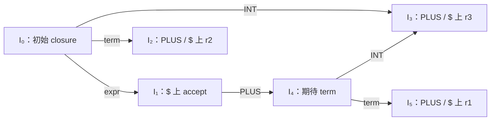

# LEC 7 · Constructing LR Parsing Generators

> SE3355 编译原理（2026 秋）  
> 依据：[LEC-7-Constructing-LR-Parsing-Generators.pptx](../lectures/LEC-7-Constructing-LR-Parsing-Generators.pptx)，共 68 页，课件主题为“从 LR(0) 冲突到 Parser 工程”。以下页码指课件页码。  
> 本笔记按主题整理；标注“补充理解”“补充推导”或“补充实现”的内容用于解释算法及其边界，不是课件原文。工程工具的补充说明附官方资料链接。  
> 前置：[LEC 6 · Introduction to LR Parsing](LEC-6-Intro-to-LR-Parsing.md)；FIRST / FOLLOW 可回顾 [LEC 5 · Top-Down Parsing](LEC-5-Top-Down-Parsing.md)。

## 1. 本讲主线：完成项究竟允许在哪些 Token 前归约（p.2–7）

上一讲已经建立了 LR Parser 的基本流程：

```text
Grammar → item 集合与自动机 → ACTION / GOTO → 状态栈与查表循环
```

LR(0) 的局限出现在归约条件上：一旦状态包含普通完成项 `A → β ·`，就把 `reduce A → β` 填到所有终结符及 `$` 列。这可能与本来应该执行的 shift 或其他 reduce 发生冲突。

本讲逐步增加“归约之后允许出现什么”的信息：

| 方法 | 归约条件从哪里来 | 状态如何构造 |
| --- | --- | --- |
| LR(0) | 所有终结符及 `$` | LR(0) item 集合 |
| SLR(1) | 左侧非终结符的 `FOLLOW(A)` | 仍用 LR(0) item 集合 |
| 规范 LR(1) | 当前 item 自带的 lookahead | 使用 LR(1) item 重新构造 |
| LALR(1) | 合并同 core 状态后得到的 lookahead 并集 | 合并规范 LR(1) 状态 |

**这些方法共享表驱动的 shift / reduce 执行方式，差别主要在生成分析表时保留多少上下文。** 本笔记后文的“LR(1)”默认指规范 LR(1)，即 canonical LR(1)。

### 1.1 统一记号

| 记号 | 含义 |
| --- | --- |
| `A`、`B`、`expr`、`term` 等 | 非终结符 |
| `INT`、`PLUS`、`EQUAL` 等 | 终结符，即 Token 类别 |
| `α`、`β`、`γ` | 零个或多个文法符号组成的序列 |
| `ε` | 空串，不是输入 Token |
| `$` | 输入结束标记 |
| `current` | 当前尚未消费的 Token，或 `$` |
| `I₀`、`I₁` 等 | item 集合，也是自动机状态 |
| `goto(I, X)` | 构造自动机时，沿任意文法符号 X 转移 |
| `GOTO[i, A]` | 运行时查询的非终结符转换表 |
| `[A → α · β, a]` | LR(1) item；a 是终结符或 `$` |

栈统一写成**左侧为栈底，右侧为栈顶**。`start → S` 表示新加入的增广产生式，其完成项在 `$` 上触发 accept，不当作普通产生式归约。

## 2. SLR(1)：用 FOLLOW 限制归约（p.3–4、8–11）

### 2.1 一个 LR(0) 冲突

在上一讲表达式文法的基础上，增加 `term → INT LPAREN RPAREN`：

```text
start → expr
expr  → expr PLUS term
      | term
term  → INT
      | INT LPAREN RPAREN
```

读完 `INT` 后，课件记作 `I₃` 的状态包含：

```text
term → INT ·
term → INT · LPAREN RPAREN
```

若 `current = LPAREN`：

- 第二条 item 要求 shift，继续识别较长的 `term`。
- 第一条 item 按 LR(0) 填表规则，在 `LPAREN` 列也要求 reduce。

因此，同一个 `ACTION[3, LPAREN]` 有两个不同动作，发生 **shift/reduce conflict（移进/归约冲突）**。

### 2.2 FOLLOW 提供全局后继信息

本例中：

```text
FOLLOW(expr) = {PLUS, $}
FOLLOW(term) = {PLUS, $}
```

来源如下：

1. `expr` 是原文法的开始符号，因此其后允许 `$`。
2. `expr → expr PLUS term` 中，右侧的 expr 后紧跟 `PLUS`。
3. term 位于两条 expr 产生式的末尾，因此继承 `FOLLOW(expr)`。

`LPAREN` 出现在 `term → INT LPAREN RPAREN` 的内部。它跟在 `INT` 后面，不代表它可以跟在一个已经完成的 term 后面。

### 2.3 SLR 填表规则

SLR 是 Simple LR。先构造与 LR(0) **完全相同的自动机**，再改变普通完成项的填表方式：

$$
A\to\beta\cdot\in I_i,\quad a\in\operatorname{FOLLOW}(A)
\quad\Longrightarrow\quad
\operatorname{ACTION}[i,a]=\operatorname{reduce}(A\to\beta)
$$

完整规则如下：

| 条件 | 写入的表项 |
| --- | --- |
| 终结符转换 `goto(Iᵢ, a) = Iⱼ` | `ACTION[i, a] = shift j` |
| 非终结符转换 `goto(Iᵢ, A) = Iⱼ` | `GOTO[i, A] = j` |
| 普通完成项 `A → β ·` | 仅在 `FOLLOW(A)` 中的列填 `reduce A → β` |
| 增广完成项 `start → S ·` | `ACTION[i, $] = accept` |
| ACTION 格中没有动作 | error |
| ACTION 格中存在不同动作 | 冲突，不能直接形成确定的分析表 |

于是上述状态变为：

| 方法 | `LPAREN` | `PLUS` | `$` |
| --- | --- | --- | --- |
| LR(0) | shift / reduce `term → INT` | reduce | reduce |
| SLR(1) | shift | reduce `term → INT` | reduce `term → INT` |

**SLR 不用 FOLLOW 生成状态；它在填 ACTION 表时，用 FOLLOW 筛选允许归约的列。** 状态数、转换边和 GOTO 表都保持不变。

## 3. SLR 的边界：FOLLOW 混合了不同上下文（p.12–14）

### 3.1 赋值文法

```text
start → stmt
stmt  → left EQUAL right
      | right
left  → STAR right
      | ID
right → left
```

合法输入示例：

```text
ID EQUAL ID
STAR ID EQUAL ID
ID
```

从初始 LR(0) 状态识别出 left 后，进入课件记作 `I₁` 的状态：

```text
stmt  → left · EQUAL right
right → left ·
```

看到 `EQUAL` 时，第一条要求 shift；SLR 是否会保留第二条的 reduce，取决于 `EQUAL ∈ FOLLOW(right)` 是否成立。

### 3.2 EQUAL 为什么进入 FOLLOW(right)

```text
stmt → left EQUAL right
    ⇒ EQUAL ∈ FOLLOW(left)

left → STAR right
    ⇒ FOLLOW(left) ⊆ FOLLOW(right)

所以 EQUAL ∈ FOLLOW(right)
```

**补充推导：** 完整的 FOLLOW 集合为：

| 非终结符 | FOLLOW |
| --- | --- |
| `stmt` | `{$}` |
| `left` | `{EQUAL, $}` |
| `right` | `{EQUAL, $}` |

`EQUAL` 出现在 right 后面确实有合法上下文：在 `STAR ID EQUAL ID` 中，左侧 `STAR ID` 可以经 `left → STAR right` 形成，其中的 right 后面就是 `EQUAL`。

但在上面的 `I₁` 中，`right → left ·` 来自 `stmt → right` 这条路径。在这个具体位置，right 完成意味着整个 stmt 完成，之后只允许 `$`。

### 3.3 全局正确的信息可能对当前状态过宽

SLR 把整个文法的 `FOLLOW(right)` 用于每个 `right → … ·`，因此仍得到：

```text
ACTION[I₁, EQUAL] = shift / reduce right → left
```

冲突的原因是**来自其他出现位置的后继信息被带入了当前状态**。要避免这种混合，需要把后继信息记录到每个 item 中。

## 4. LR(1) item：识别进度与右侧上下文（p.16–20）

### 4.1 点后符号与 lookahead 的职责

LR(1) item 写作：

$$
[A\to\alpha\cdot\beta,\ a]
$$

| 部分 | 含义 |
| --- | --- |
| `α` | 当前产生式右侧已经识别的部分 |
| `β` | 当前产生式右侧尚待识别的部分 |
| `a` | 在该 item 的上下文中，整个 A 完成后允许紧随的 Token |

例如：

```text
[expr → expr · PLUS term, $]
```

当前应继续识别 `PLUS term`。逗号后的 `$` 表示这条产生式**将来完成时**，可在 `$` 上归约。

因此，item 中的 lookahead 不要求始终等于当前输入 Token。只有变成完成项 `[A → α ·, a]` 时，才据此把 reduce 写入 a 列；在 closure 构造过程中，它也参与向内传播上下文。

### 4.2 相同的带点产生式可以配不同 lookahead

```text
[term → INT ·, $]
[term → INT ·, PLUS]
```

这是两个不同的 LR(1) item。可以紧凑写为：

```text
[term → INT ·, {$, PLUS}]
```

集合写法只是同一状态内多个 item 的缩写，每个元素仍然只含**一个** lookahead Token，不表示要同时查看两个 Token。

## 5. LR(1) closure 与 goto（p.18–20、23–31、41）

### 5.1 Closure 的关键公式

若集合中有：

```text
[A → α · B β, a]
```

则对每条 `B → γ`，以及每个 `b ∈ FIRST(βa)`，加入：

```text
[B → · γ, b]
```

即：

$$
[A\to\alpha\cdot B\beta,a]\in I
\quad\Longrightarrow\quad
[B\to\cdot\gamma,b]\in\operatorname{closure}(I)
\quad\text{for each }B\to\gamma,\ b\in\operatorname{FIRST}(\beta a)
$$

这里计算的是 **B 后面可能出现什么**，所以取 `FIRST(βa)`。

### 5.2 FIRST(βa) 的两种来源

$$
\operatorname{FIRST}(\beta a)=
\begin{cases}
\operatorname{FIRST}(\beta), & \varepsilon\notin\operatorname{FIRST}(\beta)\\
\bigl(\operatorname{FIRST}(\beta)-\{\varepsilon\}\bigr)\cup\{a\},
& \varepsilon\in\operatorname{FIRST}(\beta)
\end{cases}
$$

- β 不可空：B 完成后必须识别 β，下一个 Token 来自 β 的开头。
- β 可空：除了 β 的非空开头，外层保存的 a 也可能紧随 B。
- β 本身为空：直接传播 `{a}`。

**补充推导：可空后缀。**

```text
[A → · B C, $]
C → c | ε
```

此处小写 `c` 表示终结符。`FIRST(C$) = {c, $}`，所以对每条 `B → γ` 都加入：

```text
[B → · γ, c]
[B → · γ, $]
```

不能因为 C 可空就只传播 `$`；它也可能实际产生 c。也不能把 `ε` 当作 lookahead，因为这里 βa 的末尾还有终结符或结束标记 a。

### 5.3 用工作队列求不动点

**补充实现：** 下面以单个 lookahead 的 item 为单位，避免紧凑集合写法掩盖传播过程。

```text
closure(items):
    C = set(items)
    Q = queue(items)

    while Q 非空:
        [A → α · β, a] = Q.pop_front()
        if 点后紧跟非终结符 B:
            将点后序列写成 B δ
            for 每条产生式 B → γ:
                for b in FIRST(δ a):
                    item = [B → · γ, b]
                    if item 不在 C 中:
                        C.add(item)
                        Q.push_back(item)

    return C
```

**去重时必须比较产生式、点的位置和 lookahead。** 相同的带点产生式得到新 lookahead，仍然产生新 item，需要继续传播。若实现采用 `core item → lookahead 集合`，则集合增长时也必须重新安排传播。

item 的可能数量有限，每个新 item 至多入队一次，所以即使文法有左递归，closure 也会终止。

### 5.4 Goto：移动点，保留原来的 lookahead

$$
\operatorname{goto}(I,X)=
\operatorname{closure}\left(
\{[A\to\alpha X\cdot\beta,a]\mid[A\to\alpha\cdot X\beta,a]\in I\}
\right)
$$

先让点跨过 X，再对结果做 closure：

```text
[A → α · X β, a]  --X-->  [A → α X · β, a]
```

原 item 的 a 保持不变；新加入的 closure item 按 `FIRST(βa)` 规则计算自己的 lookahead。移进的 Token 不会自动成为该 item 的 lookahead。

## 6. 完整构造表达式文法的 LR(1) 自动机（p.21–39）

### 6.1 本节使用基础文法

```text
r0: start → expr
r1: expr  → expr PLUS term
r2: expr  → term
r3: term  → INT
```

注意：课件从 p.21 起回到上一讲的基础文法，**不再包含第 2 节增加的 `term → INT LPAREN RPAREN`**。以下沿用课件的 `I₀–I₅` 编号。

### 6.2 从初始 item 开始

```text
I₀ = closure({ [start → · expr, $] })
```

按先进先出队列处理，closure 的新增内容如下：

| 步骤 | 取出的 item | 传播依据 | 新加入的 item |
| --- | --- | --- | --- |
| 1 | `[start → · expr, $]` | `FIRST($) = {$}` | `[expr → · expr PLUS term, $]`、`[expr → · term, $]` |
| 2 | `[expr → · expr PLUS term, $]` | `FIRST(PLUS term $) = {PLUS}` | `[expr → · expr PLUS term, PLUS]`、`[expr → · term, PLUS]` |
| 3 | `[expr → · term, $]` | `FIRST($) = {$}` | `[term → · INT, $]` |
| 4 | `[expr → · expr PLUS term, PLUS]` | `FIRST(PLUS term PLUS) = {PLUS}` | 无，结果已经存在 |
| 5 | `[expr → · term, PLUS]` | `FIRST(PLUS) = {PLUS}` | `[term → · INT, PLUS]` |
| 6 | `[term → · INT, $]` | 点后是终结符 | 无 |
| 7 | `[term → · INT, PLUS]` | 点后是终结符 | 无 |

最后得到 **7 个独立 LR(1) item**。按带点产生式分组后，可写成 4 行：

```text
I₀:
    [start → · expr, $]
    [expr  → · expr PLUS term, {$, PLUS}]
    [expr  → · term, {$, PLUS}]
    [term  → · INT, {$, PLUS}]
```

这里同一状态内的紧凑书写，不是后面 LALR 所做的“合并不同状态”。

### 6.3 所有状态

```text
I₁ = goto(I₀, expr):
    [start → expr ·, $]
    [expr  → expr · PLUS term, {$, PLUS}]

I₂ = goto(I₀, term):
    [expr → term ·, {$, PLUS}]

I₃ = goto(I₀, INT):
    [term → INT ·, {$, PLUS}]

I₄ = goto(I₁, PLUS):
    [expr → expr PLUS · term, {$, PLUS}]
    [term → · INT, {$, PLUS}]

I₅ = goto(I₄, term):
    [expr → expr PLUS term ·, {$, PLUS}]
```

`I₄` 中 term 位于产生式末尾，所以 closure 直接沿用外层的 `$` 与 `PLUS`。另外：

```text
goto(I₄, INT) = I₃
```

这次结果的完整 LR(1) item 集合与已有 `I₃` 相同，直接复用已有状态。

### 6.4 所有非空转换

| 起点 | 符号 | 终点 |
| --- | --- | --- |
| `I₀` | `expr` | `I₁` |
| `I₀` | `term` | `I₂` |
| `I₀` | `INT` | `I₃` |
| `I₁` | `PLUS` | `I₄` |
| `I₄` | `INT` | `I₃` |
| `I₄` | `term` | `I₅` |



本例仍然只有 6 个状态，转换结构也与 LR(0) 相同。这是该文法的结果，不能推广为所有文法都不增加状态。

### 6.5 LR(1) 填表规则与完整分析表

Shift、GOTO 和 accept 与前面相同；普通完成项的规则改为：

```text
若 [A → β ·, a] ∈ Iᵢ 且 A → β 不是增广产生式：
    ACTION[i, a] = reduce A → β
```

`sⱼ` 表示移进并进入状态 j，`rₖ` 表示按规则 k 归约；`—` 表示无表项，ACTION 中的 `—` 即 error。

| 状态 | ACTION: `INT` | ACTION: `PLUS` | ACTION: `$` | GOTO: `expr` | GOTO: `term` |
| --- | --- | --- | --- | --- | --- |
| `I₀` | `s3` | — | — | `1` | `2` |
| `I₁` | — | `s4` | accept | — | — |
| `I₂` | — | `r2` | `r2` | — | — |
| `I₃` | — | `r3` | `r3` | — | — |
| `I₄` | `s3` | — | — | — | `5` |
| `I₅` | — | `r1` | `r1` | — | — |

课件 p.38 的 `INT` 列以淡色划线保留了 LR(0) 原有的 `r2`、`r3`、`r1`，表示这些表项被删除。上表展示删除后的 LR(1) 结果。

**补充理解：** 这份基础文法本来就是 LR(0) 文法，没有需要消除的冲突。本例的 SLR、LR(1)、LALR 表相同，均比 LR(0) 少三个无效输入上的归约表项。

### 6.6 合法输入与错误输入的运行差异（p.39）

合法输入 `INT PLUS INT $` 的运行如下，表中记录动作执行前的配置：

| 步骤 | 状态栈 | 剩余输入 | 动作 |
| --- | --- | --- | --- |
| 0 | `0` | `INT PLUS INT $` | `s3` |
| 1 | `0 3` | `PLUS INT $` | `r3`：弹 1 个状态，查 `GOTO[0, term] = 2` |
| 2 | `0 2` | `PLUS INT $` | `r2`：弹 1 个状态，查 `GOTO[0, expr] = 1` |
| 3 | `0 1` | `PLUS INT $` | `s4` |
| 4 | `0 1 4` | `INT $` | `s3` |
| 5 | `0 1 4 3` | `$` | `r3`：弹 1 个状态，查 `GOTO[4, term] = 5` |
| 6 | `0 1 4 5` | `$` | `r1`：弹 3 个状态，查 `GOTO[0, expr] = 1` |
| 7 | `0 1` | `$` | accept |

对错误输入 `INT INT $`，读完第一个 `INT` 后：

```text
状态栈 = 0 3，current = INT

LR(0)：r3 → r2 → 在 I₁ 报错
LR(1)：ACTION[3, INT] 为空，立即报错
```

这里“更早”指少执行无效上下文中的归约；两者都在第二个 `INT` 尚未消费时发现错误。此比较针对本节直接构造的分析表，实际生成器的默认归约等优化可能影响报错时机。

## 7. LR(1) 如何消除赋值文法的 SLR 冲突（p.40）

回到第 3 节的赋值文法。从 `[start → · stmt, $]` 开始做 closure，会得到：

```text
[stmt → · left EQUAL right, $]
[stmt → · right, $]
```

第二条展开 right 时，right 后面为空，所以只加入：

```text
[right → · left, $]
```

**补充推导：** 初始状态中其他 left item 的 lookahead 来源为：

| 来源 item | 加入的 left item 的 lookahead |
| --- | --- |
| `[stmt → · left EQUAL right, $]` | `FIRST(EQUAL right $) = {EQUAL}` |
| `[right → · left, $]` | `FIRST($) = {$}` |

于是完整初始状态可以紧凑写成：

```text
[start → · stmt, $]
[stmt  → · left EQUAL right, $]
[stmt  → · right, $]
[right → · left, $]
[left  → · STAR right, {EQUAL, $}]
[left  → · ID, {EQUAL, $}]
```

对这个集合执行 `goto(I₀, left)`，只有点后紧跟 left 的 item 能移动点，得到：

```text
[stmt  → left · EQUAL right, $]
[right → left ·, $]
```

因此：

| current | LR(1) 动作 | 含义 |
| --- | --- | --- |
| `EQUAL` | shift | 继续识别赋值语句 |
| `$` | reduce `right → left` | 完成 `stmt → right` 分支中的 right |

虽然全局 `FOLLOW(right)` 包含 `EQUAL`，这里的完成项只带 `$`。其他 item 带有 `EQUAL`，不会让它自动扩散到本状态的每一条 item。

**补充理解：** 完整构造这份文法时，LR(0) / SLR 有 10 个状态，规范 LR(1) 有 14 个状态且无冲突；按同 core 合并后有 10 个 LALR 状态，也无冲突。该例同时说明 LR(1) 可能增加状态，以及 LALR 可能保留解决冲突所需的信息。

## 8. 规范 LR(1) 的通用构造流程（p.41–42）

### 8.1 状态发现与去重

**补充实现：** 在 closure / goto 之外，再用一层工作队列发现所有可达状态。

```text
I₀ = closure({ [start → · S, $] })
states = { I₀ }
Q = [I₀]

while Q 非空:
    I = Q.pop_front()
    for X in I 中出现在点后的所有文法符号:
        J = goto(I, X)
        if J 非空:
            if states 中没有与 J 完全相同的状态:
                为 J 分配编号
                states.add(J)
                Q.push_back(J)
            记录转换 I --X--> J

根据转换边、完成项和增广完成项填写 ACTION / GOTO
检查每个 ACTION 单元格是否有不同动作
```

状态的相等必须比较**完整 LR(1) item 集合，包括 lookahead**。item 的排列顺序和状态编号不影响相等性。

重复写入同一个动作不构成冲突。例如，两条 lookahead 不同的 item 可能都产生同一条 `shift j`；只有同一表项要求不同动作，才是冲突。

### 8.2 为什么状态数可能增加

下面两个状态具有相同识别进度，却带有不同上下文：

```text
Iₐ:
    [A → x ·, COMMA]
    [B → y ·, $]

Iᵦ:
    [A → x ·, RPAREN]
    [B → y ·, ELSE]
```

它们在规范 LR(1) 中必须视为不同状态。区分上下文可以避免过宽的归约条件，但同一组带点产生式可能因此对应多个状态。

## 9. LALR(1)：合并相同 core 的状态（p.43–47）

LALR 表示 Look-Ahead LR。课件通过“先构造规范 LR(1)，再合并”解释它的结果。

### 9.1 Core：去掉 lookahead 后的 item 集合

本笔记定义：

$$
\operatorname{core}(I)=
\{A\to\alpha\cdot\beta\mid[A\to\alpha\cdot\beta,a]\in I\}
$$

重复的带点产生式只保留一次。比较 core 时，需要完整匹配产生式和点的位置，不能只看“都含某一条完成项”。

**补充理解：术语区别。** 有些教材用 kernel 表示去掉多数 closure 引入项之后的核项目集合；这里的 core 明确指忽略 lookahead 后的 LR(0) item 集合，不要把两种记法直接混用。

### 9.2 按对应 item 合并 lookahead

若 `core(Iₐ) = core(Iᵦ)`，可以把两个状态合并。对于每一个相同的带点产生式，分别取 lookahead 并集：

```text
Iₐ: [A → x ·, COMMA]       Iᵦ: [A → x ·, RPAREN]
    [B → y ·, $]               [B → y ·, ELSE]

合并后：
    [A → x ·, {COMMA, RPAREN}]
    [B → y ·, {$, ELSE}]
```

lookahead 的并集按 item 分组，不能把整个状态里的所有 lookahead 统一分配给每个 item。

这也不等于重新使用 `FOLLOW(A)`：合并的范围是具有相同 core 的那一组 LR(1) 状态，仍然保留一定的状态上下文。

### 9.3 转换边如何处理

若合并前有：

```text
Iₐ --Z--> Jₐ
Iᵦ --Z--> Jᵦ
```

同 core 的源状态沿相同符号移动点，目标状态的 core 也相同。因此将源、目标分别合并，并重定向为：

```text
Iₐᵦ --Z--> Jₐᵦ
```

合并完成后，用新的状态编号和 lookahead 重新生成分析表，再检查冲突。

**补充理解：** 对通常已去除无用符号的文法，标准 LALR 构造保留 LR(0) 的状态骨架，状态数与 LR(0) / SLR 相同。实际工具也可以直接在这个骨架上传播 lookahead，不必真的保存整套规范 LR(1) 状态。

### 9.4 合并可能引入 reduce/reduce 冲突

课件 p.47 的两个状态分别没有冲突：

```text
I₁:                        I₂:
    [A → x ·, p]               [A → x ·, q]
    [B → x ·, q]               [B → x ·, p]
```

这里 `x`、`p`、`q` 表示终结符。合并后：

```text
[A → x ·, {p, q}]
[B → x ·, {p, q}]
```

于是 p、q 两列都出现：

```text
reduce A → x / reduce B → x
```

这就是 **reduce/reduce conflict（归约/归约冲突）**。原先“在哪条路径到达这里”的区别，在合并后丢失了。

**补充推导：让这两个状态来自一份完整文法。**

```text
start → s
s → a A p | b A q | a B q | b B p
A → x
B → x
```

其中 `a`、`b`、`x`、`p`、`q` 都是终结符。

- 识别前缀 `a x` 后，应在 p 前把 x 归约为 A，在 q 前归约为 B。
- 识别前缀 `b x` 后，应在 q 前把 x 归约为 A，在 p 前归约为 B。

完整输入只有 `a x p`、`a x q`、`b x p`、`b x q` 这四种，每种都只有一种对应结构。这份文法是 LR(1)，但不是 LALR(1)，合并冲突不代表原文法有歧义。

### 9.5 合并是否会制造新的 shift/reduce 冲突

**补充理解：** 如果规范 LR(1) 表原来没有冲突，标准同 core 合并不会凭空制造新的 shift/reduce 冲突，但可能制造新的 reduce/reduce 冲突。

理由是：某个终结符 t 上能否 shift，由 core 中是否存在点后紧跟 t 的 item 决定。同 core 的状态都具有这项 shift 能力。若合并后某个完成项又在 t 上 reduce，这个归约 lookahead 必来自某个原状态；那个原状态已经同时具有 shift 和 reduce，与原表无冲突的前提矛盾。

## 10. 四种方法的能力与开销（p.48–49）

### 10.1 对比表

| 方法 | 状态信息 | 普通完成项的归约条件 | 状态规模与代价 |
| --- | --- | --- | --- |
| LR(0) | 产生式与点位置 | 所有终结符及 `$` | 状态少，归约条件最粗 |
| SLR(1) | 同 LR(0) | `FOLLOW(A)` | 与 LR(0) 相同，额外计算 FOLLOW |
| LALR(1) | 同 core 合并后的 LR(1) item | 对应 item 的 lookahead 并集 | 保留 LR(0) 骨架，可能因合并产生冲突 |
| 规范 LR(1) | 产生式、点位置、具体 lookahead | 当前完成项的 lookahead | 上下文最精确，状态可能显著增多 |

**补充理解：** 对不使用额外消歧规则、按相应算法构造出无冲突表的文法类，有严格包含关系：

$$
\mathrm{LR}(0)\subsetneq\mathrm{SLR}(1)
\subsetneq\mathrm{LALR}(1)\subsetneq\mathrm{LR}(1)
$$

这里比较的是**给定文法能否直接产生无冲突的分析表**。不能因为一份文法不是 SLR，就断言其语言无法用其他 SLR 文法描述；也不能因为工具用优先级处理了冲突，就把原始有歧义的 CFG 称为无歧义 LR(1) 文法。

课件提到 yacc / Bison 的 LALR 传统。Bison 默认使用 `lalr`，还支持 `ielr` 和 `canonical-lr`。这是工具对表构造方式的选择；IELR 的算法细节不在本讲范围。参见 [Bison：LR Table Construction](https://www.gnu.org/software/bison/manual/html_node/LR-Table-Construction.html)。

### 10.2 为什么常见 ALL(*)，却较少讨论 LR(*)

课件用以下公共前缀说明：

```text
stmt → ID LPAREN args RPAREN
     | ID EQUAL expr
```

- 经典 LL(1) 在展开 stmt 时就需要选择候选，仅看到 `ID` 不够，可以提取左因子。
- ALL(*) 可以根据需要继续观察输入，直到能区分后续分支。
- LR 可以先 shift `ID`，保留两条候选的识别进度，再由 `LPAREN` 或 `EQUAL` 区分。

因此，LR 已经自然延迟了许多选择。增加 lookahead 长度有时仍能帮助某份文法，但会增大构造和表存储的成本；对真正有歧义的输入，单纯多看几个 Token 也不能指定语言希望采用的结构。

**补充理解：** 不能把这段工程讨论理解为“LR(1) 适用于所有 CFG”，也不能据一次 LR(1) 冲突就证明歧义。

## 11. 冲突来源与消解（p.50–57）

### 11.1 冲突是分析表的性质，歧义是文法的性质

| 类型 | 同一 `ACTION[I, a]` 中的不同动作 |
| --- | --- |
| Shift/reduce | `shift j` 与 `reduce p` |
| Reduce/reduce | `reduce p` 与 `reduce q`，且 p、q 为不同产生式 |

课件建议沿两种动作继续分析：

- 如果能找到**同一个完整输入**，两条路径都接受，且得到不同 Parse Tree，就给出了文法歧义的证据。
- 如果在某个具体输入上只有一条路径成功，则该输入处的冲突可能源于当前方法的信息不足，例如赋值文法的 SLR 冲突。

**补充理解：** 单个输入只有一条成功路径，不能证明整份文法无歧义。诊断时要检查冲突 item、到达状态的上下文与后续输入；不能仅凭“工具报告 conflict”作出歧义判断。

### 11.2 算符优先级：shift 与 reduce 对应不同结构

有歧义的表达式文法：

```text
expr → expr PLUS expr
     | expr STAR expr
     | INT
```

`1 + 2 * 3` 可以得到：

```text
(1 + 2) * 3
1 + (2 * 3)
```

课件 p.52 展示“已经识别乘法，后面遇到 PLUS”的情况：

```text
[expr → expr STAR expr ·, PLUS]
[expr → expr · PLUS expr, PLUS]
current = PLUS
```

用输入 `1 * 2 + 3` 理解：

| 动作 | 产生的分组 | 所表达的优先级 |
| --- | --- | --- |
| reduce 乘法 | `(1 * 2) + 3` | `STAR` 高于 `PLUS` |
| shift `PLUS`，继续形成右侧表达式 | `1 * (2 + 3)` | `PLUS` 高于 `STAR` |

这里必须由语言规则规定希望的结构。LR(1) 的 lookahead 只能告诉生成器哪里发生了冲突，不能替语言设计者决定乘法是否优先。

### 11.3 将优先级和结合性编译进 ACTION

对一个 shift/reduce 冲突，比较**当前 lookahead Token 的优先级**与**待归约产生式的优先级**：

| 比较结果 | 选择 |
| --- | --- |
| lookahead Token 优先级更高 | shift |
| 产生式优先级更高 | reduce |
| 优先级相同，左结合 | reduce |
| 优先级相同，右结合 | shift |

**补充理解：** 如 `10 - 3 - 2` 在识别 `10 - 3` 后又遇到同级 `-`，左结合选择 reduce，形成 `(10 - 3) - 2`；右结合则继续 shift，形成 `10 - (3 - 2)`。

Bison 中，产生式默认采用右侧**最后一个终结符**的优先级，可用 `%prec` 显式覆盖。对于 `expr STAR expr`，最后一个终结符是 `STAR`。若冲突中的 Token 或产生式未定义优先级，默认选择 shift。参见 [Bison：How Precedence Works](https://www.gnu.org/software/bison/manual/html_node/How-Precedence.html)。

### 11.4 Bison 的优先级声明

```bison
%token INT PLUS STAR
%left PLUS
%left STAR

%%
expr:
    expr PLUS expr
  | expr STAR expr
  | INT
;
```

解释：

- 后声明的优先级更高，所以 `STAR` 高于 `PLUS`。
- `%left` 指定同级左结合。
- 生成器按这些声明处理相应的 shift/reduce 冲突，使 `1 + 2 * 3` 按 `1 + (2 * 3)` 解析。

**补充理解：** `%right` 指定右结合；`%nonassoc` 可以把本来需要按同级结合性选择的情况设为语法错误。参见 [Bison：Operator Precedence](https://www.gnu.org/software/bison/manual/bison.html#Precedence-Decl)。上述代码展示文法与声明部分，完整可运行程序还需要词法分析接口、错误处理等配套代码。

这些声明在生成阶段解决表项选择。原来的 CFG 仍有歧义，实际 Parser 的行为由“文法 + 消歧策略”共同决定。

### 11.5 Dangling else：为什么 shift 关联最近的 IF

```text
stmt → IF cond stmt
     | IF cond stmt ELSE stmt
     | other
```

遇到：

```text
IF c1 IF c2 s1 ELSE s2
```

内层 `IF c2 s1` 识别完成、`current = ELSE` 时，可以出现：

```text
[stmt → IF cond stmt ·, ELSE]
[stmt → IF cond stmt · ELSE stmt, x]
```

此处 x 代表某个 lookahead。

| 动作 | 结果 |
| --- | --- |
| shift `ELSE` | 继续完成内层长产生式，ELSE 与内层、最近的 IF 配对 |
| reduce 短产生式 | 先结束内层 IF，ELSE 可留给外层 IF |

Bison 默认 shift 在这个例子中实现“匹配最近 IF”的约定。工程上仍应明确记录预期行为，或通过文法改写、优先级声明处理，避免把偶然的默认选择当成语言规范。参见 [Bison：Shift/Reduce Conflicts](https://www.gnu.org/software/bison/manual/html_node/Shift_002fReduce.html)。

### 11.6 Reduce/reduce：优先检查重叠路径

课件例子中的原开始符号记作 s，另加增广开始符号，以保持本文约定：

```text
start  → s
s      → name | target
name   → ID
target → ID
```

识别 `ID` 后有：

```text
[name   → ID ·, $]
[target → ID ·, $]
```

在 `$` 上同时允许两种归约，输入 `ID` 确实有 `s → name → ID` 与 `s → target → ID` 两种结构。这种情况通常需要调整文法中重叠的分类。

但第 9.4 节已经展示另一种来源：原文法无歧义，LALR 状态合并却制造了 reduce/reduce 冲突。因此处理冲突时，也应检查能否通过规范 LR(1) 保留必要上下文。

## 12. Parser generator：把文法规约编译成 Parser（p.58–62）

### 12.1 生成阶段与运行阶段

```text
生成阶段：
    文法 + Token 声明 + 优先级 / 冲突策略
        ↓ closure / goto / 状态发现 / 必要的状态合并
    item 自动机
        ↓ 填表与冲突检查
    ACTION / GOTO + 通用驱动代码 + 诊断报告

运行阶段：
    源码 → Lexer → Token Stream
                       ↓
                生成的 Parser
                       ↓
               结构或语法错误诊断
```

手写递归下降常把一个非终结符组织成一个函数。LR 的 item 集合和表更适合机械生成，因此开发者主要维护文法规约，生成的 Parser 代码可以重新生成。

Parser generator 可以看作一个小型编译器：输入是 Grammar DSL，输出是 Parser 程序。它不会在每次分析源程序时重新计算 closure、FOLLOW 或完整自动机。

### 12.2 四种表共享的运行循环

**补充实现：** 使用只保存状态的栈，初始栈为 `[0]`。

```text
while true:
    i = state_stack.top()
    action = ACTION[i, current.kind]

    if action == shift j:
        state_stack.push(j)
        current = next_token()

    else if action == reduce A → β:
        弹出 |β| 个状态
        t = state_stack.top()
        state_stack.push(GOTO[t, A])

    else if action == accept:
        return success

    else:
        report_syntax_error()
        stop 或执行错误恢复
```

关键不变量与上一讲相同：

- reduce 不消费 `current`。
- `|β|` 按右侧文法符号数计算；`A → ε` 弹出 0 个状态。
- 归约之后用**弹栈后恢复的状态**查询 GOTO。
- item 中的 lookahead 已经编译进表，运行时不需要重新传播它。

**补充理解：** 上述循环只表达识别控制。若要构造 AST 或计算语义值，还要维护语义栈、节点信息或归约动作。例如归约 `expr → expr PLUS expr` 时，把两个表达式子节点组合成加法节点；“使用生成器”本身不保证自动得到目标 AST。

### 12.3 阅读冲突报告

课件给出的示意报告：

```text
grammar.y: warning:
  1 shift/reduce conflict

state 12
  expr: expr STAR expr ·
  expr: expr · PLUS expr

  PLUS  shift 8
  PLUS  [reduce 2]
```

可按以下顺序定位：

1. 找到冲突单元格：这里是状态 12、Token `PLUS`。
2. 找到提供各动作的 item：乘法完成项提供 reduce，点后为 PLUS 的 item 提供 shift。
3. 还原到达该状态的输入前缀，比较两个动作对应的结构。
4. 区分方法信息不足、LALR 合并影响、真实歧义或文法重复路径。
5. 选择更精确的表构造方法、明确消歧策略，或修改文法，再重新检查报告。

报告中的方括号归约项表示冲突处理中被舍弃的候选动作；仅看到生成器最终选出了一个动作，还不能说明它符合语言设计。

**补充理解：** 如果要在 Bison 中检查是否属于 LALR 合并造成的冲突，可把表构造类型改为 `%define lr.type canonical-lr` 后比较诊断。升级方法不会消除真正的歧义。参见 [Bison：LR Table Construction](https://www.gnu.org/software/bison/manual/html_node/LR-Table-Construction.html)。

## 13. 编辑器中的 Parser 与增量解析（p.63–67）

### 13.1 编辑器需要持续处理不完整的源码

批处理编译器通常接收一个完整文件，而编辑器在每次输入、删除或接受补全后，都希望立即得到当前结构。

| 需求 | 原因 | Parser 的工作 |
| --- | --- | --- |
| 增量 | 每次编辑通常只改动局部 | 复用未受影响的旧结构 |
| 容错 | 用户可能还没有输入右括号、分号等 | 在错误附近仍返回可用结构 |
| 保留具体语法信息 | 大纲、折叠、选择与改写需要定位源码 | 记录符号、注释及源码范围等信息 |

课件中的补全工具负责提出新文本，Parser 则把当前文本恢复成结构，供编辑器功能使用。

**补充理解：** 语法结构本身不能完成所有 IDE 分析。符号绑定、类型判断等仍需后续语义处理，这也引出下一讲对程序结构表示的讨论。

### 13.2 增量解析复用旧语法树

例如只把函数 f 中的 `2` 改成 `20`：

```text
旧树：                          新树：
program                        program
├── function f                 ├── function f
│   └── return 1 + 2            │   └── return 1 + 20  ← 更新
└── function g                 └── function g
    └── return 3 + 4                └── return 3 + 4   ← 复用
```

旧树除了是上一次的输出，也成为下一次解析可使用的缓存。运行时根据编辑范围和语法上下文，重建受影响的部分，再连接可以复用的子树。

修改一个字符不保证只需重解析一个叶节点。比如删去引号或括号，可能改变后续文本的词法划分与语法边界，实际影响范围由解析过程决定。

### 13.3 Tree-sitter 的生成时与运行时

课件用 Tree-sitter 展示这种工程分工：

```text
生成时：
    grammar.js → generator → parser.c
                              包含目标语言的表与生成代码

运行时：
    新源码 + 旧语法树 + 编辑信息
                 ↓
    生成的 Parser + 增量运行时
                 ↓
              新语法树
```

`grammar.js` 描述目标语言的文法，例如整门 C++；`main.cpp` 是运行时要解析的具体源码，两者处于不同阶段。

Tree-sitter 官方将其定位为 Parser generator 与增量解析库，输出具体语法树，并在存在语法错误时尽量提供有用结果。参见 [Tree-sitter：Introduction](https://tree-sitter.github.io/tree-sitter/)。

### 13.4 把旧子树当作已经识别的非终结符

课件 p.67 的核心抽象是：旧子树 A 近似于一个已经完成的归约结果。

```text
普通解析：
    从状态 I 出发
    对 A 覆盖的 Token 执行多次 shift / reduce
    最后通过 GOTO[I, A] 到达 J

复用子树：
    从状态 I 出发
    直接复用已经构造好的 A
    跳到 A 覆盖区域的结束位置，进入 J
```

课件用两个条件概括“何时可以复用”：

1. 旧节点 A 没有受到编辑影响。
2. 当前 LR 状态能够接受 A，且旧子树与当前解析上下文兼容。

满足条件时，就能省去 A 内部的重复工作；否则继续常规解析，或尝试复用更小的子树。

**补充理解：这是解释原理的简化模型。** 在实际实现中，“源码片段没变”加上“存在 `GOTO[I, A]`”不足以单独保证复用安全。Tree-sitter 还检查解析与词法上下文、外部扫描器状态、变更标记及节点是否为错误/缺失节点等条件。参见 [Tree-sitter 运行时的子树复用实现](https://github.com/tree-sitter/tree-sitter/blob/master/lib/src/parser.c)。

### 13.5 与课堂确定 LR 模型的边界

**补充理解：** Tree-sitter 的完整实现还支持对文法中声明的冲突使用 GLR，探索多个可能的分析分支。本讲的单状态栈模型适合解释 LR 表与子树复用思想，但没有覆盖这一部分。参见 [Tree-sitter：Grammar DSL 中的 conflicts](https://tree-sitter.github.io/tree-sitter/creating-parsers/2-the-grammar-dsl.html)。

因此，“生成分析表”“处理多种分析路径”“复用旧树”和“错误恢复”是可以组合的工程能力，需要分别理解。

## 14. 易错点速查

| 易错点 | 正确理解 |
| --- | --- |
| 一个状态同时有移进项和完成项，就一定有冲突 | 必须检查它们是否要求在同一个 ACTION 单元格执行不同动作 |
| SLR 会用 FOLLOW 重新划分状态 | SLR 复用 LR(0) 状态，只限制普通归约写入哪些列 |
| FOLLOW(A) 只反映当前状态中的 A | FOLLOW 汇总整个文法中 A 的后继，可能对当前上下文过宽 |
| LR(1) item 的 a 就是点后必须立刻读到的 Token | a 描述整个产生式完成后允许紧随的 Token |
| closure 看 `FIRST(B)` | 展开 B 时看 B 后面的 `FIRST(βa)` |
| β 可空，就只传播外层 a | 还要保留 β 的所有非空开头 |
| ε 可以作为 LR(1) lookahead | lookahead 是终结符或 `$`；ε 表示不产生符号 |
| 相同带点产生式的新 lookahead 可以忽略 | 它产生新 LR(1) item，需要继续传播 |
| goto 会把刚读入的 Token 改成 lookahead | 移动点时保留原 lookahead，再对结果做 closure |
| `{$, PLUS}` 表示一次向前看两个 Token | 它是两个单 lookahead item 的紧凑表示 |
| 本例 LR(1) 有 6 个状态，所以 LR(1) 永远与 LR(0) 等大 | 其他文法可能因上下文不同产生更多状态 |
| 同一状态内合写 lookahead，就是 LALR 合并 | LALR 合并的是不同、但 core 相同的规范 LR(1) 状态 |
| LALR 可以把含相同完成项的任意两个状态合并 | 需要完整 core 相同 |
| LALR 合并不改变可用动作 | lookahead 并集可能制造新的 reduce/reduce 冲突 |
| reduce/reduce 一定说明文法歧义 | 也可能来自 LALR 状态合并 |
| 用优先级消除了警告，就消除了原 CFG 的歧义 | 生成器增加了确定的选择规则，原 CFG 的多种推导仍存在 |
| 默认 shift 总是正确 | 它是否符合语言语义需要逐个判断 |
| Parser generator 会在每次解析输入时重算状态机 | 状态与表通常在生成时计算，运行时查表 |
| 得到 Parser 就自动得到目标 AST | 树结构或语义值通常还需要相应动作与表示设计 |
| 未编辑的旧子树必然能复用 | 还必须满足当前解析和词法上下文的兼容条件 |

## 15. 复习自测与简答

1. **SLR 相对 LR(0) 改了哪一条规则？**  
   普通完成项 `A → β ·` 只在 `FOLLOW(A)` 上归约，自动机不变。

2. **第 2 节为什么在 LPAREN 上 shift，在 PLUS / $ 上 reduce？**  
   LPAREN 是较长 term 的内部后续符号；`FOLLOW(term) = {PLUS, $}`，因此 LPAREN 不触发短规则的归约。

3. **赋值文法中，SLR 为什么仍在 EQUAL 上冲突？**  
   `left → STAR right` 把 `FOLLOW(left)` 中的 EQUAL 传播给 right；SLR 把这一全局信息也用于只应跟 `$` 的完成项。

4. **LR(1) closure 的核心公式是什么？**  
   从 `[A → α · B β, a]` 出发，对每条 `B → γ` 和每个 `b ∈ FIRST(βa)` 加入 `[B → · γ, b]`。

5. **若 `FIRST(β) = {c, ε}`，外层 lookahead 为 `$`，新 lookahead 是什么？**  
   `{c, $}`。ε 不作为 lookahead 加入。

6. **本讲基础表达式文法的初始 closure 有几条 LR(1) item？**  
   7 条；按带点产生式合写 lookahead 后为 4 行。

7. **为什么 `goto(I₄, INT)` 可以复用 I₃？**  
   得到的完整 item 集合都是 `[term → INT ·, {$, PLUS}]`，包括 lookahead 在内完全相同。

8. **规范 LR(1) 判断两个状态相同时能否忽略 lookahead？**  
   不能。忽略 lookahead 后按 core 合并，是 LALR 构造的步骤。

9. **一个状态同时含 `[A → x ·, p]` 和 `[B → x ·, q]`，p 与 q 不同，是否冲突？**  
   单看这两条不会冲突，因为它们写入不同列；仍需检查状态中的其他 item。

10. **两个无冲突的 LR(1) 状态合并后，为什么可能出现 R/R 冲突？**  
    同一完成项的 lookahead 被取并集，原先属于不同路径的两种归约可能落入同一列。

11. **遇到 shift/reduce 冲突，若 lookahead 优先级高于产生式，应如何选择？**  
    shift；若产生式优先级更高则 reduce；同级时按结合性选择。

12. **dangling else 中 shift 为什么关联最近的 IF？**  
    它让内层尚未结束的 IF 继续识别 ELSE 分支，而没有先归约为不带 ELSE 的短语句。

13. **一个冲突是否就足以证明文法有歧义？**  
    不足。需要找到同一完整输入的不同 Parse Tree；SLR 信息过宽和 LALR 合并也会制造冲突。

14. **更换 LR 表生成方法时，运行时的 reduce 操作是否改变？**  
    不改变：按右侧长度弹状态，再根据恢复的状态与左侧非终结符查 GOTO，输入保持不动。

15. **增量解析为什么能跳过一整段 Token？**  
    若对应旧子树仍有效且与当前上下文兼容，就可以复用它已经完成的识别结果，直接前进到子树结束位置。

## 16. 复习路线与下一讲（p.68）

复习时可以依次完成以下练习：

```text
解释 LR(0) 的无条件归约为何冲突
    → 用 FOLLOW 改成 SLR
    → 找到 FOLLOW 混合上下文的反例
    → 用 FIRST(βa) 手算 LR(1) closure
    → 构造 goto、状态集合和 ACTION / GOTO
    → 合并同 core 状态并重新检查冲突
    → 用完整输入区分信息不足与真实歧义
    → 解释生成器和增量运行时各自完成的工作
```

下一讲将进一步讨论：Parser 已经识别出程序结构，如何将这些结构具体表示出来，并供编译器后续阶段使用。
